# ADMET-EvO Agent：技术全景、实验结果与顶刊升级蓝图

> 文档版本：v1.0
> 证据快照：2026-08-17 至 2026-08-20
> 适用代码库：`/home/wyilin/admet`
> 文档目的：把当前系统“做了什么、怎样做、效果如何、证据边界在哪里、下一步如何升级”放进一份可审阅、可复现、可继续迭代的技术文件。

---

## 0. 一页结论

ADMET-EvO 当前已经不是单一分子预测模型，而是一个围绕 ADMET 小样本任务构建的、带有数据治理与实验纪律的研究型 Agent。它能完成：任务诊断、按化学身份划分数据、选择分子表示和模型、进行预算约束实验、多随机种子验证、外部数据审计、失败闭环、配方冻结和最终评测。

当前最强的实证资产是：

- TDC ADMET-22 上，按当前保守榜单记录，**18/22 个任务进入 Top-5，21/22 个任务进入 Top-10**；距离“全部任务至少 Top-10”的目标只差 Bioavailability_Ma 一项。该项榜单页面存在已记录的数据异常，因此暂时仍按最保守的显示名次 21 处理。
- 多表示 2D 模型、Uni-Mol2 微调和 MapLight+GIN 的组合已经构成一套有效模型库。MapLight+GIN 在 Bioavailability 与 CYP2C9 substrate 上带来正式测试提升。
- Agent 的实验安全、数据防泄漏、失败记录和成本控制已经较完整；但“Agent 的智能决策本身显著优于匹配随机搜索”目前没有被证明。
- 当前工作的论文价值主要来自“完整、严格、可复现的分子机器学习研究闭环 + 强榜单结果”；要达到顶刊/顶会水平，还需要一个可清晰形式化、在独立任务上被因果式验证的算法核心，以及真正前瞻的盲测和外部数据收益证据。

因此，升级的核心不是推翻现有系统，而是采用双轨结构：

1. **Frozen Production Track**：锁住已经获得的 22-task 能力、结果和复现路径。
2. **Research Innovation Track**：加入证据条件化的 EC-VOI 决策策略、任务级匹配对照、OpenADMET CYP 前瞻盲测、外部数据闭环与 OOD/不确定性评估。

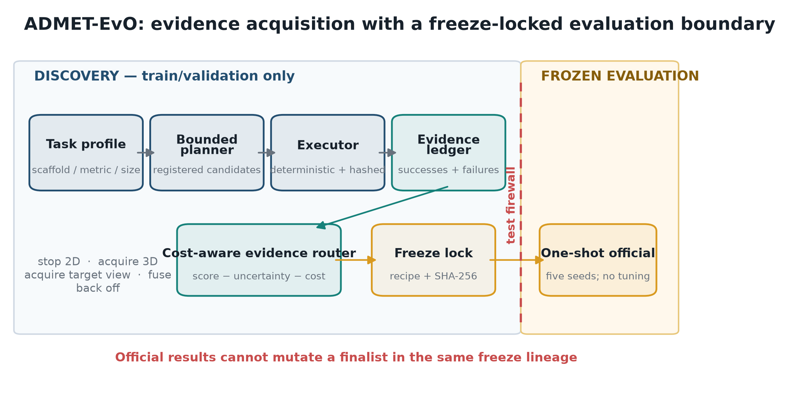

---

## 1. 系统定位：它是什么，又不是什么

### 1.1 当前系统是什么

ADMET-EvO 是一个面向分子 ADMET 预测的研究执行 Agent，由五层构成：

1. **任务与数据层**：识别任务类型、评价指标、样本规模、类别失衡、化学空间和潜在泄漏风险。
2. **分子表示层**：统一构建传统指纹、拓扑特征、RDKit 描述符、预训练分子表示和图表示。
3. **候选模型层**：包含树模型、核方法、预训练 3D 模型、图神经网络和多模型融合。
4. **研究决策层**：把诊断结果转成单轴可证伪实验，并在预算下决定下一项实验。
5. **治理与证据层**：执行数据防火墙、多种子评估、负结果保留、冻结配方、测试隔离和报告生成。

### 1.2 当前系统不是什么

- 它不是一个在所有任务上共享同一神经网络权重的“大一统 ADMET foundation model”。
- 它不是只靠 LLM 自由生成训练代码的开放式 AutoML。
- 它不是仅以榜单分数为目标、允许反复看测试集调参的刷榜脚本。
- 它也还不是一个已经证明能跨任务学习最优实验策略的成熟 meta-learning 系统。

更准确的表述是：**一个以化学任务诊断为入口、以受控实验为基本动作、以冻结和审计为终点的 ADMET 研究操作系统。**

---

## 2. 总体架构

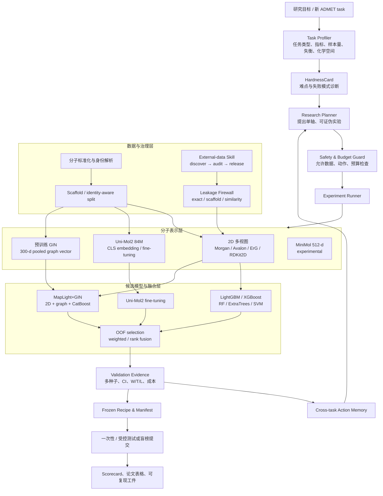

架构中的关键思想是：**测试集不参与闭环；所有选择在验证证据上完成；最终方案以机器可读配方冻结。**

---

## 3. 一次完整任务是怎样运行的

### 3.1 生命周期

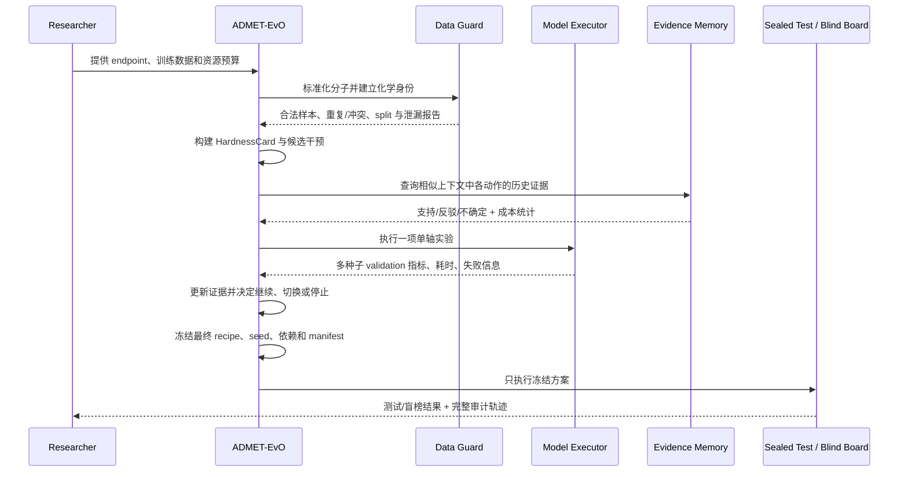

### 3.2 每一步的输入、动作与输出

| 阶段 | 主要输入 | Agent 动作 | 主要输出 |
|---|---|---|---|
| 任务解析 | endpoint、label、metric | 判断分类/回归、指标方向、失衡和样本规模 | `TaskProfile` |
| 化学诊断 | canonical SMILES、标签 | scaffold、近邻相似性、重复、标签冲突、domain shift | `HardnessCard` |
| 实验计划 | HardnessCard、模型库、历史记忆 | 生成只改变一个主要变量的候选实验 | `ExperimentPlan` |
| 安全检查 | 计划、数据来源、预算 | 拒绝测试标签、未审计外部数据和超预算动作 | guard decision |
| 训练执行 | split、representation、model | OOF/多种子训练、缓存 embedding、记录时间与异常 | run artifacts |
| 证据判定 | validation 分数和配对差异 | 计算均值、区间、方向一致性、W/T/L | evidence record |
| 记忆更新 | 动作、上下文、结果、成本 | 记录可迁移证据；负结果同样保留 | action memory |
| 冻结 | 胜出 recipe | 固定模型、权重、预处理、seed、版本 | frozen manifest |
| 最终评测 | frozen manifest、sealed test | 仅执行，不再调参 | leaderboard/report |

---

## 4. 任务诊断：为什么先看“分子身份”而不是随机切分

### 4.1 分子身份的含义

这里的“按分子身份划分”不等于只按某一个指纹阈值划分。它是分层的：

1. **精确身份层**：标准化后的 canonical structure / InChIKey，用于识别同一分子、盐形式或重复记录。
2. **骨架层**：Bemis–Murcko scaffold，用于避免同一核心骨架同时大量出现在训练和验证中。
3. **相似性层**：ECFP4/Tanimoto 等近邻相似性，用于量化验证分子距训练化学空间有多远。

### 4.2 为什么不能只做普通随机交叉验证

随机切分容易把同系列 analog 分到训练和验证两侧。模型可能只是学习了共同骨架上的局部取代规律，却得到近似“泛化”的高分。真实药物发现和盲榜更常要求模型预测新的化学系列，因此这种分数通常偏乐观。

ADMET-EvO 使用 identity/scaffold-aware 切分的理由是：

- 阻止同一分子或标准化前后的等价物跨 split；
- 减少近重复和同骨架 analog 带来的验证泄漏；
- 让验证误差更接近新 scaffold 上的真实误差；
- 让模型选择偏向可迁移表示，而不是记忆局部系列；
- 为 OOD 风险与不确定性分析提供明确的化学距离坐标。

### 4.3 对 OpenADMET CYP 的建议切分

约 1,500 个分子/任务时，不建议永久挖出一个很大的本地 test 后再只在剩余数据上训练。更合适的是：

- 训练阶段采用 **scaffold-grouped repeated cross-validation** 做模型与超参数选择；
- 另保留一个较小、只用于流程验收的本地 pseudo-test，并冻结其访问规则；
- 最终提交前，用交叉验证得到的固定配方在全部允许训练数据上重训；
- 盲榜才是最终独立 test，不能根据榜单反馈进行无上限迭代。

原因是 1,500 个样本本身不大，永久留出大量样本会明显损失训练信息；而只做一次随机留出又会产生高方差和化学系列泄漏。分组重复交叉验证能同时利用更多数据并估计 split 不确定性。

---

## 5. 分子表示与 embedding

### 5.1 当前表示库

| 表示 | 维度 | 捕获的信息 | 当前角色 |
|---|---:|---|---|
| Morgan radius 2 | 2,048 bit | 局部原子环境、官能团 | 2D 主力表示 |
| Morgan radius 3 | 2,048 bit | 更大半径局部环境 | 溶解度等任务的互补视图 |
| Morgan count | 2,048 | 子结构出现次数 | PPBR/clearance 等连续性质补充 |
| Avalon | 1,024 bit | 路径和子结构模式 | 与 Morgan 互补 |
| ErG | 315 | 药效团拓扑关系 | 功能团几何关系的 2D 近似 |
| MACCS | 167 bit | 预定义结构键 | 小维度稳健补充 |
| RDKit path fingerprint | 2,048 bit | 分子图路径 | scaffold/path 差异 |
| Atom-pair | 2,048 | 原子类型和拓扑距离 | 长程拓扑关系 |
| Topological torsion | 2,048 | 四原子拓扑片段 | 局部构象相关拓扑 |
| RDKit 2D descriptors | 动态全量 | 分子量、极性、logP、环、拓扑等 | 物化属性主通道 |
| Uni-Mol2 84M CLS | 模型隐层维度 | 预训练 3D/结构语义 | frozen embedding 与微调 |
| 预训练 GIN pooled vector | 300 | 图消息传递后的全局结构 | MapLight+GIN |
| MiniMol | 512 | 预训练轻量分子向量 | 实验性候选，未进入最终 22-task 配方 |

默认 rich-2D 表示为：

```text
Morgan(2048) + Avalon(1024) + ErG(315) + all-finite RDKit2D descriptors
```

### 5.2 Uni-Mol2 embedding 流程

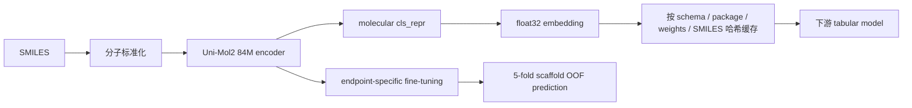

当前 Uni-Mol2 微调协议：

- 模型规模：84M；
- 训练轮数：20 epochs；
- 学习率：`1e-4`；
- batch size：通常 16，Lipophilicity 使用 8；
- 内层评估：5-fold scaffold OOF；
- CUDA 自动混合精度；
- 无效分子 embedding 以零向量占位并保留有效性记录；
- 缓存键同时包含表示 schema、依赖版本、权重标识和 SMILES，降低静默缓存污染。

### 5.3 MapLight+GIN

MapLight+GIN 是当前针对两个关键弱项采用的结构增强配方：

```text
2,563-d 2D/descriptor features
          +
300-d pretrained GIN pooled graph vector
          ↓
2,863-d joint representation
          ↓
CatBoost endpoint model
```

它的故事不是“GNN 一定优于指纹”，而是：当 task diagnosis 表明 2D 基线在特定 scaffold/结构关系上受限时，引入预训练图表示作为互补通道，并通过正式消融确认增益是否存在。

---

## 6. 模型库、选择与融合

### 6.1 Tabular 模型层

- LightGBM：高维稀疏/稠密混合特征上的主力模型。
- XGBoost：用于与 LightGBM 形成不同树生长和正则机制的互补。
- Random Forest / Extra Trees：在小样本、高方差和非平滑结构效应上提供稳健基线。
- RBF-SVM：适合部分小数据、非线性边界任务；在 CYP3A4 substrate 的最终配方中保留。
- CatBoost：用于 MapLight+GIN 的联合高维表示。

### 6.2 深度模型层

- Frozen Uni-Mol2 embedding + tabular learner：把 foundation representation 当作固定分子特征。
- Fine-tuned Uni-Mol2：针对 endpoint 更新模型，用 scaffold OOF 生成训练侧无泄漏预测。
- Pretrained GIN embedding：当前作为图表征，不把“用了 GNN”本身当成创新结论。

### 6.3 融合机制

系统支持：

- 固定权重概率/数值平均；
- OOF 选择的 top-k 组合；
- 对排序指标进行 rank fusion；
- 回归 rank-target learner；
- 只在验证侧确定融合方式，再冻结到测试执行器。

融合的约束是：**成员必须有独立的 OOF 或合法验证预测；不能根据测试表现选择成员或权重。**

### 6.4 当前冻结配方概览

| Endpoint | 最终配方概要 |
|---|---|
| Bioavailability_Ma | MapLight+GIN |
| CYP2C9_Substrate | MapLight+GIN |
| DILI | 2D LightGBM + 2D ExtraTrees + fine-tuned Uni-Mol2，等权 raw fusion |
| Half_Life | fine-tuned Uni-Mol2 + fixed rank top-3 + rank-target XGBoost，等权 rank fusion |
| Lipophilicity | fine-tuned Uni-Mol2 |
| hERG | 2D LightGBM + fine-tuned Uni-Mol2，0.5/0.5 |
| CYP3A4_Substrate | 两个不同 2D view 的 RBF-SVM，0.25/0.75 |
| 其余任务 | rich-2D 上的 LightGBM/XGBoost/RF/ExtraTrees 单模或双模加权 |

机器可读的完整映射位于：`runs/v27-maplight-gnn-freeze/full-22-task.mapping.json`。

---

## 7. Agent 的研究决策机制

### 7.1 HardnessCard：先诊断，再行动

HardnessCard 把端点问题拆成可行动的失败模式，例如：

- 小样本与高方差；
- 分类失衡或少数类召回不足；
- scaffold shift / feature-domain shift；
- 回归长尾和标签噪声；
- 排序指标与点预测损失错配；
- 单一 2D 表示容量不足；
- 外部数据标签语义不一致；
- 概率校准或 OOD 风险过高。

诊断不会直接声称某个模型最好，而是映射到一组可证伪干预，例如：

| 诊断 | 单轴干预示例 | 反证条件 |
|---|---|---|
| feature-domain shift | rich-2D → graph/foundation representation | 多种子 scaffold validation 无稳定增益 |
| 类别失衡 | class weighting / focal objective | AUPRC 或少数类指标退化 |
| 排序目标错配 | rank target / rank fusion | Spearman 无增益或 MAE 明显恶化 |
| 过拟合 | 降低模型复杂度 / 增加正则 | 验证差距未收敛 |
| 数据不足 | 高质量外部数据 direct merge | 来源审计失败或 source-heldout 无增益 |

### 7.2 当前 legacy 路由

现有 planner 以启发式和历史证据结合的方式，为候选 action 排序。每个实验尽量只改变一个主要因素，便于把结果归因到表示、模型、损失、数据或融合中的某一项。

它已经能有效减少不必要拟合，但行为回放显示：当前 action memory 尚未在 22 个历史任务上改变首选动作。因此，不能把“记忆带来更聪明的任务路由”作为已证实结论。

### 7.3 升级中的 EC-VOI：Evidence-Conditioned Value of Information

顶刊升级中的算法核心是 EC-VOI。其目标不是简单预测哪一个模型分数最高，而是决定：**在给定任务上下文、已有证据、实验成本与失败风险时，下一单位计算预算最值得验证什么。**

对动作 \(a\) 与任务上下文 \(x\)，定义：

\[
\mathrm{Priority}(a\mid x)=
\underbrace{\mathrm{LCB}_{\alpha}(\Delta_a\mid x)}_{\text{保守性能收益}}
+\lambda\underbrace{\mathrm{VOI}(a\mid x)}_{\text{减少决策不确定性的价值}}
-\beta\underbrace{C(a)}_{\text{计算/时间成本}}
-\gamma\underbrace{R(a\mid x)}_{\text{失败与治理风险}}
\]

其中：

- \(\Delta_a\) 是动作相对当前基线的 validation 增益；
- `LCB` 使用后验下置信界，防止少量偶然高分主导选择；
- `VOI` 衡量再做一次实验预计能减少多少不确定性；
- `C(a)` 由历史拟合时长和资源消耗估计；
- `R(a|x)` 包括数据不合规、迁移证据不匹配、失败率和 OOD 风险；
- 只有被标记为 routing-eligible 的跨任务证据才允许进入迁移后验；
- 被稳定反驳的动作触发 negative gate，避免反复消耗预算。

EC-VOI 目前属于 **Research Innovation Track 的实验性模块**。它已经以 opt-in 方式接入 Runner 和 CLI，并提供 `full / no-context / no-memory / no-VOI / no-cost / no-risk` 六类可执行路由变体；默认策略仍为 legacy，`finalize` 路径不开放 EC-VOI 参数，因此不能回写或改变冻结的 v27 结果。只有通过匹配对照和独立任务验证后，才可升级为默认策略。

当前实现还增加了两层证据隔离：

- action memory 分别序列化 context-matched 与全局 transport 统计，未达到 endpoint 数量、结论变化和协议一致性门槛的证据不能改变路由；
- 正式结果收集器同时核对 protocol hash、benchmark arm 和 research-routing-policy，阻止用 legacy 运行冒充 EC-VOI arm。

一次覆盖冻结 22 个 HardnessCard 的 label-blind 行为回放已经完成。系统先把全局 complete-grid 的逐任务记录投影到冻结的任务上下文空间：距离由 hardness 0.55、task type 0.20、metric 0.10、ADMET category 0.15 构成，再用 `exp(-3d)` 形成权重；只有原始 endpoint 数不少于 5、有效样本数不少于 3、最大相似度不少于 0.35 时才允许进入 contextual posterior。由此 full EC-VOI 相对 legacy 改变 3/22 个首选动作，no-memory 改变 0/22，no-context 改变 4/22，no-VOI 改变 5/22，no-cost 改变 3/22，no-risk 改变 3/22。这证明 context kernel、scope firewall 和消融开关在行为上有效，但仍不证明这些变化能提高预测性能。对应工件为 `reports/ecvoi_routing_replay_v1.{json,md}`，冻结上下文为 `reports/admet22_action_context_registry_v1.json`。

### 7.4 决策闭环

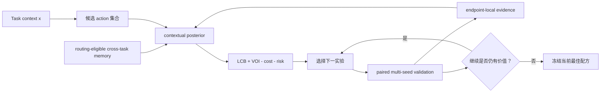

---

## 8. 外部数据 Skill 与数据闭环

新接入的 `admet-data-collector` skill 不只是下载数据，而是一个独立的来源发现、语义审核、防泄漏、分级放行与审计状态机。

### 8.1 数据分级

| 等级 | 定义 | 允许用途 |
|---|---|---|
| Direct merge | endpoint、assay、单位、方向和质量高度一致 | 经防火墙后加入监督训练 |
| Bridge | 有相关生物学含义，但测量条件/标签不完全同构 | 辅助任务、迁移学习、representation adaptation |
| Pretrain-only | 结构或弱标签有价值，但监督语义不可靠 | 自监督/弱监督预训练，禁止直接合并标签 |
| Reject | 来源、许可证、标签或污染风险不可接受 | 不进入任何训练路径 |

### 8.2 数据 Skill 工作流

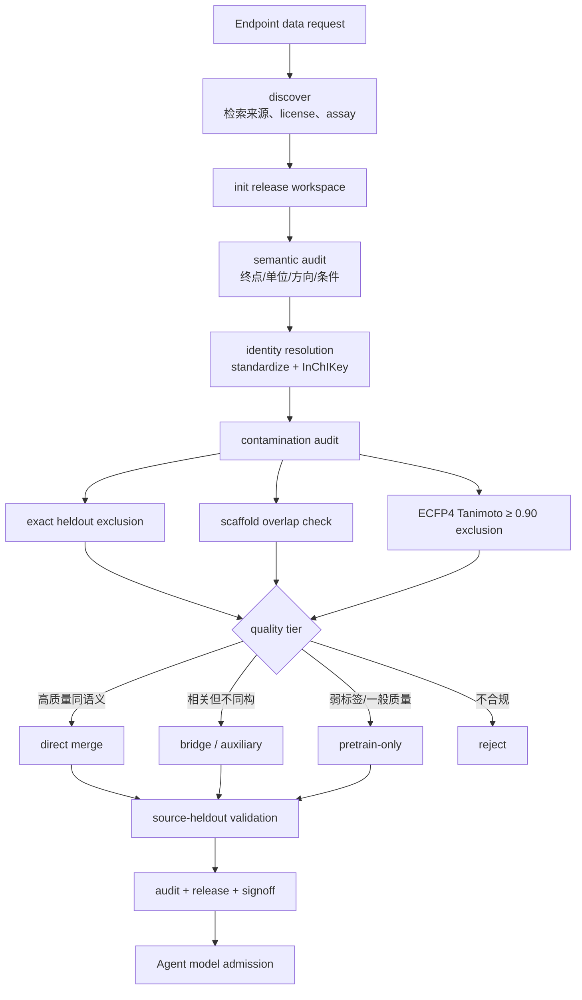

### 8.3 当前外部数据状态

- 已完成机制接入和命令行路由；Runner 会生成 `data_skill_route_seed_<seed>.json`。
- 模型侧准入要求 audit、release、signoff 和 contamination 状态完整。
- hERG 已发现 3 个候选来源，全部被分到 `bridge_required`，没有直接合并。
- 当前有 2 次冻结外部数据尝试、0 次成功拟合；ChEMBL 请求曾因 HTTP 500 失败，系统按 fail-closed 处理。
- 因此，**“外部数据提升模型”仍是待验证命题，不是当前结果。**

---

## 9. 安全、泄漏防护与冻结协议

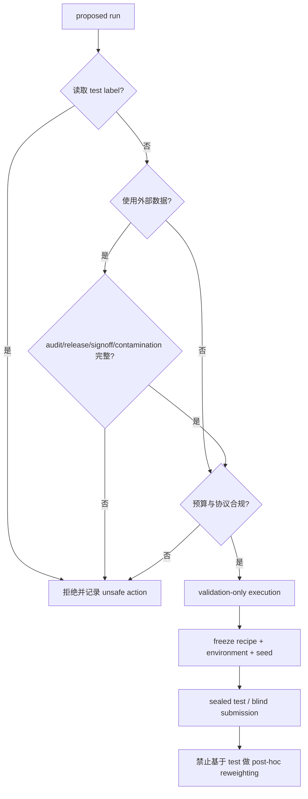

### 9.1 冻结对象

- 数据版本、标准化规则和 split；
- 表示 schema、embedding 权重和缓存版本；
- 模型家族、超参数、seed 和训练协议；
- 融合成员、权重和概率/排序变换；
- 软件依赖、硬件信息、运行日志和预测文件；
- 测试访问与异常事件记录。

### 9.2 设计原则

1. 测试标签不可用于 planner 或 memory 更新。
2. 外部数据默认不能进入模型，必须显式通过审计状态机。
3. 同一最终结果必须能从 frozen manifest 重建。
4. 失败、反例和 inconclusive 结果不能被删掉。
5. 榜单结果与科研结论分开：高排名不能替代公平对照。

---

## 10. TDC ADMET-22 当前结果

> 指标方向：AUROC/AUPRC/Spearman 越高越好；MAE 越低越好。名次来自 `goal_scorecard_v27.md` 的保守快照。

| # | Task | Metric | Score | Rank | Top-5 | Top-10 |
|---:|---|---|---:|---:|:---:|:---:|
| 1 | AMES | AUROC ↑ | 0.874 | 1 | ✓ | ✓ |
| 2 | Half_Life | Spearman ↑ | 0.590 | 1 | ✓ | ✓ |
| 3 | Lipophilicity | MAE ↓ | 0.392 | 1 | ✓ | ✓ |
| 4 | PPBR | MAE ↓ | 7.302 | 1 | ✓ | ✓ |
| 5 | Solubility | MAE ↓ | 0.739 | 1 | ✓ | ✓ |
| 6 | BBB | AUROC ↑ | 0.921 | 2 | ✓ | ✓ |
| 7 | HIA | AUROC ↑ | 0.990 | 2 | ✓ | ✓ |
| 8 | CYP2D6 substrate | AUPRC ↑ | 0.721 | 3 | ✓ | ✓ |
| 9 | DILI | AUROC ↑ | 0.920 | 3 | ✓ | ✓ |
| 10 | VDss | Spearman ↑ | 0.673 | 3 | ✓ | ✓ |
| 11 | CYP2D6 inhibition | AUPRC ↑ | 0.721 | 4 | ✓ | ✓ |
| 12 | CYP3A4 inhibition | AUPRC ↑ | 0.885 | 4 | ✓ | ✓ |
| 13 | Caco2 | MAE ↓ | 0.283 | 4 | ✓ | ✓ |
| 14 | Clearance hepatocyte | Spearman ↑ | 0.456 | 4 | ✓ | ✓ |
| 15 | CYP2C9 substrate | AUPRC ↑ | 0.434 | 5 | ✓ | ✓ |
| 16 | CYP2C9 inhibition | AUPRC ↑ | 0.799 | 5 | ✓ | ✓ |
| 17 | LD50 | MAE ↓ | 0.591 | 5 | ✓ | ✓ |
| 18 | hERG | AUROC ↑ | 0.860 | 5 | ✓ | ✓ |
| 19 | Clearance microsome | Spearman ↑ | 0.591 | 8 |  | ✓ |
| 20 | P-gp | AUROC ↑ | 0.912 | 8 |  | ✓ |
| 21 | CYP3A4 substrate | AUROC ↑ | 0.633 | 9 |  | ✓ |
| 22 | Bioavailability | AUROC ↑ | 0.731 | 21* |  |  |

汇总：

- Rank 1：5 个任务；
- Top-3：10/22；
- Top-5：18/22；
- Top-10：21/22；
- 中位 rank：4；
- 目标“至少 15 个 Top-5”已经超过；
- 目标“最差 Top-10”尚未按保守记录完全达成。

\* Bioavailability 榜单页面存在已确认的显示/数据异常，当前不据此抬高名次，避免选择性报告。

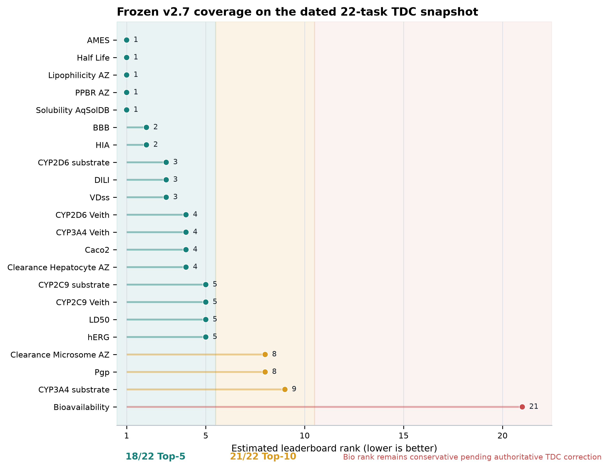

---

## 11. 关键模型增益与消融结果

### 11.1 MapLight+GIN 正式测试改进

| Task | Before | After | Absolute gain |
|---|---:|---:|---:|
| Bioavailability | 0.697 | 0.731 ± 0.007 | +0.034 |
| CYP2C9 substrate | 0.340 | 0.434 ± 0.009 | +0.094 |

这些改进没有在测试结果出现后继续做权重重调。

### 11.2 配对多种子模型效应

| Comparison | Mean oriented gain | 95% CI | W/T/L | Interpretation |
|---|---:|---:|---:|---|
| Bio: MapLight+GIN − MapLight | +0.02353 | [+0.00014, +0.04692] | 4/0/1 | 稳定正向，区间刚越过 0 |
| CYP2C9 substrate: MapLight+GIN − MapLight | +0.03422 | [−0.04240, +0.11085] | 4/0/1 | 多数 seed 正向，但区间较宽 |
| Lipophilicity: Uni-Mol2 164M − 84M | −0.00934 | [−0.02057, +0.00189] | 1/0/4 | 更大模型没有形成收益 |

重要边界：五个 seed 是计算重复，不是五个独立化学任务；不能把它们当成跨任务统计显著性。

### 11.3 研究过程结果

| 指标 | 结果 |
|---|---:|
| 单轴实验有效率 | 1.00 |
| treatment/control 完整率 | 1.00 |
| 反证结论解析率 | 0.909 |
| 负结果保留率 | 1.00 |
| 历史运行中自我纠错 coverage | 0.00 |
| 支持 / 反驳 / 不确定 | 18 / 2 / 2 |
| 总拟合数 | 790 |
| 总 fit time | 23,871.9 s |

这些结果证明研究流程是可审计的，但属于 retrospective validation，尚不是独立前瞻验证。

### 11.4 EC-VOI 端到端 smoke 结果

在冻结的同预算协议下，BBB_Martins 完成了一个不读取 test 的五 seed 端到端 smoke：EC-VOI 选择 `data-leakage-safe`，matched treatment/control 的平均 oriented AUROC 增益为 +0.00701，seed 标准差 0.01279，4/5 个 seed 为正，超过预注册的 0.005 最小效应并达到 0.80 方向一致率，因此 action evidence 为 `supported`。完整搜索执行 8 个独立配置、26 次拟合、0 失败、193.76 fit-seconds，racing 避免 6 次计划拟合；最终最佳候选的 validation AUROC 为 0.93914 ± 0.02516。

该 smoke 同时发现并修复了一个多轮 duplicate matched-pair identity bug：此前 racing 保护的一对和 evidence resolver 读取的一对可能不同。现在 protected pair 会被有序写入 racing artifact 并显式传给 evidence evaluator。该结果只证明实现闭环可运行，不能作为 EC-VOI 优于控制组的证据。详见 `reports/ecvoi_bbb_smoke3_result_v1.md`。

### 11.5 EC-VOI v1 首批正式 matched control：早期负结果

在最终冻结源码和协议下，EC-VOI 与 legacy Agent 已完成 BBB_Martins、CYP2C9_Veith 和 CYP2D6_Veith 三个任务的同预算比较。两臂各执行 24 个独立配置和 24 个 primary candidate fits，汇总均为 `test_loaded=false`。

| Task | EC-VOI validation | Legacy validation | EC-VOI − legacy |
|---|---:|---:|---:|
| BBB_Martins | 0.939139 ± 0.025162 AUROC | 0.943656 ± 0.018534 AUROC | −0.004516 |
| CYP2C9_Veith | 0.793662 ± 0.023732 AUPRC | 0.817939 ± 0.018337 AUPRC | −0.024276 |
| CYP2D6_Veith | 0.720435 ± 0.029191 AUPRC | 0.720435 ± 0.029191 AUPRC | 0.000000 |

EC-VOI 的观察 W/T/L 为 0/1/2，三任务平均 oriented difference 为 −0.009598。EC-VOI 使用 7,392.646 fit-seconds，legacy 使用 2,321.121 fit-seconds，前者为后者的 3.18495 倍。三个任务不足以支持显著性或非劣效性结论，但已经足以关闭“直接把 v1 扩展到 22-task 并宣称优势”的 claim gate。

机制诊断显示，v1 把启发式 `expected_effect` 当作跨 action 可比较的效应尺度，同时以手工 `compute_cost/scientific_risk` 施加惩罚。三个任务因此都选择低手工成本的 `data-leakage-safe`，而 legacy 都选择 `feature-domain-shift`。前者在三任务上的行动证据分别为 supported、inconclusive、refuted；后者均为 supported。下一版必须使用按端点评价分辨率归一化的经验 action effect、真实计算成本模型和显式探索配额，并以新源码哈希、新协议及未用于开发的任务重新验证。

### 11.6 固定规则对照：预测相同不等于研究证据相同

固定规则臂随后在同一三个任务上完成 24 个独立配置、87/87 次成功拟合，总计 2,264.995 fit-seconds，聚合 `test_loaded=false`。其三个 finalist validation 分数与 legacy Agent 完全相同，因此 EC-VOI 相对固定规则仍为 0/1/2，平均 oriented difference 为 −0.009598，并使用 3.26387 倍 fit-seconds。

但两者的证据产出不同。Legacy 在 3/3 个任务上执行了验证过的单轴 `feature-domain-shift` treatment/control pair，三个动作证据均为 supported；固定规则虽然得到同样的最终预测分数，却在 0/3 个任务上形成单轴匹配对，三个动作证据均为 inconclusive。因此论文必须把“找到高分模型”和“产生可归因、可迁移的研究证据”作为两个独立结果域，并报告 single-axis verification rate、action-evidence coverage 和 evidence yield per fit-second。详见 `reports/ecvoi_confirmatory_cohort1_three_arm_v1.md`。

---

## 12. Agent 本身是否真的比基线“更聪明”

这是当前最需要诚实面对的部分。

### 12.1 与 expanded AutoML 的预测比较

| Result | Value |
|---|---:|
| Agent − expanded AutoML mean | −0.0098 |
| 95% CI | [−0.0277, +0.0065] |
| W/T/L | 5 / 7 / 10 |
| non-inferiority | FAIL |

这说明当前不能声称 Agent 的预测性能整体优于强 AutoML。

### 12.2 决策质量与安全

| System | Composite decision score | Unsafe actions |
|---|---:|---:|
| ADMET-EvO Agent | 1.00 | 0 |
| 完整规则系统 | 0.86 | 0 |
| Expanded AutoML | 0.54 | 未作为治理最优系统 |

数据治理测试中：

| System | Accuracy | Unsafe actions |
|---|---:|---:|
| ADMET-EvO Agent | 1.00 | 0 |
| Expanded AutoML | 0.27 | 7 |

因此，当前最强的 Agent 结论是：**它在研究流程安全性、治理和结构化决策上更可靠**，而不是已经证明它在所有任务上产生更高预测分数。

### 12.3 与匹配随机策略和 winner-only 的结果

| Comparison | Mean gain | 95% CI / 结果 |
|---|---:|---|
| Agent vs cost-matched random | +0.00083 | [−0.00380, +0.00542]；7/5/10；p=0.8684 |
| Memory vs winner-only | −0.00031 | [−0.00276, +0.00240] |
| With-memory vs no-memory action change | 0/22 | 无行为改变 |

结论：现有 evidence memory 和 routing 还没有证明选择智能优于成本匹配随机搜索。这正是 EC-VOI 与前瞻对照要解决的问题。

---

## 13. 成本控制、迁移记忆与不确定性

### 13.1 计算成本

| Setting | Performance effect | Cost effect |
|---|---|---|
| Router candidate stage | — | 0.256 h vs 2.488 h，cost ratio 0.1028 |
| Fresh-seed cost-aware vs score-only | mean −0.000348，CI [−0.001482, +0.000585] | 0.625 h vs 2.247 h，cost ratio 0.278 |
| Pilot early stopping | — | 14/20 fits，节约 30% |
| Composite estimate | — | 约节约 37.5% |

成本控制已经形成真实价值：性能差异接近零时显著减少拟合。但它还需要硬件归一化和更完整的峰值显存/能耗记录，才能形成强系统论文主张。

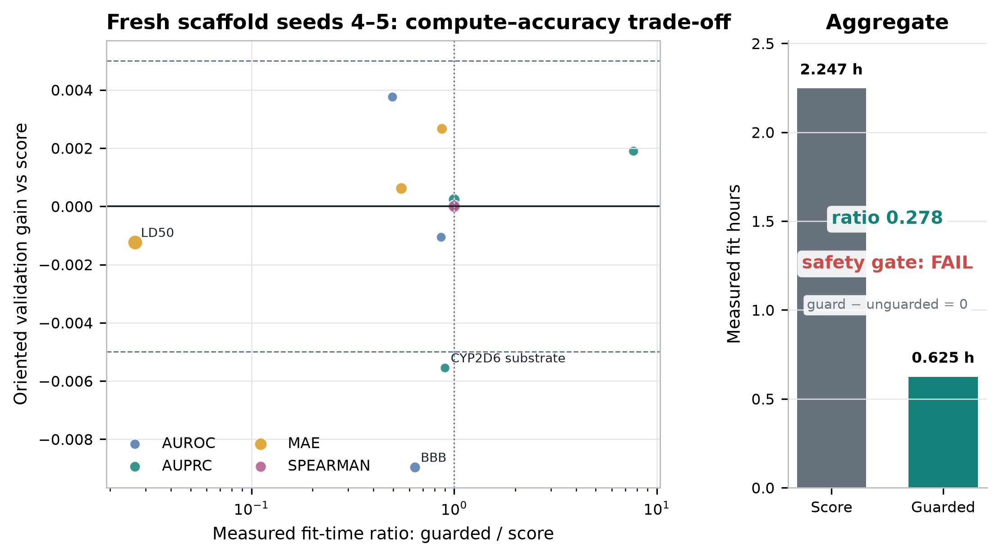

### 13.2 Cross-task transport memory

在 15 个 transport episodes、100 次拟合中：

| Action family | Supported | Refuted | Inconclusive | Posterior | Routing eligible |
|---|---:|---:|---:|---:|:---:|
| feature-domain-shift | 3 | 2 | 0 | 0.556 | ✓ |
| model-estimator-family | 0 | 4 | 1 | 0.278 | ✓ |
| data-quality-filter | 0 | 0 | 5 | 0.500 | ✗ |

- 记录避免了 50 次重复拟合；
- 实际 1,234.4 fit-s，对比 naive 1,745.0 fit-s，节约约 510.6 fit-s；
- 但这些数据仍未证明 context-aware routing 优于简单策略。

### 13.3 校准与化学空间风险

| Analysis | Result |
|---|---:|
| 13 个分类任务平均 Brier | 0.1173 |
| 平均 adaptive ECE | 0.0964 |
| 低相似度分子 Brier 更差 | 11/13 tasks |
| 低相似度分子回归残差更差 | 7/9 tasks |
| 最大 ECE | CYP3A4 substrate 0.1909 |
| 其次 | DILI 0.1750；hERG 0.1506 |
| Lipophilicity 低−高相似度 MAE 差 | +0.2723 |
| PPBR 低−高相似度 MAE 差 | +9.4631 |

这说明“预测分数高”不等于“对新化学空间可靠”。升级后的 Agent 应把相似度、校准和 conformal/ensemble uncertainty 纳入决策，而不是只在论文附录报告。

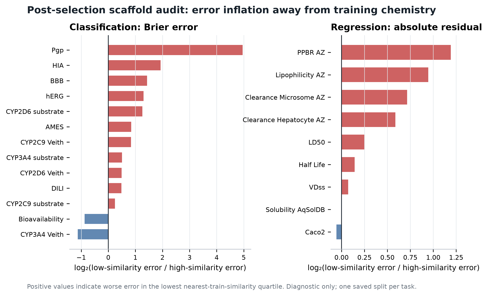

---

## 14. 当前代码模块地图

| 模块 | 责任 | 关键工件/入口 |
|---|---|---|
| Feature bank | 2D、Uni-Mol2、MiniMol 等表示 | `admet_agent/features.py` |
| Frozen execution | 按冻结 mapping 训练与预测 | `admet_agent/frozen_executor.py` |
| Frozen recipes | 深度模型、融合和特殊配方 | `admet_agent/frozen_recipe.py` |
| Research loop | 诊断驱动的实验规划和闭环 | `admet_agent/research_loop.py` |
| EC-VOI policy | 新的证据条件化实验优先级 | `admet_agent/research_policy.py` |
| External data skill | 外部数据发现、审计、放行 | `admet_agent/data_skill.py` |
| 22-task mapping | 每个 endpoint 的冻结模型 | `runs/v27-maplight-gnn-freeze/full-22-task.mapping.json` |
| Goal scorecard | 榜单状态与目标差距 | `reports/goal_scorecard_v27.md` |
| Agent evidence | 对照、治理、记忆和 claim gates | `reports/ai_scientist_evidence_scorecard_v1.md` |
| Model effects | 关键模型配对效应 | `reports/primary_model_effects_v27.md` |
| Process baseline | 研究流程质量和成本 | `reports/research_process_baseline_v3.md` |
| Transport evidence | 跨任务迁移实验 | `reports/transport_grid_results_v1.md` |
| Memory replay | 有/无记忆行为回放 | `reports/transport_memory_behavior_replay_v1.md` |
| External data status | 外部数据能力和防火墙 | `reports/external_data_agent_capability_v1.md` |
| Manuscript draft | 当前论文叙事和结果 | `paper/submission/jcheminformatics/manuscript.md` |

---

## 15. 当前系统的优势与证据边界

### 15.1 已经可以强力主张的内容

1. **强任务覆盖**：22 个异构 ADMET endpoint 上取得 18 个 Top-5 和 21 个 Top-10。
2. **表示和模型并非一刀切**：不同端点由不同诊断与验证证据决定 2D、foundation、GNN 或融合路径。
3. **复现与治理较完整**：配方冻结、外部数据准入、防泄漏、负结果保留和审计轨迹均有代码与工件。
4. **成本优化有效**：在接近无性能损失的条件下显著减少训练时间。
5. **会报告失败**：大模型、MiniMol rescue、外部数据和 memory routing 的负/不确定结果没有被隐藏。

### 15.2 目前不能越界主张的内容

1. 不能声称 Agent 在预测上普遍优于 expanded AutoML。
2. 不能声称 cross-task memory 已经改善了 22-task 决策。
3. 不能声称外部数据已经产生正式性能增益。
4. 不能把五个随机种子当成五个独立任务。
5. 不能把公开 test 上的高排名等同于真正独立的盲测泛化。
6. 不能仅因为系统使用 Uni-Mol2、GIN 或 LLM 就声称方法新颖。

这一区分非常重要：顶级论文通常不是因为“模块多”被接受，而是因为核心问题明确、方法可形式化、对照公平、证据独立且结论边界诚实。

---

## 16. 顶刊/顶会升级架构

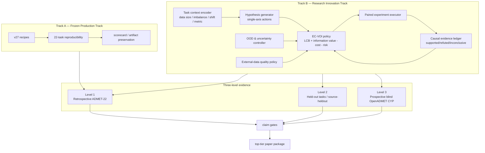

### 16.1 核心科学问题

建议把论文核心问题收敛为：

> 在小样本、端点异构、化学分布偏移和实验预算有限的条件下，能否用可审计的证据条件化价值信息策略，选择最值得执行的分子机器学习干预，并在不牺牲安全和复现性的前提下，提高跨任务收益/成本比？

这个问题比“做一个会自动训练模型的 Agent”更具体，也更容易形成可证明的方法贡献。

### 16.2 三个方法贡献

1. **Contextual Evidence Posterior**：只把与当前任务上下文匹配、且通过 routing eligibility 的历史实验转成先验，避免无条件跨任务迁移。
2. **Risk-aware VOI policy**：同时考虑保守收益、信息价值、成本、失败率、数据污染和 OOD 风险。
3. **Auditable research ledger**：每项动作都有假设、对照、seed、成本、结论和迁移资格，支持重放、消融和反事实比较。

### 16.3 关键消融矩阵

| Variant | 去掉的能力 | 要回答的问题 |
|---|---|---|
| Full EC-VOI | 无 | 完整方法的收益/成本与安全 |
| − Context | 不使用任务上下文 | 只看全局经验会不会负迁移 |
| − Memory | 不使用跨任务证据 | 记忆是否真的改善决策 |
| − VOI | 只看预期分数 | 信息探索是否有价值 |
| − Cost | 不惩罚时间/资源 | 节省是否来自显式成本建模 |
| − Risk | 不建模失败/污染/OOD | 安全项是否有实际作用 |
| Rules | 完整手工规则 | 学习策略是否超越专家系统 |
| Winner-only | 只复用历史赢家 | 完整证据是否优于只记赢家 |
| Cost-matched random | 同预算随机动作 | 是否存在真正选择智能 |
| Expanded AutoML | 强模型搜索基线 | 是否超越通用搜索 |

### 16.4 主要评价指标

不能只看 leaderboard score。建议同时报告：

- 任务级 oriented validation/test gain；
- AUROC/AUPRC/MAE/Spearman 的原始值；
- Top-5/Top-10 任务覆盖；
- 同预算下 best-found performance；
- 达到阈值性能所需 wall-clock/GPU-hours；
- unsafe action 数、数据审计错误数；
- OOD 子群性能、ECE/Brier、coverage-risk；
- 独立任务上的 action selection regret；
- 支持/反驳/不确定结论的校准程度。

---

## 17. 前瞻 OpenADMET CYP 实验设计

### 17.1 数据协议

对每个约 1,500 分子的 CYP 任务：

1. 冻结 SMILES 标准化、重复处理和标签规则。
2. 建立 scaffold groups，并统计 ECFP4 相似性分布。
3. 外层采用 repeated scaffold-group CV 估计模型选择方差。
4. 将一小部分 chemistry-diverse 数据作为流程 pseudo-test，只用于最终本地验收。
5. 外部数据分成 direct/bridge/pretrain-only，分别建立 source-heldout 对照。
6. 冻结最终配方后，用全部合法训练样本重训并只提交盲榜。

### 17.2 防止盲榜变成开发集

- 预注册提交次数和允许修改的变量；
- 每次提交前保存 git commit、manifest、预测哈希和理由；
- 榜单反馈不能直接写入 action memory 作为训练标签；
- 若发生第二轮提交，只允许使用预注册的、与首轮无关的修改；
- 最终论文区分 local CV、pseudo-test 和 blind leaderboard 三类结果。

### 17.3 外部数据因果对照

对每个来源，至少做：

```text
Base model
Base + pretraining only
Base + bridge/auxiliary task
Base + direct merge（仅高质量来源）
Base + direct merge without quality weighting
```

并要求：

- 主效应在 source-heldout 和 scaffold-heldout 上同时报告；
- exact/near-duplicate 清除前后都生成审计统计；
- 单独报告数据量收益与数据质量收益；
- 若外部数据无益，保留负结论并更新 EC-VOI 的 data-action 后验。

---

## 18. 分阶段交付与 claim gates

### Phase A：保护现有能力

- 冻结 v27 mapping、所有测试预测和 scorecard；
- 对新策略默认 opt-in，legacy 为默认行为；
- 建立 regression test，确保升级不改变原有 22-task 配方；
- 复现关键 endpoint 的 validation/test 工件。

### Phase B：完成算法核心

- 把 endpoint-local evidence、eligible transport evidence 和 cost/risk 统一进 EC-VOI；
- 为每次 action 输出可解释的 posterior、LCB、VOI、cost 和 risk 分解；
- 建立 negative gate 与 stopping rule；
- 完成 full/−context/−memory/−VOI/−cost/−risk 消融。

### Phase C：独立验证

- 选取未参与策略设计的 held-out endpoints；
- 在完全相同动作空间与预算下，与 random、rules、winner-only、AutoML 配对；
- 以任务而非 seed 作为统计单位；
- 主要报告 selection regret、gain per compute 和 unsafe rate。

### Phase D：前瞻盲测

- 在 OpenADMET CYP 上锁协议；
- 接入高质量 external data，并执行 source-heldout 验证；
- 冻结提交，保留全过程日志；
- 盲榜结果只在揭榜后进入最终论文。

### Phase E：论文与工件

- 方法正文、算法伪代码和复杂度分析；
- task-level paired tables、完整负结果和 error taxonomy；
- Docker/conda lock、随机种子、manifest 和预测哈希；
- 可复现的最小示例和全量 artifact index；
- model card、data card、risk/limitation statement。

只有以下条件同时满足，才建议把“顶刊级 Agent 方法”作为主结论：

1. EC-VOI 在独立任务上优于 cost-matched random 和完整规则系统；
2. 优势以任务为统计单位，置信区间和效应量成立；
3. 至少一次真正前瞻盲测；
4. 外部数据至少在一个 endpoint 上通过 source-heldout 证明收益，或形成有价值的系统性负结论；
5. OOD/校准与安全收益不是只在个案上成立；
6. 所有结果可由冻结工件复现。

---

## 19. 论文叙事建议

### 19.1 最有潜力的主线

标题方向可以围绕：

> **Evidence-conditioned value-of-information agents for budgeted and auditable ADMET model discovery**

完整故事线：

1. ADMET endpoint 异构、小样本、分布偏移，使单一模型和无上下文 AutoML 难以稳定工作。
2. 我们把模型开发转成一系列单轴、可证伪、带成本和风险的实验动作。
3. EC-VOI 使用上下文化证据后验，在有限预算下选择下一项最有价值的实验。
4. 数据审计、测试隔离和 evidence ledger 使整个过程可以安全重放。
5. ADMET-22 展示广泛能力；held-out tasks 证明选择策略；OpenADMET CYP 提供真正前瞻盲测。

### 19.2 不应作为主线的叙事

- “我们堆叠了很多模型，因此性能高”；
- “使用了 LLM，所以是 AI Scientist”；
- “使用了 Uni-Mol/GNN，所以表示新颖”；
- “榜单名次高，因此路由方法有效”。

这些可以是系统组成或结果，但不足以单独形成顶级方法贡献。

---

## 20. 复现与审计清单

每个 endpoint 的最终 artifact 最少应包含：

- [ ] 原始数据来源、license 与版本；
- [ ] 标准化前后样本数；
- [ ] 重复、冲突、exact/scaffold/similarity overlap；
- [ ] split 文件和 group id；
- [ ] feature schema 与 embedding cache hash；
- [ ] 候选实验列表和 planner 分数分解；
- [ ] 每个 seed 的训练/验证结果和运行时间；
- [ ] 失败日志和被拒绝动作；
- [ ] OOF 预测、校准和 OOD 分组；
- [ ] frozen recipe 与环境 lock；
- [ ] test/blind prediction hash；
- [ ] leaderboard submission id；
- [ ] 主结果、消融、负结果和结论边界。

---

## 21. 主要证据文件索引

本文数值来自以下仓库工件：

1. `reports/goal_scorecard_v27.md`：22-task 榜单分数与名次。
2. `reports/primary_model_effects_v27.md`：MapLight+GIN、Uni-Mol2 模型效应。
3. `reports/ai_scientist_evidence_scorecard_v1.md`：Agent、AutoML、规则、数据治理与 claim gates。
4. `reports/research_process_baseline_v3.md`：单轴实验、反证、负结果和成本。
5. `reports/transport_grid_results_v1.md`：跨任务迁移证据和节约拟合。
6. `reports/transport_memory_behavior_replay_v1.md`：有/无记忆行为回放。
7. `reports/external_data_agent_capability_v1.md`：外部数据来源、防火墙和准入状态。
8. `paper/submission/jcheminformatics/manuscript.md`：当前论文级综合结果与限制。
9. `runs/v27-maplight-gnn-freeze/full-22-task.mapping.json`：完整冻结模型映射。

---

## 22. 相关领域参照

本项目升级应持续对照以下方向，而不是只与传统 QSAR 比较：

- [TDC Benchmark Evaluation](https://tdcommons.ai/benchmark/overview/)：任务、划分和评价协议。
- [NeurIPS Reviewer Guidelines](https://neurips.cc/Conferences/2025/ReviewerGuidelines)：质量、原创性和重要性的审稿尺度。
- [ScienceAgentBench](https://arxiv.org/abs/2410.05080)：科学 Agent 的任务能力和评估边界。
- [The AI Scientist-v2](https://arxiv.org/abs/2504.08066)：端到端科学研究 Agent。
- [Auto Research](https://arxiv.org/abs/2606.22731)：闭环研究自动化的近期发展。
- [MuMo](https://openreview.net/forum?id=EYC29OdxgA)：分子任务中的近期多模态/表示学习参照。

---

## 23. 最终判断

当前 ADMET-EvO 已经具备一篇扎实领域论文所需的大部分工程与实验基础：强 22-task 结果、多表示模型库、冻结执行、数据治理、成本控制、负结果和校准/OOD 分析。它还不够支撑“顶刊级自主科学 Agent”这一最强主张，因为核心路由策略尚未在独立任务上显示出超越匹配随机或完整规则系统的优势，外部数据收益和真正盲测也仍未闭环。

最合理的升级方式是保留现有 production track，并把新增研究集中在一个可形式化、可消融、可前瞻验证的 EC-VOI 核心上。这样既不会牺牲已经取得的排行榜能力，又能把论文从“强模型工程系统”提升为“有原创决策算法、有严格因果式对照、有真实盲测证据的研究 Agent”。
