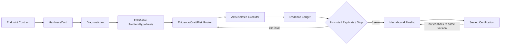
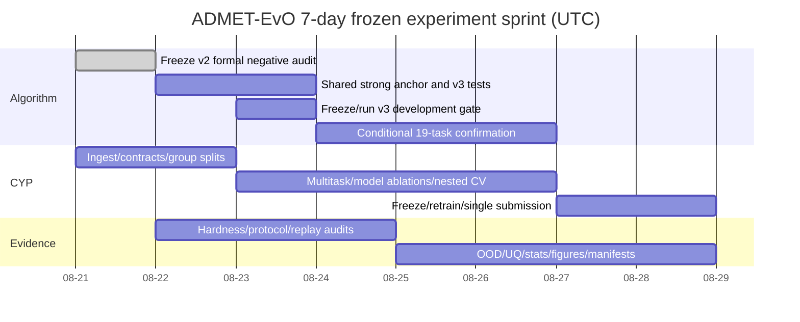

# ADMET-EvO Results 逐项回答与 7 天实验冲刺计划

> 冻结日期：2026-08-21 UTC
> 实验执行硬截止：2026-08-28 23:59 UTC
> 适用目标：在不降低现有 TDC ADMET-22 能力、冻结结果、协议安全性与可复现性的前提下，把 ADMET-EvO 升级为具有原创算法核心、强对照、独立认证和完整审计链的投稿级系统。
> 证据纪律：本文明确区分“已经完成”“正在运行”“本周预注册后执行”和“不能由当前证据支持”。计划不是结果，validation 不是 certification，排行榜名次也不是 Agent 因果贡献。

## 1. 先给结论

附件提出的 Results 逻辑是正确的，但目前还不能按原措辞直接写成论文结论。现在最准确的判断是：

1. **Result 1 的系统机制大体成立**：22/22 Endpoint Contract/HardnessCard、动作谱系、源码和协议哈希、冻结执行、失败保留、只读记忆、结果收集器均已存在；但多 seed hardness 稳定性、系统化 protocol attack 和抽样 recipe replay 仍需本周补齐。
2. **Result 2 的性能优势尚未成立，而且 EC-VOI v2 的预注册开发门已经失败**：旧 v2.7 应用模型在 22 个 TDC 任务上达到 18 个 top-5、21 个 top-10，但这不能证明 Agent 相对 matched-budget AutoML 的因果优势。正式 v2 在 BBB/CYP2C9/CYP2D6 上相对 AutoML 为 0/0/3，平均 oriented delta 为 -0.032686（development bootstrap 95% CI -0.052713 至 -0.009503）；因此没有启动 19-task confirmation。
3. **Result 3 必须从“动作选择频率”升级为“matched-state 因果干预”**：五轴在代码中有操作边界，但目前只有少量 feature/model 消融与三任务动作证据，尚无完整 leave-one-axis-out 结论。
4. **Result 4 目前只能写成受控能力而非自主推理优势**：现有 10-case hidden-fault fixture 中 Agent 与完整规则 guard 都是 F1=1.0。它证明 guard 有用，但不能证明 Agent 超过专家规则。独立外部作者编写的 sealed composite faults 是升级该主张的必要条件。
5. **附件缺少其文字中引用的 Result 5**。应正式加入“OpenADMET CYP prospective blind validation and real external-data loop”，否则真实 CYP 案例在全文中没有归属。
6. **一周内不能做无限全因子实验**。本周锁定最小充分证据集；任何未预注册的探索不进入主结果。训练、内部认证和一次性 OpenADMET 提交在一周内完成；组织方计划在 2026-09-25 才发布 intermediate leaderboard，最终赛于 2026-11-03 关闭，因此最终全盲名次的发布时间不受我们控制。

### 1.1 真正把论文推到顶刊/AI-for-Science 的实验优先级

| 优先级 | 必补实验 | 为什么决定档次 | 一周内判定 |
|---|---|---|---|
| A1 | 共同强锚点下的策略选择对照 | 排除“Agent 只是起点更弱/搜索更多”的混杂，直接检验 scientific policy 是否创造增益 | v3 三任务 gate；通过才跑 19 untouched tasks |
| A2 | Frozen-state matched interventions | 从同一状态分叉 selected/same-axis/random/no-op，给 diagnosis→action→effect 因果证据 | 8 个代表端点，固定 state/hash/seed |
| A3 | Prospective blind OpenADMET CYP | 提供开发者无法接触标签的真实前瞻验证，补足 TDC 已被历史接触的弱点 | 本周冻结训练、内部认证与一次提交；官方揭榜延迟读取 |
| A4 | 真实外部数据 source-held-out trial | 证明 Agent 不只会换模型，还能审核、吸收或拒绝新科学证据 | exact supervised 与 auxiliary/pretrain 两条 route，各自有 contamination gate |
| A5 | OOD/UQ/abstention | AI-for-Science 不只追均分，还需知道何时不可信、何时停止 | cluster/source holdout、ECE/NLL、coverage-risk、harm avoided |
| A6 | Hidden-fault external benchmark | 检验未知故障上的 diagnosis、root cause、repair，而非复述作者写的规则 | 必须由外部作者 sealed；拿不到则降到扩展数据 |
| B1 | Hardness stability/predictive validity | 证明 HardnessCard 是可重复观测而非装饰性标签 | 22×5 profiling seeds，ICC/kappa/条件相关 |
| B2 | Protocol attacks + recipe replay | 支撑“autonomous but safe/reproducible” | critical attacks 100% 拦截，抽样 replay 过容差 |
| B3 | 五轴 LOAO 与预指定交互 | 解释 feature/model/data/replicate/stop 分别贡献性能、可靠性、成本和安全 | gate 通过后做；不跑 2^5 全因子 |

只有 A1+A2 能支撑“Agent 架构本身有算法贡献”；A3+A4+A5 提供生态有效性和科学可信度；B 组保证审稿人无法把系统归类为不可审计的 LLM wrapper。榜单成绩是重要外部结果，但不能替代这些因果与协议证据。

## 2. 当前证据底账

### 2.1 2026-08-21 formal execution update

- EC-VOI v2 已接入生产 runner。三任务六个主臂与七个机制/安慰剂消融共
  13 臂全部完成；collector 验证每臂恰好覆盖三个开发任务，所有 fits 完成，
  protocol/source/memory/context hash 均一致，且 `test_loaded=false`、
  `leaderboard_loaded=false`。
- Full v2 仅运行三任务各一个三 seed ExtraTrees anchor，共 9 fits、569.6 s，
  三任务均因 `nonpositive_robust_utility` 停止。其平均 rank 为 5.667；AutoML
  为 1.333，legacy/rules 均为 2.000。
- 相对 AutoML，full v2 三任务为 0/0/3，平均 oriented delta -0.032686，
  development bootstrap 95% CI [-0.052713, -0.009503]。相对 expanded AutoML
  也是 0/0/3，平均 delta -0.026379，CI [-0.044116, -0.011586]。
- `-context/-memory/-VOI/-risk` 与 shuffled context/memory 都被同一个上游
  stop gate 遮蔽，行为近乎相同，不能据此称这些组件无用。只有 `-cost`
  打破零探索：39 fits，在 CYP2C9/CYP2D6 相对 full v2 分别 +0.008509 和
  +0.011556，但仍低于强对照，故不能晋级。
- v2 development 决策为 `reject`，未启动 19-task confirmation。根因已冻结为：
  EC-VOI 使用了弱而非 endpoint-specific frozen strong anchor；零本地证据时
  LCB=0，再减 cost/risk 使安全探索无法发生。

### 2.2 2026-08-21 v3 bounded revision status

- v3 只允许两个由 v2 失败直接支持的机制修改：所有策略共享同一个
  endpoint-specific frozen strong anchor/finalist fallback；当前 episode 尚无
  local pair 时允许至多一次 risk≤0.10 的 acquisition-positive matched pair，
  随后恢复完整 robust cost/risk gate。
- 所有臂被协议强制使用 `identity_safe` discovery data；共同 mapping SHA-256
  仍为 `17523aa1...e98d`，旧 TDC-22 finalization mapping 未修改。
- 两个早期 source-bound drafts 因 anchor/planner 适配问题分别 aborted 并保留
  audit，不能混入 canonical result。修复后的全量回归为 519 passed、1 skipped。
- 当前 canonical development protocol 为
  `reports/ecvoi_v3_development_protocol_v3.json`，protocol SHA-256
  `89620bd5...ef223e`，source SHA-256 `ddbaff7d...c2a2fb`。
- 七臂三任务正式队列正在 `runs/ecvoi-v3-development-v3/` 执行；只有其
  promotion gate 通过后才会生成 confirmation protocol 并打开 19 个 untouched
  TDC tasks。
- OpenADMET 训练集已完成 6,145 个 canonical identity、3,869 个 chemistry
  group、5 个 outer fold 与 12.51% sealed certification 的锁定划分；blind
  标签未打开。
- OpenADMET Stage A 拒绝 B2/M0/M1/M2。Stage B 的 B1、M3、M4 已完成
  5 folds × 3 seeds；B1 的 ST-RAE/MCC 为 0.72594/0.24635，M3 为
  0.77439/0.11544，M4 为 0.90255/0.10740。预注册 gate 拒绝 M3/M4，冻结
  recipe mode 为 `single_component_B1`，没有事后制造 stack。
- MiniMol 512 维 frozen embedding 已完成，但其存在不构成性能贡献；M4
  的失败是明确的机制否证结果。
- 本地 TDC Veith CYP2C9/2D6/3A4 `train_val` 外部来源、许可和 endpoint
  判决已冻结。其 binary qHTS 标签只准进入 auxiliary/pretraining route，
  禁止与 OpenADMET pIC50/TDI 主标签直接合并；实际 firewall/bridge 要等
  生产 standardizer hash 冻结后执行。

| 证据项 | 当前事实 | 可写主张 | 不可写主张 |
|---|---|---|---|
| TDC 应用性能 | v2.7：18/22 top-5，21/22 top-10；Bioavailability 排名来源存在完整性警告 | 系统已有强 ADMET 应用基础 | 这些名次由新 EC-VOI 策略导致 |
| Endpoint profiling | 22/22，平均 hardness 0.313，`test_loaded=false` | 可对端点形成结构化画像 | 画像已证明跨 seed 稳定或能预测 test gap |
| EC-VOI v2 正式开发 | 13 臂 × 3 task；全量 hash/test-access 审计通过；promotion gate 失败 | 新策略可执行且失败机制可定位 | v2 优于 AutoML 或可进入 19-task confirmation |
| EC-VOI v1 三任务 | BBB/CYP2C9/CYP2D6；EC-VOI vs legacy 0/1/2 | 可报告支持、无结论、反驳三类证据和负结果 | 扩展成 22-task superiority |
| 计算成本 | EC-VOI 7,392.646 fit-s；legacy 2,321.121 fit-s | v1 暴露真实成本建模缺陷 | “同动作数”等价于“同成本” |
| hidden fault | 10-case fixture；Agent 与完整规则均 F1=1.0 | endpoint guard 可拦截已知故障 | 超过专家规则或在未知故障上泛化 |
| 外部数据 | EndpointContract、source scout、license gate、结构 firewall 已实现；ChEMBL hERG failed closed | 能在不安全时拒绝数据 | 外部数据已经提高预测性能 |
| OpenADMET CYP | identity/group split、MiniMol embedding、Stage A/B 与 UQ 完成；B1 胜出，M3/M4 被拒绝 | Agent 按冻结 gate 否证无效新模型且未读取 blind label | 新神经模型提高 CYP 性能，或已经获得官方 blind 排名 |
| 盲测安全 | 当前冻结 benchmark 各臂为 `test_loaded=false` | 新 benchmark 未读 test | 整个历史 goal session 从未发生 test access；已有事件必须披露 |

当前冻结 v2 development 标识：

- protocol SHA-256：`bee6168489297fc908dd7ce19615726116a62c9db2fe05fcc89a3ad7b467e12d`
- implementation source SHA-256：`2564502788151fe020ba724de6f672966ecfd8ae15d1241000ff3b6fb590d185`
- EC-VOI v2 memory SHA-256：`42a1ad71c4fba8de2abad223d445fc6bc2b6ec20cb48d1689dd7652eede506e2`
- action-memory SHA-256：`5257d01873121971fd7cb18a5986dc27f505fa597e70ebac4be0ed08a31989e4`
- context registry SHA-256：`ce0628dbb1cb6c93780b8953dcf80ed8e95b8ca4792d25138195ac9e57ae0713`
- mapping SHA-256：`17523aa1d5583437833f7f22aecceff5d0932f466104936b0be4ce5ee363e98d`

## 3. 对“Results 统一评价合同”的逐项回答

### 3.1 22 个 endpoint 是否明确？

是。冻结集合为：

`Caco2_Wang`、`HIA_Hou`、`Pgp_Broccatelli`、`Bioavailability_Ma`、`Lipophilicity_AstraZeneca`、`Solubility_AqSolDB`、`BBB_Martins`、`PPBR_AZ`、`VDss_Lombardo`、`CYP2C9_Veith`、`CYP2D6_Veith`、`CYP3A4_Veith`、`CYP2C9_Substrate_CarbonMangels`、`CYP2D6_Substrate_CarbonMangels`、`CYP3A4_Substrate_CarbonMangels`、`Half_Life_Obach`、`Clearance_Hepatocyte_AZ`、`Clearance_Microsome_AZ`、`LD50_Zhu`、`hERG`、`AMES`、`DILI`。

分类任务主指标为 AUROC 或 AUPRC，回归任务为 MAE 或 Spearman；方向必须由 Endpoint Contract 固定，不能在结果出来后改变。

### 3.2 discovery、validation 与 certification 应如何划分？

采用三层职责，而不是把一次随机 split 叫作 blind test：

1. **Discovery**：训练、候选生成、诊断和动作试验；可重复访问。
2. **Selection validation**：按 molecule identity 先去重，再按 scaffold/chemistry cluster 分组的多 seed 或 nested CV；用于选择策略，但不得宣称完全盲测。
3. **Certification**：finalist、源码、数据 manifest 和预测接口冻结后才运行；其结果不得重新打开同一版本的选择。

这里“按分子划分”首先指标准化后相同分子身份不得跨 split；然后用 Bemis–Murcko scaffold 或基于 ECFP4 的 chemistry cluster 保证近邻系列尽量不跨 split。指纹相似度是近邻分组工具，不等于分子身份。这样做是为了防止盐型、互变异构体、重复测量和近似物让模型通过记忆系列而获得虚高估计。

旧 TDC test 已被历史流程接触，且本 goal session 有已披露 incident，因此它只能作为冻结应用 scorecard，不能独自承担“全新盲测”。真正 prospective certification 由 OpenADMET 盲测和 evaluator-owned sealed tasks 承担。

### 3.3 公平预算具体锁什么？

冻结 v1 已定义 11 臂、每任务最多 8 个动作、24 个候选、90 分钟、相同五个 validation seed、相同源码/数据/记忆快照和 `test_loaded=false`。但 v1 说明“同动作数”不足以保证公平：慢模型会使实际 fit-seconds 相差 3 倍。

v2 同时锁定四类预算：

- action/trial cap；
- primary fit 与 replicate fit 分账；
- realized CPU/GPU seconds 和峰值内存；
- LLM tokens/API dollar cost。

主分析采用 matched maximum budget；效率分析再在相同 realized cost 截面比较。超时与失败的已消耗时间全部计入，不能只统计成功模型。

### 3.4 normalized improvement 如何定义？

先把指标统一为“越大越好”的 oriented delta：

\[
\Delta_{e,m}=d_e\left(M_{e,m}-M_{e,baseline}\right),
\]

其中 AUROC/AUPRC/Spearman 的 \(d_e=+1\)，MAE 的 \(d_e=-1\)。论文必须同时报告原始单位的 \(\Delta\)。跨 endpoint 聚合不使用容易爆炸的百分比，而使用预注册的稳健尺度：

\[
NI_{e,m}=\frac{\Delta_{e,m}}
{\max(\operatorname{MAD}(M_{e,baseline}^{seed}),\epsilon_e)}.
\]

\(\epsilon_e\) 是端点预注册的 practical-equivalence margin。这样 NI 表示相对于 baseline seed 波动的增益，不会因 baseline 接近 0 而失真。主统计单位是 endpoint，不把 seed 当作 110 个独立样本。

### 3.5 tie、harm 和 transfer 如何定义？

- `win`：paired endpoint delta 的点估计大于 `+epsilon_e`；
- `tie`：落在 `[-epsilon_e,+epsilon_e]`；
- `loss/harm`：小于 `-epsilon_e`；
- harmful intervention rate：所有进入 certification 的动作中，certification delta 小于 `-epsilon_e` 的比例；
- sign reversal：validation delta 与 certification delta 符号相反，且至少一侧超过 `epsilon_e`；
- transfer ratio 只在 `|validation delta| >= epsilon_e` 时报告，其他情况标为 undefined；同时报告 paired scatter、Spearman 相关和绝对 generalization gap，避免比值在零附近失真。

统计上使用 endpoint-paired bootstrap 95% CI、Wilcoxon/permutation sensitivity analysis、Hodges–Lehmann effect；逐 endpoint 次要检验做 Holm 校正。主检验只保留一个：Full v2 相对 expanded AutoML 的跨 endpoint oriented delta。

## 4. Result 1：protocol-safe autonomous research loop

### 4.1 它是不是“LLM 调参器”？

不是。当前系统的可执行链是：

普通 AutoML 的核心输出是最高 validation score；ADMET-EvO 还输出 endpoint 难点、根因假设、替代解释、否证条件、动作轴、成本/风险、paired evidence、停止理由和完整 lineage。对论文最强的定位不是“LLM 搜得更好”，而是“把可证伪研究决策变成可审计的 sequential decision problem”。

### 4.2 Endpoint Contract/HardnessCard 已回答了什么？

已经完成 22/22 profiling，不同任务并非得到相同标签：17 个首选 feature-domain-shift、4 个 model-imbalance-aware、1 个 data-leakage-safe；domain shift 均值 0.748，而 scarcity、imbalance、roughness 在任务间有明显分层。

尚未回答的是稳定性与外部效度。本周实验为每个 endpoint 用 5 个 profiling seeds 重算连续维度，报告：

- 连续维度 ICC(2,1) 与 Spearman；
- 动作类别一致率与 Fleiss' kappa；
- hardness 与 baseline metric、模型排名熵、validation gap 的 Spearman 及 bootstrap CI；
- 每一维的跨 endpoint 方差/seed 方差比。

若 ICC < 0.75，则 HardnessCard 只能作为不确定观测，v2 router 必须显式传播其方差，不能当作确定标签。

### 4.3 ProblemHypothesis 是否真的可否证？

已有三类真实例子：

- supported：BBB 的 `data-leakage-safe` matched action，平均 +0.007006 AUROC，4/5 seed 为正；
- inconclusive：CYP2C9 同动作在 4 个完成配对上平均 -0.000889 AUPRC，且发生 hard timeout；
- refuted：CYP2D6 同动作平均 -0.009210 AUPRC，0/5 seed 为正。

这比只展示成功案例更可信。不过 v1 router 错把启发式 `expected_effect` 当作跨动作可比的数值效应，并用手设 cost/risk 过度偏好低成本 data action。v2 必须改用端点分辨率归一化的经验后验与实现成本模型。

### 4.4 audit 应报告什么？

本周 Result 1 的最小充分审计为：

| 审计 | 样本量 | 通过条件 |
|---|---:|---|
| Contract coverage | 22 endpoint | 必填字段 100%；所有冲突有 disposition |
| Protocol attacks | 12 类 × 5 实例 | critical attack 100% 拦截；clean false rejection <5% |
| Lineage trace | 每臂随机 10 条 | action/config/prediction/artifact/hash 100% 可追溯 |
| Recipe replay | 8 endpoint × 2 seed | metric absolute error <1e-8（确定模型）或落入预注册容差；prediction correlation >0.999 |
| Tamper test | 10 个 artifact | 10/10 hash mismatch 被拒绝 |
| Failure retention | 所有 timeout/failure | 100% 入账，耗时不丢失 |

必须在论文中披露历史 test-access incident；更严谨的写法是“all experiments under the new frozen protocol had zero test-label access”，而不是“the project never accessed test data”。

### 4.5 Freeze-and-certify 现在成立到哪一步？

hash-bound freeze、source snapshot、collector rejection 和禁止 leaderboard feedback 重开选择已经实现；真正独立的 certification 结果尚缺。TDC 结果只能展示现有应用能力；OpenADMET 与外部 evaluator 才承担 prospective claim。

## 5. Result 2：matched-budget predictive value

### 5.1 现有结果到底说明什么？

v2.7 的 18 个 top-5/21 个 top-10 说明模型栈有竞争力，是“能力地基”。但旧 Agent-vs-AutoML validation audit 为 5/2/15，平均 train-normalized oriented delta -0.011923，且协议不满足正式同预算资格。新 EC-VOI v1 在三任务相对 legacy 也是负结果。因此，当前不能写“hardness-aware research improves prediction”。

论文可以诚实地把 v1 负结果作为算法迭代依据：启发式效应不可跨轴比较，动作上限不等于计算上限，低成本 prior 会压制更有效的 feature action。这为 v2 的 calibrated EC-VOI 提供了可检验动机，而不是隐藏失败。

### 5.2 哪些对照是必需的？

| 对照 | 当前状态 | 本周决策 |
|---|---|---|
| Strong fixed baseline | 已有强多视图 ExtraTrees/LightGBM 与 v2.7 frozen recipes | 必报 |
| Legacy Agent | 三任务完成 | 必报 |
| Rule-based | 三任务冻结对照完成 | 必报 |
| Seeded random | 三任务冻结对照完成 | 必报 |
| Conventional AutoML | 三任务正式协议完成，平均 rank 1.333 | 必报，当前最强策略对照 |
| Expanded AutoML | 三任务正式协议完成，平均 rank 2.333 | 必报，作为宽搜索对照 |
| LLM planner without diagnosis | no-context/no-memory 已跑，但被上游 stop deadlock 遮蔽 | v3 gate 通过后才重做可解释消融 |
| Full calibrated EC-VOI v2 | 生产运行完成；三任务 gate 失败 | `reject`，禁止进入 19-task confirmation |

v1 与 v2 都只承担三任务 failure localization，不再扩展到 22 任务。新的 v3 仍只能在这三个任务上开发；三者不得作为 v3 独立 confirmatory endpoints。其余 19 个 TDC endpoint 继续密封，只有 v3 预注册 promotion gate 通过后才能构成 primary confirmatory cohort。

### 5.3 一周内能否完成 22-task 主结果？

**22-task 覆盖可以完成；19-task primary paired comparison 现在是有条件交付，不再承诺必然运行。** 必须先实现并冻结 v3 的两个有限修复：所有臂共享 endpoint-specific strong anchor，以及零本地证据时只允许一次 safe matched-pair exploration。随后仍在同三个 development endpoints 上重新过门：

- 主表：shared strong baseline、expanded AutoML、legacy/rules、Full v3；
- random 只作为策略 sanity control；
- EC-VOI 机制消融只在主 gate 通过后用预注册的最小集合；
- 5 seeds 用于 finalist robust evaluation，不为每个探索 trial 都重复 5 次；
- 所有任务可并行，但每个进程绑定独立 CPU 集，且同时运行数受内存上限约束。

v2 已经失败，故旧确认队列永久关闭。v3 若未达到新协议事前锁定的 gate，则同样不运行 19-task superiority；转而保留 v2/v3 为方法负结果，主论文聚焦安全审计、失败机制与 prospective CYP，禁止为了赶进度放宽 gate。

## 6. Result 3：五类 research-action axes

### 6.1 每个轴的独立能力是什么？

- **Feature Action**：改变分子信息表达；主结果是 held-out delta、fold 稳定性和特征成本。
- **Model Action**：改变归纳偏置、loss、校准和 ensemble；主结果是 metric、calibration、互补性和训练成本。
- **Data Action**：改变合法证据基础；主结果是 source-held-out delta、有效样本、冲突、污染拒绝和负迁移。
- **Replicate Action**：改变“是否相信一次提升”；主结果是错误晋级、winner's curse、sign reversal 与额外成本，不要求平均分必然上升。
- **Abstain/Stop**：改变覆盖率、伤害与资源；主结果是 coverage-risk、harm avoided 和 compute saved，不应用强制全覆盖的平均分评价。

### 6.2 leave-one-axis-out 怎么做才公平？

完整 Agent 与 `-Feature/-Model/-Data/-Replicate/-Stop` 共六臂，保持相同初始 state、动作上限和最大预算。需要两张表：

1. matched maximum budget：关闭一个轴后，其他轴可以使用剩余预算；
2. matched realized cost：在共同 fit-seconds 截面截断轨迹。

系统消融回答“没有该能力会怎样”，不能证明某一步动作因果。因此另建 frozen state snapshots：从预注册的 8 个端点各抽取若干 state，在同一 state 执行 Agent 所选动作、同轴替代、跨轴随机和 no-op。所有分支使用相同数据、seed、起始模型和 certification evaluator。

### 6.3 是否需要 2^5 全因子？

不需要，也不应在一周内做。主分析是五个 leave-one-out 主效应；只保留三个科学上预指定的二阶交互：

- Feature × Model：表征与归纳偏置是否互补；
- Data × Replicate：新来源增益是否经复核后仍成立；
- Replicate × Stop：复核信息是否改变正确停止时机。

不检验其他交互，也不根据结果追加组合。交互分析以 endpoint 为随机效应，报告 effect/CI，不把动作选择次数当因果效应。

### 6.4 v1 的规则臂已经告诉我们什么？

BBB 的固定规则可以达到与 legacy 相同的 final validation，但没有执行仅改变一个动作轴的 treatment/control pair，因此 action evidence 为 inconclusive。这是一个重要区分：预测分数相同，不代表能产生可归因的科学证据。Result 3 应增加 `evidence yield per 1,000 fit-seconds`、`single-axis verification rate` 和 `supported/refuted/inconclusive coverage`。

## 7. Result 4：hidden fault 与 harmful intervention

### 7.1 当前能否说 Agent 会发现隐藏故障？

只能有限地说。现有 10-case deterministic fixture 中：Agent contract guard 与 complete rules guard 都是 micro-F1=1.0、critical recall=1.0；expanded AutoML schema guard F1=0.615，常规 AutoML F1=0。结论是结构化 endpoint/data guard 有用，但 Agent 没有超过完整人工规则。

### 7.2 顶刊级独立 benchmark 需要什么？

至少 12 个由**未参与 Agent/规则实现的人**编写的 sealed composite tasks：4 clean controls、8 faulty tasks；故障标签、severity 和 remediation rubric 由 evaluator 持有。每例分别评分 detection、root cause、falsification plan、repair 和 abstain。规则 baseline 在看到 benchmark 前冻结。

如果 2026-08-23 之前拿不到独立 evaluator pack，Result 4 不进入主文优势主张，只作为 Extended Data 的受控 fixture 与局限性。我们不能自己编题、自己定答案，再称为独立盲测。

### 7.3 harmful intervention 如何评价？

将 clean controls 纳入分母，预先设 practical harm margin；报告 precision/recall/F1、clean false-alarm、repair success、clean degradation、Brier/ECE 和 selective risk。诊断正确但修复失败、诊断错误但偶然提分、完全正确三类必须分开。

## 8. 新增 Result 5：OpenADMET CYP prospective validation

### 8.1 任务合同

官方挑战包含：

- direct inhibition：CYP3A4、CYP2C9、CYP2D6、CYP1A2 四个 pIC50 回归目标；
- time-dependent inhibition：CYP3A4、CYP2D6 两个二分类目标；
- 约 750 个盲测分子；测试集按 hit expansion/近邻系列构成，具有现实的 chemistry shift；
- 回归主指标为 macro soft-threshold relative absolute error（MA-ST-RAE），利用实验 credible interval 对不确定区间内预测不处罚；
- TDI 主指标为 MCC。

官方页面：<https://openadmet.org/blindchallenges/>；挑战说明：<https://openadmet.ghost.io/announcing-openadmets-cyp-inhibition-blind-challenge/>。

### 8.2 只有约 1,500 个分子时，固定 test 还是交叉验证？

最佳方案是**按化学系列分组的 nested CV + 一个最后才打开的 cluster holdout**，而不是普通随机 CV，也不是长期牺牲大量训练样本：

1. 标准化分子身份，identity duplicate 永不跨 fold；
2. 用 scaffold/Butina clustering 构建 group；四 CYP 同一分子共享 group，避免 multitask 泄漏；
3. outer 5-fold group CV 估计泛化，inner group CV 选择模型/动作；
4. 按预注册 seed 封存 10–15% 的完整 chemistry groups 作为一次性 internal certification，不参与任何选择；化学距离最远子集只在 outer-fold OOD 曲线中分析，不用于挑选 sealed set；
5. recipe 冻结并通过 internal certification 后，用**相同 recipe**在全部有标签训练数据上重训，生成盲测提交。

理由：nested group CV 最大化小样本利用率并降低偶然 split 依赖；cluster holdout 检查系列外泛化和 pipeline 过拟合；最终 OpenADMET test 才是真正独立盲测。普通随机 CV 会让同系列近邻分散到 train/validation，显著高估性能。

### 8.3 模型本身如何形成新颖故事？

本周不从零训练巨型 foundation model，而构建一个可落地的 **assay-conditioned multi-fidelity multitask model**：

- 共享分子表征：冻结 pretrained molecular embeddings + Morgan/Avalon/RDKit2D；
- endpoint/source/assay-arm token：区分 CYP isoform、-NADPH/+NADPH、single concentration/DRC 与外部来源；
- masked multitask heads：利用稀疏 DRC 矩阵和跨 CYP 共性；
- interval/censor-aware heteroscedastic regression：显式建模 pIC50 下限和测量不确定性，并与 ST-RAE 对齐；
- TDI consistency head：分类概率与 direct/TDI shift 的物理定义保持软一致；
- domain-of-applicability gate：基于 chemistry distance、ensemble variance 和 source shift 输出 uncertainty/abstain；
- EC-VOI Agent 决定下一步应尝试 data、feature、model、replicate 还是 stop，而不是固定执行全部模块。

可检验的新颖性不在“又一个 embedding”，而在“assay semantics + multi-fidelity evidence + uncertainty-aware research policy”的联动。主消融为：无 assay token、无 single-concentration auxiliary、无 consistency loss、无 uncertainty head、单任务替代 multitask。

### 8.4 外部数据怎么用？

分三级：

1. **A 级 exact/bridgeable**：human recombinant 同 isoform、IC50/pIC50、明确 assay arm/单位/关系、许可可用；经 identity/near-neighbor 防火墙后可进入 supervised treatment。
2. **B 级相关但 assay 不同**：公开 CYP inhibition、binding、substrate/phenotyping；只做 source-aware pretraining/auxiliary task，不与 challenge 标签直接合并。
3. **C 级质量一般或标签语义不清**：只做 self-supervised representation pretraining；不能让 noisy labels 进入 endpoint head。

每个来源必须有 URL/DOI、license、获取日期、原始 SHA、curation code SHA、EndpointContract 判决、冲突率、与 train/holdout/test structure overlap 审计。用户提供的外部数据也执行同一规则，不因“内部整理”而降低门槛。

### 8.5 如何避免 leaderboard overfitting？

- 2026-08-28 前冻结一个 submission manifest 和预测 SHA；
- 只做一次正式提交，不根据 live score 选择模型或调权重；
- leaderboard 回传只用于报告，不重开同版本；
- 后续若开发 v3，必须有新协议/新 hash，并在论文中与 v2 分开，不能把多次提交中的最好一次当预注册结果。

## 9. 一周硬截止执行矩阵

### 9.1 三条并行证据线

### 9.2 每日交付物与停机门槛

| UTC 日期 | 必须完成 | 失败时的预注册处理 |
|---|---|---|
| Aug 21 | v2 13-arm collector、统计与 formal failure audit；OpenADMET manifests | v2 永久禁止进入 confirmation；负结果不改写 |
| Aug 22 | shared endpoint-specific strong anchor、不退化 finalist、首次安全探索；回归测试 | 不新增模型/表征，不接触 19-task 结果 |
| Aug 23 | 冻结 v3 source/protocol/hash；仅跑 3-task development gate | gate 未过则停止 TDC superiority 路线 |
| Aug 24 | 仅在 gate 通过时启动 19-task 核心臂；否则转投 audit/CYP；CYP nested group CV | freeze 后不再改源码；bug 只能生成新版本并披露 |
| Aug 25 | 19-task 主臂/核心消融；Hardness stability；protocol attacks/replay | 只补失败 job，不追加新假设 |
| Aug 26 | CYP multitask/multifidelity/UQ 消融；TDC matched-state/LOAO 收尾 | 按预注册 gate 淘汰，不看盲榜 |
| Aug 27 | OOD/calibration/coverage-risk；paired bootstrap；一次性 internal holdout | holdout 打开后不允许重选 |
| Aug 28 | 全数据同 recipe 重训；一次 OpenADMET 提交；freeze manifest、图表、结果文档 | 18:00 UTC 后禁止新实验；仅修复报告/哈希缺失 |

### 9.3 本周最小充分实验集

| ID | 实验 | 任务/样本 | 方法臂 | 主要输出 |
|---|---|---|---|---|
| E1 | v2 failure localization（已完成） | 3 development endpoints | 6 main + 7 ablation/placebo arms | 分数、动作证据、fit-s、失败 |
| E2 | Hardness stability | 22 × 5 profile seeds | frozen profiler | ICC/kappa/condition correlation |
| E3 | v3 promotion | 同 3 development endpoints | shared anchor/v3/legacy/expanded AutoML | promotion gate |
| E4 | TDC confirmatory（有条件） | 19 untouched endpoints | v3 + core controls | endpoint-paired primary result |
| E5 | five-axis LOAO | 预注册 representative 8 endpoints；资源允许则扩 19 | Full/-five axes | performance/stability/efficiency/safety |
| E6 | matched-state interventions | 8 endpoints × frozen states | selected/same-axis/random/no-op | 因果 delta、evidence yield |
| E7 | audit battery | 22 contracts + attacks + replay | Agent/guard | safety/reproducibility |
| E8 | CYP baseline/CV | 4 regression + 2 classification | fixed/AutoML/v2 model | group nested-CV metric |
| E9 | CYP model ablation | 同上 | five architecture ablations | novelty mechanism |
| E10 | CYP external data | exact supervised + auxiliary/pretrain | control/treatment | source-heldout delta/negative transfer |
| E11 | OOD/UQ | TDC representative + CYP cluster holdout | ensemble/UQ/abstain | ECE/NLL/coverage-risk |
| E12 | hidden fault | 外部 evaluator pack（若按时提供） | Agent/rules/AutoML/random | detection/root cause/repair |

E12 依赖外部作者，若 48 小时内不可得则从主文移除，不影响其他实验的 7 天完成定义。OpenADMET 的训练与提交在本周完成，但组织方最终全盲揭榜晚于本周，结果到达后只能作为冻结版本的延迟 certification readout。

### 9.4 资源约束

当前机器有 144 个逻辑 CPU、约 59 GiB available memory、无已检测到的 GPU、磁盘仅余约 82 GiB。CPU 不是瓶颈，内存与磁盘是。

- 最多同时运行 6 个重模型进程，每进程 8 threads，绑定不重叠 CPU set；
- 每个进程软上限约 8 GiB，避免已经耗尽的 swap 再抖动；
- TDC、CYP、audit 分别保留 48/32/16 cores，余量用于 OS 与失败重跑；
- feature cache 内容寻址复用；只保留 finalist、paired controls、predictions、manifests 和失败日志；
- 新 artifacts 预算 40 GiB，余下空间作为安全余量；
- 公平 wall-clock 比较使用隔离运行；并发实验以 fit-seconds/CPU-seconds 为主，不把共享机器的原始 elapsed time 当因果结论。

## 10. Claim gates 与论文措辞

| 主张 | 开门条件 | 未开门时的合法措辞 |
|---|---|---|
| protocol-safe | 新协议 critical attacks 100% 拦截、test labels 0 access、replay 通过 | “mechanism implemented; full attack certification pending” |
| v2 优于 search | 19 endpoint paired CI 的方向/门槛通过，且无预算不公平 | “v2 was not superior under the preregistered budget” |
| diagnosis 有用 | matched-state 与 no-diagnosis 消融一致支持 | “routing changes behavior but predictive value is unproven” |
| memory 有用 | no-memory ablation 与 context transport 在 untouched tasks 获益 | “memory is stored and auditable, not demonstrably beneficial” |
| Data Action 有用 | real source-heldout treatment 通过 gain/contamination gate | “unsafe sources were rejected; gain remains unproven” |
| independent reasoning | unseen external fault pack 超过 frozen complete rules | “guard capability on a deterministic fixture” |
| prospective validity | frozen OpenADMET submission 获得官方 blind readout | “submission frozen; blind outcome pending” |

负结果不会导致换端点、换指标或重开 selection。若 Full v2 未胜出，论文故事可以是“为什么启发式 scientific agents 在公平验证下失败，以及 calibrated evidence/cost accounting 如何避免虚假自主性”，但不能继续写 superiority。

## 11. 需要的外部输入与最晚时间

这些不是要求暂停当前工作的澄清问题；本地可做部分会继续推进。但它们决定相关 claim 能否在本周开门：

1. **OpenADMET challenge train/test-blinded 文件**：已于 Aug 21 从官方 Hugging Face 仓库冻结，dataset commit 为 `85f8b358d0a2056a98b990dd75d3b3ec9247862b`，原始 manifest 见 `reports/openadmet_cyp_data_manifest_v1.json`；该依赖已解除。
2. **用户整理的外部数据**：每个来源至少提供 source URL/DOI、license、原始文件、字段说明、单位/阈值/assay/物种；最晚 Aug 23。缺信息的数据自动降为 pretraining-only 或 quarantine。
3. **独立 fault-task 作者**：不得参与 Agent/规则实现；最晚 Aug 23 提供 sealed pack。可直接使用
   `reports/expert_blind_author_kit_v1/`，但 completed hidden packet 必须由
   custodian 保存在本工作区之外。否则 Result 4 不作独立优势主张。
4. **论文目标受众**：当前按“AI for science + cheminformatics/drug discovery”双受众设计；具体期刊只影响图表压缩，不改变实验合同。

## 12. 2026-08-28 的 Definition of Done

本周实验完成不是“所有结果都为正”，而是以下对象全部冻结：

- v1 controls 与完整负结果报告；
- v2 source SHA、protocol SHA、data/memory/context SHA；
- 22-task coverage、19-task primary comparison 和 endpoint-level raw artifacts；
- five-axis 预注册消融与 matched-state evidence；
- Hardness stability、protocol attacks、recipe replay、tamper/failure audit；
- OpenADMET Endpoint Contracts、group nested-CV、model/data/UQ ablations、一次性 frozen submission；
- real external source 的 accept/reject ticket，或明确 failed-closed 证据；
- OOD/calibration/coverage-risk 与 paired endpoint statistics；
- figures/tables 的机器可读源数据、环境锁、完整 manifest 和 claim-evidence matrix；
- 所有失败、timeout、负迁移和不支持主张均保留。

达到这些条件即表示“本周可控实验执行完成”。OpenADMET 官方在之后发布的 blind score 是冻结 artifact 的延迟读取，不允许反向修改本周版本。
