# ADMET-EvO Research Agent：改进版总体架构与逻辑链条

> 状态：v5 AI Scientist 评测实施中（仅限 TDC ADMET 22 endpoints，既有 test 结果只读封存）  
> 目标：预测指标以“应用合格”为约束，不再刷榜；主目标改为量化 Agent 相比传统 AutoML 的诊断、证伪、自我纠错、数据治理、成本感知停止和可审计科研闭环优势。

## 0. v5 当前主链：性能合格后，评价“会不会研究”

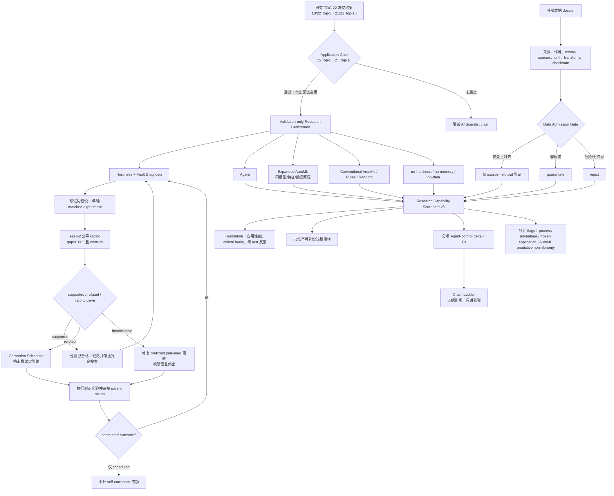

v5 的正式预注册是 `runs/v5-policy-benchmark-90m/protocol.json`，哈希为
`ff01a79f6db0bb6d51a2abff3bcec1becde54827265ad720f525514d0858f4a7`。每个策略每个
endpoint 的整体计算硬上限为 90 分钟；多角色只共享一个执行队列，不增加 action/fit
预算。既有 TDC test 不再承担新策略选择或迁移性证明。

当前 self-correction 机制已实现“证据 → 下一纠正计划”的确定性、validation-only、哈希
可审计转换，并接入主 runner。它不会把 scheduled 计划当成已完成能力；只有后续 matched
experiment 实际执行并产生链接 outcome，过程评分才会增加。这样防止用更多文字步骤替代
真实实验，也防止在 refuted 后无意义重复同一动作族。

第一轮前瞻 smoke 已按该链执行：22 个历史 endpoint 中 18 个 supported 直接停，另有 2 个
因下一步超过 compute-cost gate 而停；仅 CYP2C9_Substrate 和 hERG 进入执行队列。2/2
纠正动作完成，共 12 fits/67.6 fit-s，无 Uni-Mol2、调参或 ensemble。两个 child hypotheses
均 inconclusive，最终再次停止。因此当前证据支持“能把失败变成受控 follow-up 并接受
无结论”，不支持“纠正后一定涨分”或“优于 complete rules”。

fresh-validation 成本证书给出的当前边界是：相对 score-only selection，mean oriented
delta = −0.000348，95% CI [−0.001482, 0.000585]，20/22 endpoints 在 −0.005 实用界限
内，aggregate selected-recipe cost ratio=0.278。它证明有界 Pareto efficiency，不证明
路由优于随机或 Agent 优于 AutoML。

Scorecard v3 不再把“预测非劣于 expanded AutoML”错误地放在所有 Agent claim 的必经路径
上。应用性能合格与安全构成 foundation；科研过程优势、冻结应用认证、以及预测非劣分别
出具独立 flags。这样旧 Agent-vs-AutoML 的负预测证据会阻断 predictive-noninferiority
flag，但不会抹掉已经验证的诊断、治理或自纠错过程能力。

## 1. 核心目标

改进后的 ADMET-EvO 不只回答：

> 哪个模型在当前验证集上分数最高？

而要完整回答：

1. 这个 endpoint 为什么难？
2. 当前主要问题来自数据、表示、模型、评价协议，还是验证方差？
3. 下一步最有价值的研究动作是什么？
4. 该动作是否有可证伪的实验设计？
5. 验证集上的提升是否能迁移到独立 held-out 数据？
6. Agent 的决策是否优于同成本的随机、规则和传统 AutoML？
7. 当模型超出适用域时，系统是否知道应该拒绝预测或请求新数据？

## 2. 总体架构

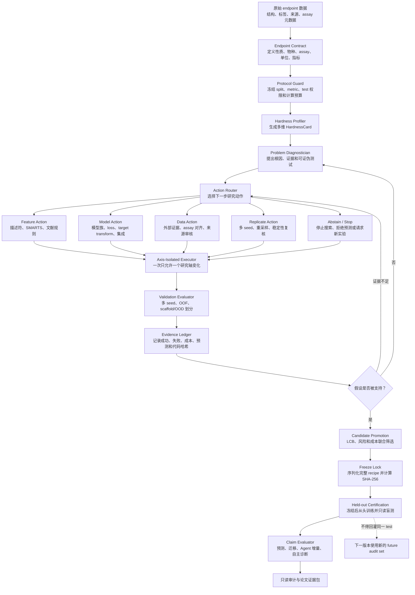

### 2.1 v4 精简执行链：多角色，但不多开训练

v4 不采用“三个 Agent 各自跑一套实验”的高成本方式。Data Steward、Model
Researcher 和 Skeptic 只在规划层提出候选；一个确定性 Arbiter 去重、执行协议检查、
保护 matched pair，并把每轮最多 4 个唯一配置交给同一个执行器。委员会模式和单
Agent 模式都受同一上限约束：2 轮 × 4 配置 = 每 endpoint 最多 8 个 discovery
配置，因此多角色本身不会增加训练次数。

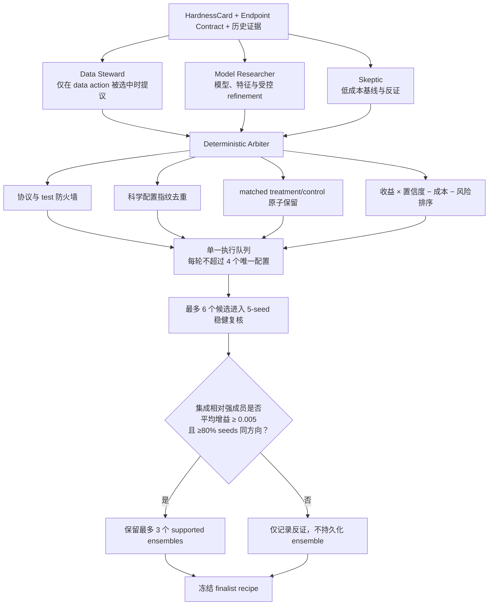

### 2.2 防止“操作越多、效果越差”的五道门

| 门槛 | v4 规则 | 防止的问题 |
|---|---|---|
| 动作预算 | 正式比较严格限制为每任务 8 个唯一配置 | 多 Agent 偷偷扩大搜索空间 |
| 数据动作 | 只有 Router 明确选择 data action 才执行 treatment/control | 对轻微诊断信号过度清洗 |
| Uni-Mol2 | 只在 domain-shift action、严重度/置信度/先验均通过时做 2D/3D matched pair | 反复计算昂贵 3D 表示 |
| Ensemble | 必须达到实质效应和跨 seed 一致性 | 验证集偶然融合收益 |
| Artifact | discovery 模型默认不保存；特征使用版本化共享缓存 | 重复 `model.joblib`、特征和 checkpoint 占盘 |

旧 v5 的 validation-only 回放显示：将 12 个动作无条件截断为 8 个会使 4/22
任务损失超过 0.005，因此 v4 先验证“更好的 8 动作排序”而不是盲目删减。正式
比较同时运行单 Agent 与委员会两个等预算 arm；只有委员会在跨 22 endpoints 的
效应、稳定性或效率上胜出，才升级为默认策略。

## 3. 三条并行逻辑链

系统同时维护三条链，不能只保留最终最佳分数。

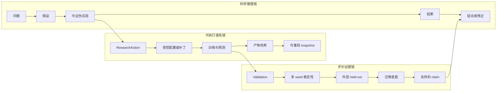

## 4. Endpoint Contract

每个 endpoint 必须先被转换成结构化合同，避免只凭一个任务名称推断标签含义。

```yaml
endpoint_id: cyp2c9_substrate
property: CYP2C9 substrate status
task_type: binary_classification
species: human
assay_system: curated substrate evidence
label_definition:
  positive: substrate
  negative: non_substrate
unit: null
metric:
  primary: pr_auc
  direction: maximize
source:
  dataset: TDC ADMET
  provenance: Carbon-Mangels et al.
split_contract:
  discovery: scaffold_multi_seed
  certification: evaluator_owned_holdout
```

Endpoint Contract 应至少包含：

| 字段 | 含义 |
|---|---|
| `property` | 预测的生物学或理化性质 |
| `species` | 人、大鼠、小鼠或其他体系 |
| `assay_system` | 实验体系和读出方式 |
| `label_definition` | 分类阈值或回归标签定义 |
| `unit` | 原始单位、对数尺度和变换方式 |
| `metric` | 主指标、辅助指标及方向 |
| `source` | 数据来源、年份、许可和引用 |
| `split_contract` | discovery、certification 和 future audit 的所有权 |

## 5. Hardness Profiler

### 5.1 Hardness 不是单一分数

系统首先输出多维 `HardnessCard`，保留每一种困难的原始证据。

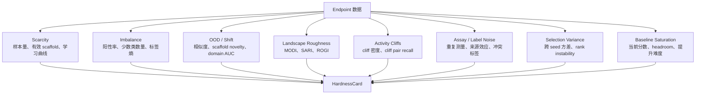

### 5.2 建议的 HardnessCard

```json
{
  "endpoint": "CYP2C9_Substrate_CarbonMangels",
  "scarcity": {
    "n_train": 428,
    "effective_scaffolds": 117,
    "learning_curve_slope": 0.31
  },
  "imbalance": {
    "positive_rate": 0.18,
    "minority_count": 77,
    "severity": "high"
  },
  "distribution_shift": {
    "median_nearest_train_similarity": 0.39,
    "novel_scaffold_fraction": 0.72,
    "domain_classifier_auc": 0.81
  },
  "roughness": {
    "modi": 0.42,
    "sari": 0.37,
    "rogi": 0.61
  },
  "activity_cliffs": {
    "pair_fraction": 0.08,
    "baseline_pair_recall": 0.11
  },
  "selection_variance": {
    "validation_std": 0.024,
    "top_candidate_rank_stability": 0.43
  },
  "baseline_saturation": {
    "baseline_score": 0.373,
    "headroom": "high"
  }
}
```

### 5.3 Hardness 到动作的初始映射

| 主要难度 | 优先动作 | 不应默认采取的动作 |
|---|---|---|
| 小数据 | 简单模型、预训练表示、外部证据 | 从头训练大模型 |
| 极端不平衡 | balanced ensemble、PR-AUC、阈值/校准分析 | 只看 ROC-AUC |
| scaffold/OOD | 2D/3D 对照、适用域、拒绝预测 | 无条件融合所有模型 |
| roughness/activity cliff | cliff-aware loss、局部模型、matched-pair 特征 | 只做普通超参数调优 |
| assay 噪声 | 来源分层、leave-one-source-out、噪声模型 | 直接合并更多数据 |
| selection variance | 多 seed 复核、LCB、seed ensemble | 增加同一验证集 trial 数 |
| baseline 饱和 | 停止、转向新证据或新评价维度 | 追逐极小验证增益 |

## 6. Problem Diagnostician

Diagnostician 不直接修改模型。它先产生一个可审核的 `ProblemHypothesis`。

```json
{
  "problem_id": "ph_0042",
  "endpoint": "Clearance_Microsome_AZ",
  "suspected_root_cause": "selection_variance",
  "confidence": 0.82,
  "evidence": [
    "top-5 candidate ranks change across validation seeds",
    "candidate differences are smaller than bootstrap uncertainty",
    "validation gain increases with trial count but LCB does not"
  ],
  "falsification_test": {
    "action": "repeat_top_candidates",
    "seeds": [6, 7, 8, 9, 10],
    "expected_signature": "winner rank instability"
  },
  "recommended_next_action": "replicate",
  "alternative_hypothesis": "dataset-specific model mismatch"
}
```

诊断状态机：

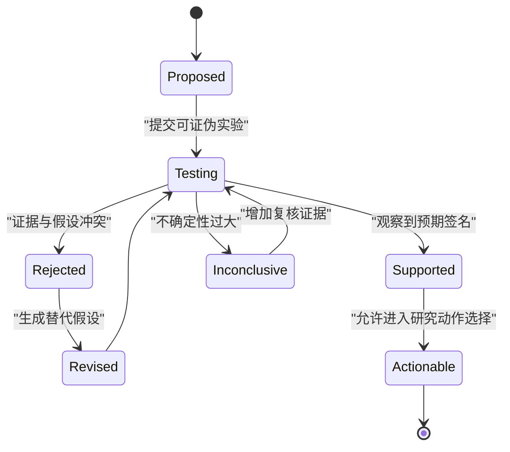

## 7. ResearchAction 统一协议

所有特征、模型、数据、复核和停止行为都使用同一种结构。

```yaml
action_id: action_0107
parent_action_id: action_0099
endpoint: half_life_obach
axis: data
hypothesis: >
  Independent FDA clinical-pharmacology records improve coverage of
  long-half-life compounds without importing the benchmark source.
expected_effect:
  primary_metric_delta: 0.03
  subgroup: low_similarity
falsification_condition: >
  Multi-seed validation LCB is non-positive or leave-one-source-out
  performance degrades.
editable_assets:
  - external_evidence/half_life_obach.csv
budget:
  max_rows: 500
  max_trials: 1
  max_minutes: 60
provenance:
  source: FDA clinical pharmacology records
  citation: required
  license: required
```

每个 action 必须回答：

1. 改什么？
2. 为什么改？
3. 哪些证据支持它？
4. 什么结果会否定它？
5. 允许修改哪些资源？
6. 成本上限是多少？
7. 如何判断成功、失败或证据不足？

## 8. 五类研究动作

### 8.1 Feature Action

优先使用声明式特征，而不是开放任意 Python 编辑。

```yaml
axis: feature
endpoint: herg
feature_type: smarts_alert_set
features:
  - name: lipophilic_basic_amine
    smarts: "..."
  - name: benzhydryl
    smarts: "..."
evidence:
  citation: required
```

受控编译器负责：

- SMARTS 语法检查；
- 计算复杂度限制；
- 常量特征检测；
- NaN/Inf 检查；
- 标签和 split 信息隔离；
- 特征产物哈希。

### 8.2 Model Action

允许的模型动作包括：

- 模型族选择；
- 受限超参数；
- target transform；
- metric-aligned loss；
- activity-cliff-aware loss；
- calibration；
- multi-seed ensemble；
- 2D/3D/多模态组合。

模型动作不能修改：

- 数据划分；
- 主评价指标；
- held-out test loader；
- 最终 evaluator；
- freeze manifest。

### 8.3 Data Action

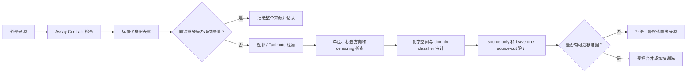

数据轴的 `AssayContract` 至少记录：

- source、publication、license；
- species；
- assay protocol；
- measurement unit；
- label direction；
- classification threshold；
- censoring；
- experimental year/laboratory；
- 与目标 endpoint 的兼容性判断。

### 8.4 Replicate Action

当主要风险是验证方差时，最有价值的下一步不是提出新模型，而是复核：

- 新 validation seeds；
- bootstrap；
- OOF；
- 重复训练；
- candidate rank stability；
- ensemble variance decomposition。

### 8.5 Stop / Abstain Action

系统必须允许以下结论：

- 没有研究动作超过最小效应阈值；
- endpoint 已基线饱和；
- 当前样本不足以区分候选；
- 分子超出适用域；
- 外部数据 assay 不匹配；
- 应请求新实验，而不是继续搜索模型。

## 9. Axis Isolation 和安全边界

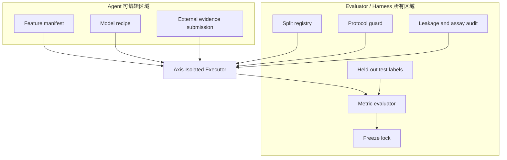

执行规则：

1. 每个 trial 只开放一个 axis；
2. trial 前恢复所有非目标文件；
3. trial 前后比较冻结资源哈希；
4. 发生修改、删除或旁路即判为 tampered；
5. evaluator、metric、split 和 test 永远不进入可写区；
6. 外部数据只能通过受控工具进入训练。

## 10. Action Router

### 10.1 目标函数

Router 不只最大化当前验证分数。

\[
U(a)=
\mathbb{E}[\Delta_a]
-\lambda_{\sigma}\sigma_a
-\lambda_c C_a
-\lambda_d D_a
-\lambda_h P(\text{harm}\mid a)
\]

其中：

- \(\mathbb{E}[\Delta_a]\)：动作的预期收益；
- \(\sigma_a\)：收益不确定性；
- \(C_a\)：训练、API、GPU 和数据获取成本；
- \(D_a\)：数据或化学空间偏移风险；
- \(P(\text{harm}\mid a)\)：动作导致 endpoint 退化的概率。

### 10.2 Router 决策顺序

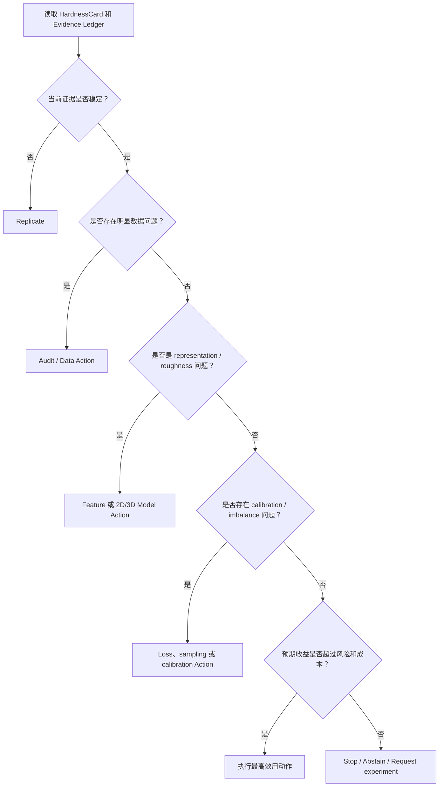

## 11. Evidence Ledger

Evidence Ledger 是研究过程的单一事实来源，不只保存赢家。

建议的数据实体：

```text
endpoints
hardness_profiles
problem_hypotheses
research_actions
runs
predictions
external_sources
data_audits
snapshots
freeze_manifests
certification_results
claims
```

每次运行至少记录：

- parent action 和谱系深度；
- hypothesis；
- 完整配置；
- validation seed；
- raw metric 和 normalized improvement；
- validation predictions；
- subgroup metrics；
- wall time、GPU time 和 API 成本；
- failure/crash/tamper 原因；
- artifact SHA-256；
- 是否被保留以及为什么。

失败实验不能删除，因为它们是后续 Agent 避免重复无效研究的证据。

## 12. 三层评价隔离

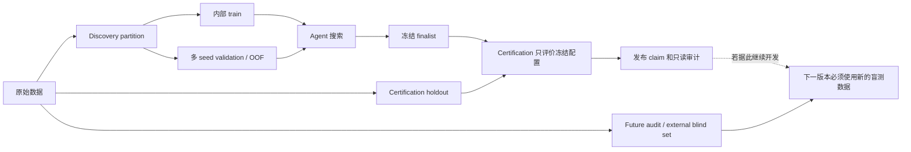

### 12.1 Discovery

允许重复访问，但必须使用：

- 多 validation seeds；
- OOF 或 nested CV；
- candidate rank stability；
- LCB；
- 最小效应阈值；
- trial budget。

### 12.2 Certification

- Agent 永远不读取标签；
- 配置 freeze 后才可运行；
- 不能根据结果替换 finalist；
- 不能回灌进 Agent memory；
- 报告 raw metric、增益、置信区间和 subgroup 结果。

### 12.3 Future audit

一旦人类根据 certification 结果修改系统，同一个 certification set 就不再是下一版的独立证据。下一版本需要：

- 新 outer split；
- temporal/source split；
- 外部独立数据；
- 社区 blind challenge；
- 或新生成的实验数据。

## 13. 如何证明 Agent 本身有效

不能只用最终 leaderboard 分数证明 Agent 有效。需要四类独立证据。

| Claim | 必要对照 | 主要指标 |
|---|---|---|
| 预测效果好 | 强固定基线、公开 SOTA | held-out raw metric、win/tie/loss |
| 改进可靠 | validation 与独立 test 配对 | transfer ratio、generalization gap、sign reversal |
| Agent 有增量贡献 | 随机、规则、Optuna/FLAML、matched cost | regret、gain/trial、gain/GPU-hour |
| 能自主发现问题 | Hidden Fault Benchmark | diagnosis precision/recall、修复成功率、harm rate |

### 13.1 建议的对照组

1. Strong fixed MapLight；
2. FLAML/Optuna；
3. Maximum-entropy random action policy；
4. Fixed action schedule；
5. Rule-based ADMET-EvO；
6. 当前 LLM ADMET-EvO；
7. Auto-Research-Molprop；
8. Hardness-aware Research Agent。

所有比较需要匹配：

- split；
- baseline；
- trial 数；
- wall-clock 或 compute；
- LLM/API 预算；
- 可用动作空间；
- 外部数据权限；
- seed。

## 14. Hidden Fault Benchmark

### 14.1 隐藏故障类型

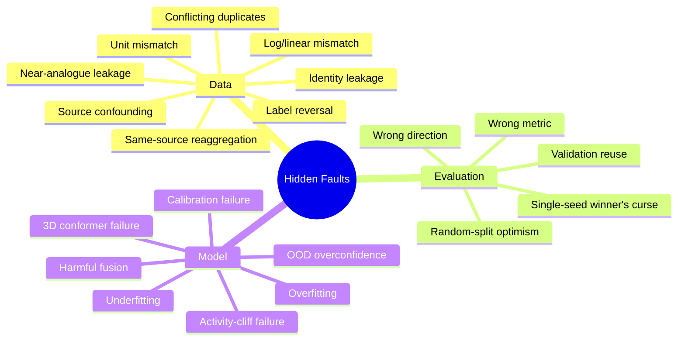

### 14.2 Agent 输出

Agent 不知道故障标签，只能看到 train/validation 证据，并需要输出：

1. 是否存在异常；
2. 推测的根因；
3. 支持证据；
4. 置信度；
5. 可证伪实验；
6. 修复动作；
7. 预期结果；
8. 替代假设。

### 14.3 评分

| 能力 | 指标 |
|---|---|
| 异常发现 | precision、recall、F1 |
| 根因定位 | exact/partial accuracy |
| 置信度质量 | calibration error、Brier score |
| 假设质量 | falsifiability 和证据充分性 |
| 修复效果 | 独立 held-out improvement |
| 安全性 | harmful intervention rate |
| 效率 | 诊断所需 trial、时间和成本 |

## 15. 实施阶段

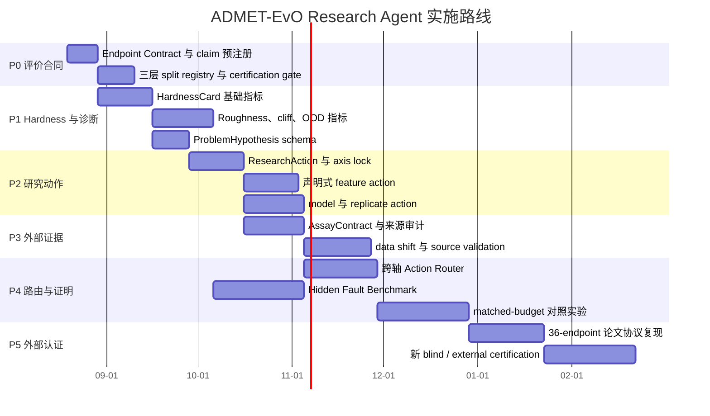

时间只是建议顺序，不是未经资源评估的承诺。

## 16. 现有模块到新模块的映射

| 现有模块 | 保留能力 | 建议新增或扩展 |
|---|---|---|
| `profiling.py` | 数据画像 | `HardnessCard`、roughness、cliff、OOD、学习曲线 |
| `schemas.py` | ExperimentSpec、RunResult | EndpointContract、ProblemHypothesis、ResearchAction |
| `guard.py` | 注册模型和参数防火墙 | axis 权限、feature/data schema、assay contract |
| `brain.py` | 规则候选生成 | 诊断优先、可证伪假设和动作建议 |
| `openai_brain.py` | 结构化 LLM planner | 分离 Diagnostician 和 Action Planner |
| `evidence_router.py` | LCB 与成本惩罚 | 跨轴效用、shift risk、harm risk、replicate/stop |
| `experiment_db.py` / `action_memory.py` | 运行和跨任务记忆 | transport eligibility 防火墙；只有前瞻随机/complete-grid、同预算同协议且覆盖充分的证据可影响路由 |
| `transport_protocol.py` | 5-endpoint × 3-action 前瞻运输协议 | shared-control 去重、global/category 分层 prior、全 inconclusive 保持 neutral；破坏性剪枝另需独立 confirmation certificate |
| `runner.py` | 搜索、multi-seed、freeze、finalize | axis-isolated executor、action lifecycle |
| `frozen_executor.py` | 冻结 recipe 执行 | certification-only 权限和 subgroup audit |
| `features.py` | 注册表示和缓存 | 声明式特征编译器和 feature provenance |

## 17. 最小可交付版本

第一版不需要一次实现所有能力。最小闭环应包含：

1. `EndpointContract`；
2. 包含 scarcity、imbalance、shift、seed variance 和 saturation 的 `HardnessCard`；
3. `ProblemHypothesis`；
4. feature、model、replicate、stop 四类 `ResearchAction`；
5. axis lock；
6. Evidence Ledger；
7. matched-cost random policy 对照；
8. 5–8 种隐藏故障；
9. frozen held-out certification。

完成这九项后，系统才形成最小意义上的研究闭环：

```text
识别困难
→ 提出根因
→ 设计可证伪实验
→ 选择受控动作
→ 记录完整证据
→ 冻结候选
→ 独立认证
→ 判断 Agent 是否真正增加价值
```

## 18. 最终验收标准

建议只有同时满足以下条件，才宣称系统升级成功：

- 官方 test 在搜索和路由阶段零访问；
- 非目标研究轴零未授权修改；
- 所有 finalist 均有 freeze hash；
- 所有外部数据均有 provenance 和 assay audit；
- 所有主结果提供 raw metric、normalized gain 和不确定性；
- validation-positive/test-negative 的比例显著降低；
- Agent 在 matched-cost 下优于随机或固定策略；
- Hidden Fault Benchmark 的问题发现和根因定位显著优于规则基线；
- Agent 能正确选择 `replicate`、`stop` 或 `abstain`，而不是永远提出更复杂模型；
- 失败实验和阴性结果完整保留在 Evidence Ledger；
- 人工查看 certification 结果后，下一版本使用新的独立盲测证据。

## 19. 一句话定位

> ADMET-EvO Research Agent 是一个 hardness-aware、problem-diagnosing、protocol-safe 的闭环研究系统：它先判断 endpoint 为什么难，再选择特征、模型、数据、复核或停止动作，并通过独立盲测区分真实发现与验证集幻觉。
