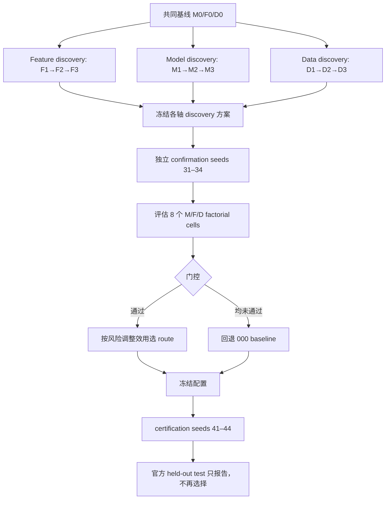
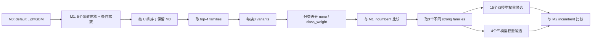
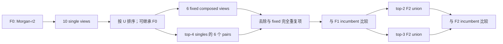

# ADMET-EvO：Model / Feature 候选池、选择路线与门控（three-axis ablation v2）

> 审计日期：2026-09-03  
> 范围：当前根项目；不纳入嵌套副本或个人分支目录。  
> 目标：说明“有哪些 Model/Feature 被当作候选、候选怎样逐级生成与筛选、哪些门控决定晋级/回退、最终怎样冻结和认证”。

## 1. 版本口径与一句话结论

本文的主体是 `all22-three-axis-agent-ablation-v2`，因为它是当前仓库中 **Feature/Model 两条轴已经完成 discovery、independent confirmation 和 certification 的最新完整证据链**。协议 JSON 的 `sha256` 字段以及三阶段 artifacts 的 `protocol_sha256` 一致记录为：

```text
2d49342fefdfe83be520dde5cea16c9e8c67aafd4e779d1932aab7aad99097dc
```

需要同时区分两件事：

- **v2.7 frozen mapping**：正式 22-task 预测产品，回答最终上线/评测执行哪套模型；
- **three-axis ablation v2**：Model、Feature、Data 三个因素的候选生成、逐级选择、交互路由与独立认证实验，回答模型和特征是怎样被系统选择的。

后续 three-axis v3 虽已有 22 个 discovery 输出，但尚未形成完整 confirmation、certification 和 final 产物，因此不能替代本文的 v2 完整证据。

一句话概括这套路线：

> 以 `LightGBM + Morgan r=2 + official-only data` 为共同基线，Feature 轴按 F0→F1→F2→F3 从单视图扩展到复合视图与互补并集，Model 轴按 M0→M1→M2→M3 从默认模型族扩展到端点级调参、类别不平衡处理和跨模型融合；discovery 负责提出方案，独立 confirmation 用风险调整效用与正向 seed 门控选择八种 M/F/D 组合中的最终 route，certification 只评估冻结 route，不再调参。

## 2. 总体流程



三阶段使用完全分离的 seeds：

| 阶段 | seeds | 可以做什么 | 不可以做什么 |
|---|---:|---|---|
| Discovery | 21, 22, 23, 24 | 生成候选、选择 F1/F2/F3 与 M1/M2/M3、提出 factorial route | 不得加载 hidden-test label |
| Confirmation | 31, 32, 33, 34 | 复跑 discovery 已冻结的轴配置；对 8 个 cells 做最终 route 选择 | 不重新打开大候选池；不得用 test label |
| Certification | 41, 42, 43, 44 | 对 confirmation 冻结的 route 重新拟合并报告 official held-out test | 不得再选模型、特征、权重或 route |

权威协议见 [`reports/all22_three_axis_ablation_v2/protocol.json`](reports/all22_three_axis_ablation_v2/protocol.json)。22/22 个 certification 均已完成，见 [`all22_three_axis_ablation_v2_results.audit.json`](reports/all22_three_axis_ablation_v2/all22_three_axis_ablation_v2_results.audit.json)。

---

## 3. 门控系统：候选为什么能晋级，为什么会回退

### 3.1 Gate 0：协议与哈希门

在运行前冻结：

- 任务列表；
- baseline；
- F/M/D 三轴定义；
- discovery、confirmation、certification seeds；
- 候选 family、feature views、fusion weights；
- risk adjustment、threshold、positive-seed fraction、tie-break；
- 实现文件 SHA-256；
- `test_labels_loaded=false`。

协议摘要绑定后，后续产物都携带 `protocol_sha256`。Confirmation 保存 discovery artifact hash；Certification 同时保存 discovery 和 confirmation hash，防止阶段之间暗改配置。

### 3.2 Gate 1：候选合法性与适用性门

在开始比较分数前先过滤不合法候选：

- Balanced ExtraTrees 仅允许分类；
- `class_weight` 仅允许分类；
- RBF-SVM 只在 `n_train ≤ 5000` 时加入候选池；
- 模型必须支持任务类型，依赖必须可用；
- 超参数必须属于该模型允许的 schema；
- Feature 必须来自注册表；
- 至少需要一个合法表征；
- 无效 SMILES、非有限特征和缓存一致性按统一特征层规则处理。

这个门控先缩小无效搜索空间，也避免把某个任务上不可执行的候选带入后续统计比较。

### 3.3 Gate 2：Discovery 的 variance-penalized no-regret 选择

Discovery 对每个候选保留逐 seed 分数、相对 baseline 的归一化增益、均值、sample SD、positive-seed fraction 和风险调整效用。

轴内选择的核心规则是：

```text
当前层 candidates + 上一层 incumbent
    ↓
按风险调整效用比较
    ↓
优者晋级；否则继承 incumbent
```

具体继承关系：

```text
F2 ← F1 incumbent
F3 ← F2 incumbent
M2 ← M1 incumbent
M3 ← M2 incumbent
```

`no_regret` 指的是**在 discovery 选择证据上不强迫更复杂层覆盖更好的简单层**，不是承诺未来 confirmation 或 certification 一定不出现负值。分布漂移和有限 seed 方差仍可能造成后续结果回退。

Feature 轴的实际继承结果：

- F2：3/22 任务继承 F1；
- F3 的 `source_arm`：3/22 仍来自 F1，8/22 来自 F2，11/22 选择 `F3_union_top3`；
- 其中有 2 个 top-3 union 在 block 集合上与 F2 相同，因此按最终结构归类时为 F1 3 个、F2 10 个、真正新增 F3 9 个。

Model 轴的最终结构归类为：M1 1 个、M2 4 个、真正 M3 fusion 17 个。

### 3.4 Gate 3：独立 Confirmation 门

Discovery 的赢家不是最终答案。Confirmation 做两件事：

1. 不再搜索完整 F/M 候选池，只把 discovery 冻结的 F1/F2/F3、M1/M2/M3、D1/D2/D3 在新 seeds 31–34 上复跑；
2. 用冻结的 on-level `M3/F3/D3` 构造 8 个 factorial route cells。

bit 顺序固定为 `[Model, Feature, Data]`：

| Cell | 实际含义 |
|---|---|
| `000` | M0 + F0 + D0，共同基线 |
| `100` | 只开启 M3；F0 + D0 |
| `010` | 只开启 F3；M0 + D0 |
| `001` | 只开启 D3；M0 + F0 |
| `110` | M3 + F3；D0 |
| `101` | M3 + D3；F0 |
| `011` | F3 + D3；M0 |
| `111` | M3 + F3 + D3 |

非基线 cell 必须同时通过：

\[
U_{risk}=\bar g-0.5SE(g)\ge 0.005
\]

和：

\[
positive\ seed\ fraction\ge0.75
\]

四个 confirmation seeds 下，后一个条件等价于至少 3/4 seeds 相对基线改善。artifact 将规则写为：

```text
positive_seed_gate_then_mean_minus_0.5_standard_error
```

`000` 始终保留为安全 fallback，即使它的 gain 和 positive fraction 都是 0。

对于通过门控且被视为等价的 cells，按“低复杂度优先，再按字典序”选择。协议未公开等价容差的独立数值字段，所以最终判断应以 confirmation artifact 的 `selected_cell` 为准，而不是在文档外自行重算并覆盖。

这点在 `CYP2D6_Veith` 上尤其直观：`110` 的风险调整效用为 `0.0840207`，略高于 `010` 的 `0.0834626`，但最终仍选择更简单的 `010`。这说明 route 不是机械地取浮点数最大值；由于 artifact 未暴露独立的“等价容差”数值，本文只报告协议给出的复杂度优先 tie-break 和产物中的最终选择，不反推一个不存在于证据中的容差。

### 3.5 Gate 4：Factorial 交互门

八个 cells 的意义不仅是选最高分，更是防止把独立主效应简单相加：

- `100` 对应纯 Model intervention；
- `010` 对应纯 Feature intervention；
- `110` 直接测量 Model 与 Feature 同时开启；
- 如果 `M3` 和 `F3` 单独都好，但组合后误差高度相关或过拟合，`110` 不会自动晋级；
- 如果某个轴单独不够稳定，却在组合中产生互补作用，组合 cell 可以通过门控；
- Data bit 同理，但本文不展开其候选细节。

最终 22 个任务的 route 分布是：

| Selected cell | 任务数 | 含义 |
|---|---:|---|
| `001` | 1 | 仅 Data |
| `010` | 8 | 仅 Feature |
| `011` | 2 | Feature + Data |
| `100` | 2 | 仅 Model |
| `110` | 9 | Model + Feature |
| `000/101/111` | 0 | 未成为任何端点的最终 route |

因此最终 routed 方案中：

- Feature intervention 被实际开启于 19/22 tasks；
- Model intervention 被实际开启于 11/22 tasks；
- 是否启用某个轴，由 confirmation 组合门控决定，而不是只看该轴 discovery 的赢家。

### 3.6 Gate 5：Certification 与 test firewall

Certification 的职责是“评估已经冻结的答案”，而不是“再找一个更好的答案”。安全字段记录：

- `configuration_frozen_from_confirmation=true`；
- `test_labels_loaded_only_after_frozen_confirmation=true`；
- `test_results_used_for_selection=false`；
- test 结构列可供 firewall 检查，但标签在冻结前不可见；
- Data curation/weighting 的 `heldout_labels_used=false`；
- 用 seeds 41–44 报告 mean 和 sample SD。

三阶段 artifact 数量均为 22，且 discovery/confirmation/certification 的 seeds 两两不相交。审计还发现 11/22 tasks 的 discovery provisional cell 在 confirmation 后发生改变，这正说明独立 confirmation 不是形式步骤。

### 3.7 一个具体门控例子：AMES

AMES 的 confirmation 中，`110` cell：

```text
mean normalized gain = 0.0258433
sample SD            = 0.0179713
SE                   = 0.0179713 / sqrt(4) = 0.0089857
risk-adjusted U      = 0.0258433 - 0.5 × 0.0089857
                     = 0.0213505
positive fraction    = 1.0
```

因为 `0.0213505 ≥ 0.005` 且 4/4 seeds 改善，`110` 通过门控并成为最终 route。Certification 随后只复现这条已冻结路线。

---

## 4. Model 候选池与 M0→M3 选择路线

### 4.1 M0：共同模型基线

M0 固定为 default LightGBM，输入固定为 Morgan r=2，数据固定为 official-only。当前模型构建器中的主要默认值为：

```text
n_estimators=600
num_leaves=31
learning_rate=0.04
subsample=0.85
subsample_freq=1
colsample_bytree=0.7
min_child_samples=15
reg_lambda=2.0
imbalance=none
```

分类 objective 为 `binary`；MAE 回归使用 `regression_l1`，其他回归使用 `regression`。

### 4.2 M1：默认模型族候选

M1 比较模型族，不做端点级超参数搜索。候选和准入门如下：

| 模型族 | 默认配置摘要 | 分类 | 回归 | 额外准入门 |
|---|---|---:|---:|---|
| LightGBM | 600 trees, 31 leaves, lr .04 | ✓ | ✓ | 无 |
| XGBoost | 600 trees, depth 6, lr .05, subsample .85, colsample .7 | ✓ | ✓ | 无 |
| ExtraTrees | 400 trees, min leaf 2 | ✓ | ✓ | 无 |
| Random Forest | 400 trees, min leaf 2 | ✓ | ✓ | 无 |
| CatBoost | 600 iterations, depth 8, lr .05 | ✓ | ✓ | 无 |
| Balanced ExtraTrees | 300 trees × 7 members，majority undersampling | ✓ | ✗ | 仅 classification |
| RBF-SVM | C 10, gamma scale；分类含 3-fold calibration | ✓ | ✓ | 仅当 `n_train ≤ 5000` |

M1 全部使用 `imbalance=none`。因此每个 task、每个 seed 的候选数取决于任务类型和训练规模：

| 情形 | M1 候选数 / seed |
|---|---:|
| classification 且 `n_train ≤ 5000` | 7 |
| classification 且 `n_train > 5000` | 6，去掉 SVM |
| regression 且 `n_train ≤ 5000` | 6，去掉 Balanced ExtraTrees |
| regression 且 `n_train > 5000` | 5，去掉 Balanced ExtraTrees 与 SVM |

M1 在 discovery seeds 上计算每个默认 family 的风险调整效用，选出本层 incumbent，同时形成进入 M2 的 top-family 排名。

候选边界也需要说清：这个 v2 protocol 的 Model 候选全集就是上表 7 个 family（其中 2 个带条件准入），不包含 GNN、Transformer、3D 等深度模型，也不把仓库中其他实验分支出现过的模型自动并入本次审计。

### 4.3 M2：只调 M1 排名前四的模型族

M2 不会对全部模型无限搜索。每个 endpoint 只取 M1 风险调整排名最高的 **4 个 family**，每族评估 **3 个预注册 parameter variants**。

分类任务的普通模型，每个 variant 同时尝试：

```text
imbalance = none
imbalance = class_weight
```

回归任务只允许 `none`。Balanced ExtraTrees 已经通过内部多数类欠采样实现平衡，不再叠加外部 `class_weight`。

#### Boosting variants

| Family | v0 | v1 | v2 |
|---|---|---|---|
| LightGBM | `n=800, leaves=31, depth=7, lr=.035, child=12, subsample=.9, colsample=.7, λ=3` | `n=1000, leaves=15, depth=5, lr=.025, child=20, subsample=.8, colsample=.8, α=.1, λ=5` | `n=600, leaves=63, depth=9, lr=.05, child=25, subsample=.75, colsample=.6, α=.5, λ=8` |
| XGBoost | `n=800, depth=4, lr=.035, min_child=2, subsample=.9, colsample=.6, λ=3` | `n=1000, depth=3, lr=.025, min_child=4, subsample=.8, colsample=.8, α=.1, λ=5` | `n=600, depth=7, lr=.05, min_child=6, subsample=.75, colsample=.5, α=.5, λ=8` |
| CatBoost | `iterations=900, depth=6, lr=.04, l2_leaf_reg=5` | `iterations=1200, depth=5, lr=.025, l2_leaf_reg=8` | `iterations=700, depth=8, lr=.05, random_strength=1.5` |

#### Tree and kernel variants

| Family | v0 | v1 | v2 |
|---|---|---|---|
| ExtraTrees | `n=700, leaf=1, max_features=.5`；分类 gini，回归 squared_error | `n=800, leaf=3, max_features=sqrt`；分类 entropy，回归 absolute_error | `n=600, leaf=2, max_features=.8`；分类 log_loss，回归 squared_error |
| Random Forest | 与 ExtraTrees 的 v0 网格相同 | 与 ExtraTrees 的 v1 网格相同 | 与 ExtraTrees 的 v2 网格相同 |
| Balanced ExtraTrees | `n=300, members=9, majority_ratio=1, leaf=1, max_features=.5, gini` | `n=300, members=7, majority_ratio=2, leaf=2, max_features=sqrt, entropy` | `n=400, members=5, majority_ratio=3, leaf=3, max_features=.8, log_loss` |
| RBF-SVM | 分类 `C=3, gamma=scale`；回归另设 `epsilon=.1` | 分类 `C=10, gamma=.001`；回归另设 `epsilon=.05` | 分类 `C=30, gamma=1e-4`；回归另设 `epsilon=.2` |

各模型的 `class_weight` 最终由统一 builder 映射到相应实现：

- ExtraTrees：`class_weight=balanced`；
- Random Forest：`class_weight=balanced_subsample`；
- LightGBM：`class_weight=balanced`；
- XGBoost：按训练标签计算 `scale_pos_weight = negatives / positives`；
- CatBoost：`auto_class_weights=Balanced`；
- SVM：`class_weight=balanced`。

M2 搜索规模为：

| 情形 | 配置数 / seed | 4 个 discovery seeds 的 rows |
|---|---:|---:|
| 回归：4 families × 3 variants | 12 | 48 |
| 分类且 top-4 不含 BalancedET：4 × 3 × 2 imbalance | 24 | 96 |
| 分类且 top-4 含 BalancedET | `3×3×2 + 1×3` = 21 | 84 |

选择 M2 时，M1 incumbent 同时保留。如果全部 tuned variants 都不如 M1 的风险调整结果，M2 直接继承 M1。

### 4.4 M3：受限的二/三模型预测融合

M3 先从 M2 证据中为不同 family 确定强配置，再选 3 个不同 family 构造融合候选。它不允许同一 family 以不同参数重复占多个 ensemble 成员。

对于 3 个 family \(A,B,C\)：

1. 两两组合为 `AB`、`AC`、`BC`；
2. 每个 pair 对首成员扫描 5 个权重：`0.20, 0.35, 0.50, 0.65, 0.80`，另一成员权重为 `1-w`；
3. 三成员组合扫描 4 套权重：
   - `(1/3, 1/3, 1/3)`；
   - `(0.50, 0.25, 0.25)`；
   - `(0.25, 0.50, 0.25)`；
   - `(0.25, 0.25, 0.50)`。

所以每个 task、每个 seed 的 M3 新候选数固定为：

\[
{3 \choose 2}\times 5 + 4 = 19
\]

四个 discovery seeds 共 `19 × 4 = 76 rows/task`。

融合语义为：

- 分类：各成员正类概率加权平均；
- 回归：各成员 raw prediction 加权平均；
- artifact 统一写为 `aggregation="probability_or_raw"`。

M2 incumbent 仍参与 M3 选择。如果 fusion 没有更高的风险调整结果，就继承单模型 M2。

### 4.5 Model 轴的完整候选流



### 4.6 预处理随模型走，而不是随 Feature 轴统一处理

- LightGBM、XGBoost、ExtraTrees、Random Forest、Balanced ExtraTrees、CatBoost 直接接收数值特征；
- RBF-SVM 使用 `StandardScaler`；
- 分类 SVM 再经 3-fold `CalibratedClassifierCV` 生成概率；
- Feature 轴本身没有统一的全局标准化、PCA 或全局特征选择；
- 类别不平衡处理是 M2 的模型候选维度，不是 Feature preprocessing 的固定步骤。

---

## 5. Feature 候选池与 F0→F3 选择路线

### 5.1 F0：共同特征基线

F0 固定为：

```text
Morgan radius=2, bit fingerprint, 2048 dimensions
```

选择 F0 的作用不是宣称 Morgan 必然最好，而是提供一个计算便宜、适用于全部任务、定义稳定的共同参照点。

### 5.2 F1：10 个单视图候选

F1 一次只改变一个 representation block，候选全集如下：

| 顺序 | 候选名 | 表征含义 | 配置 | 当前宽度 |
|---:|---|---|---|---:|
| 0 | `morgan` | 二进制圆形局部环境 | radius 2 | 2048 |
| 1 | `morgan_r3` | 更大感受野的二进制圆形环境 | radius 3 | 2048 |
| 2 | `morgan_count` | 保留子结构出现次数 | radius 2 | 2048 |
| 3 | `avalon` | 子结构模式 | Avalon bit FP | 1024 |
| 4 | `erg` | reduced graph / pharmacophore topology | ErG | 315 |
| 5 | `rdkit2d` | 连续理化、拓扑与片段描述符 | runtime list | 当前环境 217 |
| 6 | `maccs` | 预定义结构键 | MACCS | 167 |
| 7 | `rdkit_fp` | path-based topology | RDKit path FP | 2048 |
| 8 | `atom_pair` | 原子类型与拓扑距离 | hashed atom-pair | 2048 |
| 9 | `torsion` | 四原子拓扑扭转模式 | hashed torsion | 2048 |

对每个 endpoint：

1. 使用固定 default LightGBM；
2. 每个单视图在 discovery seeds 21–24 上分别训练；
3. 相对 F0 计算四个 paired normalized oriented gains；
4. 用 `U = mean - 0.5SE` 排序；
5. F0 incumbent 仍可保留，避免为了“升级”而强制换特征；
6. 记录最终 F1 的 `config`、`source_arm`、均值、sample SD、positive-seed fraction 和 prediction hash。

每个 task 的 F1 搜索规模为 `10 candidates × 4 seeds = 40 rows`。

候选边界同样由 protocol 冻结：即使当前 `features.py` 注册表还包含 `unimol2`、`minimol` 等后来加入的表征，它们也没有出现在 three-axis ablation v2 的 `single_views` 或 `composed_views` 中，因此不能写成这次 F0→F3 搜索的候选。

### 5.3 F2：固定复合视图 + 数据驱动 pairwise 视图

F2 有两部分候选。

第一部分是 6 个预注册固定组合：

| 固定组合 | blocks | 当前环境总宽度 |
|---|---|---:|
| F2-fixed-0 | Morgan + RDKit2D | 2265 |
| F2-fixed-1 | Morgan + Avalon + ErG + RDKit2D（Rich-2D） | 3604 |
| F2-fixed-2 | Morgan-count + atom-pair + MACCS + RDKit2D | 4480 |
| F2-fixed-3 | Morgan + RDKit-FP + torsion + RDKit2D | 6361 |
| F2-fixed-4 | Morgan-r3 + RDKit2D | 2265 |
| F2-fixed-5 | Avalon + ErG + RDKit2D | 1556 |

第二部分是端点自适应组合：

1. 按 F1 的风险调整效用取 top-4 单视图；
2. 对 top-4 做全部两两组合；
3. 理论上生成 \({4 \choose 2}=6\) 个 pairwise candidates；
4. 如果某个 pair 与 6 个 fixed views 完全相同，则在 F2 候选层去重。

所以 F2 通常有：

```text
6 fixed compositions + 6 top-single pairs = 12 candidates / task / seed
```

已观察到的去重例外是 `CYP2D6_Veith`：动态产生的 `morgan + rdkit2d` 与 fixed-0 重合，所以实际为 11 个 F2 arms，而其余任务为 12 个。

选择时将 F1 incumbent 与全部 F2 challenger 一起按风险调整效用比较。若复合视图没有提供更可靠的增益，就直接继承 F1，而不是强制增加维度。实际 22 个任务中，F2 有 3 个任务继承 F1。

### 5.4 F3：top-2 / top-3 互补复合视图并集

F3 不再穷举任意 feature subset，而是利用 F2 已经获得的端点证据：

1. 按风险调整效用对 F2 复合候选排序；
2. 取 top-2 F2 recipes，生成 `F3_union_top2`；
3. 取 top-3 F2 recipes，生成 `F3_union_top3`；
4. union 内按首次出现顺序保留 block，同名 block 只保留一次；
5. 将这两个 challenger 与 F2 incumbent 一起比较；
6. 若 union 不占优，则继承 F2，甚至继续体现更早的 F1 结果。

例如，若 top-3 为：

```text
[atom_pair, maccs]
[atom_pair, morgan_count]
[morgan, avalon, erg, rdkit2d]
```

则 union 为：

```text
[atom_pair, maccs, morgan_count, morgan, avalon, erg, rdkit2d]
```

F3 每个 task 每个 seed 只新增 2 个候选，因此为 `2 × 4 = 8 rows`。

一个实现细节需要如实说明：union 内部会去掉重复 block，但若 `top2` 与 `top3` 最终产生完全相同的 union，artifact 仍可能把它们作为两个候选重复评估。也就是说，F3 做了**块级去重**，但未完全做**等价候选级去重**。

### 5.5 Feature 轴的完整候选流



### 5.6 Feature 计算、缓存与安全边界

所有普通 feature blocks 由 [`admet_agent/features.py`](admet_agent/features.py) 生成：

- 按 recipe 指定顺序直接 concatenate；
- 输出为 `float32`；
- 单个 RDKit descriptor 抛异常时置 0；
- 拼接后 `NaN/+Inf/-Inf → 0`；
- 无效 SMILES 回填同宽全零向量；
- `FeatureCache` 不含标签，键包含 feature schema、RDKit 版本、SMILES 字符串集合及 block 顺序；
- 缓存使用临时文件 + 原子替换写入；
- 缓存的 `sorted(set(smiles))` 是字符串级去重，不等于 canonical chemical identity 去重。

`rdkit2d` 在 registry 中是动态宽度 `-1`；固定复现环境 `rdkit==2026.3.5` 下为 217 维。换 RDKit 版本时不能继续假定列数和 descriptor 清单完全相同。

---

## 6. 为了做因果归因，哪些变量被锁住

Model 和 Feature 不能同时自由变化，否则无法判断收益来自哪里。因此两个单轴搜索采用不同的锁定策略：

| 实验轴 | 被改变的变量 | 被锁定的变量 |
|---|---|---|
| Feature F0→F3 | representation / feature blocks | default LightGBM、official-only data、同一 split、同一 endpoint metric |
| Model M0→M3 | model family、超参数、imbalance、prediction fusion | Morgan r=2 bit、official-only data、同一 split、同一 endpoint metric |

共同基线 `000` 为：

```text
Model   = default LightGBM
Feature = Morgan radius-2 bit fingerprint
Data    = official-only, leakage-safe
Imbalance override = none
Hyperparameter override = {}
```

所以：

- F 轴测到的是“换特征、模型不变”的效应；
- M 轴测到的是“换模型、特征不变”的效应；
- 最终 factorial cells 再检验 Model×Feature 以及它们与 Data 的交互；
- 不能把单独最好的 F3 和单独最好的 M3 的收益直接相加，当作组合后的收益。

---

## 7. 候选怎样计分

### 7.1 方向统一后的归一化增益

每个候选都和同 seed 的共同基线配对比较。先把指标方向统一为“越大越好”：

\[
\Delta_s^{\mathrm{oriented}}=
\begin{cases}
S_{candidate,s}-S_{baseline,s}, & \text{AUROC/AUPRC/Spearman}\\
S_{baseline,s}-S_{candidate,s}, & \text{MAE}
\end{cases}
\]

再按基线绝对值归一化：

\[
\Delta_{norm,s}=\frac{\Delta_s^{\mathrm{oriented}}}
{|S_{baseline,s}|}
\]

这样分类、排序回归和误差回归可以使用同一个“正数为改善”的选择口径。

### 7.2 风险调整效用

对四个配对 seeds 计算：

\[
\bar{\Delta}_{norm}=\frac{1}{4}\sum_{s=1}^{4}\Delta_{norm,s}
\]

\[
SE=\frac{SD(\Delta_{norm})}{\sqrt{4}}
\]

\[
U=\bar{\Delta}_{norm}-0.5\times SE
\]

`U` 是 variance-penalized utility：平均增益相近时，跨 seed 波动更小的候选更占优。

同时记录：

```text
positive_seed_fraction
= count(Δnorm,s > 0) / 4
```

### 7.3 两类门控不能混为一谈

候选筛选有两个层次：

1. **Discovery 轴内选择**：按风险调整效用比较候选，同时把上一层 incumbent 放回候选集合，执行 no-regret inheritance。实际 artifacts 中存在 `positive_seed_fraction < 0.75` 或 `U < 0.005` 仍成为 F3/M3 轴端配置的例子，因此不能把 `0.005/0.75` 误写成每个 discovery 候选的统一硬门槛。
2. **Confirmation route 硬门控**：对非基线 factorial cell，要求风险调整效用达到 practical threshold `0.005`，且至少 75% seeds 为正，即 4 个 seeds 至少 3 个改善；只有通过的 cell 才能参与最终 route 竞争。`000` 被保留为强制安全回退。

同分时协议规定：

```text
lower complexity first → lexicographic order
```

协议没有在 JSON 中公开一个可独立复算的连续 complexity 公式，因此准确说法是“复杂度用于 tie-break”，不应自行解释成 FLOPs、参数量或训练时间惩罚。

---

## 8. 22 个任务的 F3/M3 轴端配置与最终 route

这一节同时列出三个不同层次，避免把它们混为一谈：

1. **F3 on-level**：Feature 轴走到终点后冻结的配置；可能由 F3 新 union 得到，也可能因 no-regret 继承 F2/F1。
2. **M3 on-level**：Model 轴走到终点后冻结的配置；可能是真正的 M3 fusion，也可能继承 M2/M1 单模型。
3. **Confirmation route**：最终实际打开哪些轴。bit 顺序是 `[Model, Feature, Data]`，某一位为 0 时，对应 on-level 配置虽然完成了 discovery，但不进入最终 routed 配置。

模型缩写如下：

| 缩写 | 含义 |
|---|---|
| `LGB / XGB / ET / RF / CB / BET / SVM` | LightGBM / XGBoost / ExtraTrees / Random Forest / CatBoost / Balanced ExtraTrees / RBF-SVM |
| `d` | builder default；具体默认值见 4.1–4.2 |
| `v0 / v1 / v2` | 4.3 中对应 family 的预注册参数 variant |
| `n / cw` | `imbalance=none / class_weight` |
| `A+B @ .x/.y` | A、B 按所列顺序以 `.x/.y` 加权；分类融合概率，回归融合 raw prediction |

下表中的 `U` 和“正向 seeds”均来自 **independent confirmation validation**，不是 certification test 分数。

| Task | Discovery 的 F3 on-level（来源：blocks） | Discovery 的 M3 on-level（来源：recipe） | Confirmation 最终选择 |
|---|---|---|---|
| `AMES` | `F3_union_top3`: `atom_pair+maccs+morgan_count+morgan+avalon+erg+rdkit2d` | `M3`: `ET-d(n)+CB-v2(n) @ .80/.20` | `110`; U=`0.02135`; 4/4 正向 |
| `BBB_Martins` | `F3_union_top3`: `morgan+rdkit_fp+torsion+rdkit2d+morgan_count+maccs` | `M2` 继承: `ET-v1(cw)` | `110`; U=`0.05647`; 4/4 正向 |
| `Bioavailability_Ma` | `F3_union_top3`: `morgan+rdkit_fp+torsion+rdkit2d+avalon+maccs` | `M3`: `SVM-v2(cw)+CB-v1(cw) @ .80/.20` | `110`; U=`0.17528`; 4/4 正向 |
| `CYP2C9_Substrate_CarbonMangels` | `F1_single_9` 继承: `torsion` | `M2` 继承: `XGB-v2(n)` | `010`; U=`0.21842`; 4/4 正向 |
| `CYP2C9_Veith` | `F2_composed_2` 继承: `morgan_count+atom_pair+maccs+rdkit2d` | `M3`: `LGB-d(n)+CB-v0(n) @ .50/.50` | `010`; U=`0.03562`; 4/4 正向 |
| `CYP2D6_Substrate_CarbonMangels` | `F2_composed_3` 继承: `morgan+rdkit_fp+torsion+rdkit2d` | `M2` 继承: `RF-v1(cw)` | `110`; U=`0.17332`; 3/4 正向 |
| `CYP2D6_Veith` | `F3_union_top3`: `morgan+avalon+erg+rdkit2d+morgan_r3+morgan_count` | `M3`: `LGB-v2(n)+CB-v2(cw) @ .65/.35` | `010`; U=`0.08346`; 4/4 正向 |
| `CYP3A4_Substrate_CarbonMangels` | `F1_single_9` 继承: `torsion` | `M3`: `RF-v1(n)+CB-v1(cw) @ .80/.20` | `110`; U=`0.11748`; 3/4 正向 |
| `CYP3A4_Veith` | `F3_union_top3`: `morgan+rdkit_fp+torsion+rdkit2d+morgan_count+atom_pair+maccs` | `M3`: `LGB-d(n)+CB-v0(n) @ .65/.35` | `010`; U=`0.04396`; 4/4 正向 |
| `Caco2_Wang` | `F1_single_5` 继承: `rdkit2d` | `M3`: `XGB-v0(n)+RF-v0(n) @ .80/.20` | `010`; U=`0.07113`; 3/4 正向 |
| `Clearance_Hepatocyte_AZ` | `F3_union_top3`: `morgan_r3+erg+morgan+rdkit_fp+torsion+rdkit2d+avalon` | `M3`: `LGB-d(n)+RF-v0(n) @ .35/.65` | `010`; U=`0.29902`; 3/4 正向 |
| `Clearance_Microsome_AZ` | `F3_union_top3`: `morgan_r3+morgan+atom_pair+morgan_count` | `M3`: `XGB-v2(n)+LGB-v2(n)+RF-v1(n) @ .25/.25/.50` | `100`; U=`0.07489`; 3/4 正向 |
| `DILI` | `F3_union_top3`: `morgan_count+torsion+maccs` | `M3`: `ET-d(n)+RF-v1(n) @ .80/.20` | `011`; U=`0.07407`; 4/4 正向 |
| `HIA_Hou` | `F2_composed_9` 继承: `erg+morgan_count` | `M3`: `CB-v0(cw)+BET-v1(n)+LGB-v0(cw) @ .25/.50/.25` | `110`; U=`0.25393`; 3/4 正向 |
| `Half_Life_Obach` | `F2_composed_6` 继承: `erg+rdkit_fp` | `M2` 继承: `ET-v2(n)` | `001`; U=`4.82961`; 3/4 正向 |
| `LD50_Zhu` | `F2_composed_1` 继承: `morgan+avalon+erg+rdkit2d` | `M3`: `XGB-v2(n)+LGB-d(n)+RF-v0(n) @ .333/.333/.333` | `110`; U=`0.07906`; 4/4 正向 |
| `Lipophilicity_AstraZeneca` | `F3_union_top3`: `morgan+avalon+erg+rdkit2d` | `M1` 继承: `LGB-d(n)` | `010`; U=`0.23598`; 4/4 正向 |
| `PPBR_AZ` | `F2_composed_6` 继承: `rdkit2d+morgan_count` | `M3`: `LGB-v2(n)+XGB-v2(n) @ .80/.20` | `011`; U=`0.06737`; 4/4 正向 |
| `Pgp_Broccatelli` | `F2_composed_11` 继承: `rdkit2d+rdkit_fp` | `M3`: `ET-d(n)+SVM-v1(n) @ .65/.35` | `100`; U=`0.01498`; 4/4 正向 |
| `Solubility_AqSolDB` | `F3_union_top3`: `morgan+avalon+erg+rdkit2d` | `M3`: `LGB-v2(n)+XGB-v2(n)+CB-v2(n) @ .50/.25/.25` | `110`; U=`0.38547`; 4/4 正向 |
| `VDss_Lombardo` | `F2_composed_10` 继承: `avalon+maccs` | `M3`: `RF-v1(n)+CB-v2(n) @ .80/.20` | `110`; U=`0.81723`; 4/4 正向 |
| `hERG` | `F3_union_top3`: `atom_pair+erg+avalon` | `M3`: `XGB-v1(cw)+ET-d(n) @ .35/.65` | `010`; U=`0.06002`; 4/4 正向 |

因此，读取这张表时要应用 route bit：

- `110`：实际采用表中的 M3 on-level + F3 on-level，Data 保持 D0；
- `010`：实际采用 M0 + 表中的 F3 on-level + D0，表中的 M3 只是一条已评估但最终关闭的候选轴；
- `100`：实际采用表中的 M3 on-level + F0 + D0，表中的 F3 最终关闭；
- `011`：实际采用 M0 + 表中的 F3 on-level + D3；
- `001`：实际采用 M0 + F0 + D3，表中的 M3/F3 均未进入最终 route。

## 9. 汇总结果说明了什么

### 9.1 no-regret 确实发生了，而不是每层强制升级

Discovery 终点的来源分布为：

| 轴终点 | 实际来源 |
|---|---|
| F3 on-level | 3 个继承 F1，8 个继承 F2，11 个来自 `F3_union_top3` |
| F3 的结构口径 | 上述 11 个中有 2 个 union 与 F2 blocks 完全相同；因此真正新增 F3 结构为 9 个 |
| M3 on-level | 1 个继承 M1，4 个继承 M2，17 个是真正的 M3 fusion |

Confirmation 再次收缩方案：最终只有 11/22 tasks 打开 Model bit，19/22 tasks 打开 Feature bit。这证明“轴内最好配置”和“跨轴组合后值得启用”是两层不同决策。

### 9.2 Certification 上的轴级结果

下表是 22-task certification artifact 中相对共同 baseline 的 normalized delta 汇总；W/T/L 也是 artifact 对同一认证结果给出的胜/平/负计数，并非 discovery 阶段的晋级次数。

| 轴级配置 | 平均 normalized delta | task 间 sample SD | W / T / L |
|---|---:|---:|---:|
| F1 | 0.07357 | 0.15311 | 16 / 1 / 5 |
| F2 | 0.09999 | 0.14996 | 19 / 0 / 3 |
| F3 | 0.10383 | 0.16285 | 18 / 0 / 4 |
| M1 | 0.04256 | 0.15200 | 10 / 11 / 1 |
| M2 | 0.06006 | 0.17553 | 13 / 4 / 5 |
| M3 | 0.07215 | 0.17930 | 16 / 1 / 5 |

最终 routed 配置的跨任务平均 normalized delta 为 `0.15864`，task 间 sample SD 为 `0.31633`。Factorial 汇总中的 Feature main effect 为 `0.11723`，Model main effect 为 `0.07195`，Model×Feature interaction 为 `0.02177`。

这些数值的正确解释是：在这 22 个端点和这套归一化口径下，Feature 轴的平均贡献更大，Model 轴也有增益，M×F 交互总体为正；它们不是统计显著性声明，也不能替代逐任务 route。Discovery 的 no-regret 只约束开发选择，不能保证新 seeds 和 held-out test 上每个任务都不出现负增益。

## 10. 审计边界与需要保留的限制

1. **本文不是 v2.7 production mapping 清单。** 它解释 three-axis ablation v2 的候选与选择机制；不能据此宣称已经改写 v2.7 的正式 22-task 生产映射。
2. **v3 目前不能替代 v2。** 截至审计日，v3 有 22 份 completed discovery JSON，但 confirmation 和 certification 均为 0；v2 则是 22/22/22 三阶段齐全。
3. **F3 的等价候选没有完全去重。** union 内会去重 block，但 `top2` 与 `top3` 得到相同最终 block 集时仍可能重复评估；`CYP2D6_Veith` 存在这一实例。
4. **“complexity-aware”只能按协议口径陈述。** protocol 给出 `lower_complexity_then_lexicographic`，但 artifacts 没有候选级连续 complexity 数值，也没有公开等价容差；不能把它扩写成某个 FLOPs、参数量或训练时长惩罚公式。
5. **部分 driver 源文件不可读。** v2 的初始化、主运行和汇总脚本当前权限为 owner-only；本文对候选、逐 seed 结果、配置冻结和 hash chain 的判断来自 protocol 与完整 artifacts，精确 builder 默认值和特征行为来自可读的 `selection.py` 与 `features.py`。对未暴露的 tie-break 实现细节保留 source-level verification gap。
6. **归一化比值在基线接近 0 时会放大。** 例如 `Half_Life_Obach` 的 Spearman baseline 在某些 confirmation seeds 接近 0，因此 selected-cell 的 `U=4.82961` 不应与常规 AUROC 任务按绝对大小机械比较。
7. **RDKit2D 宽度与环境绑定。** 本环境 `rdkit==2026.3.5` 时为 217 维；跨 RDKit 版本复现时应以 descriptor 清单和缓存 schema 为准，而不是硬编码 217。

## 11. 证据索引

| 证据 | 用途 |
|---|---|
| [`reports/all22_three_axis_ablation_v2/protocol.json`](reports/all22_three_axis_ablation_v2/protocol.json) | baseline、候选全集、seeds、阈值、tie-break、test firewall 与协议 hash |
| [`reports/all22_three_axis_ablation_v2/discovery/AMES.json`](reports/all22_three_axis_ablation_v2/discovery/AMES.json) | 一个完整的 F1/F2/F3、M1/M2/M3 行级候选与 selected 示例；其余任务同目录同结构 |
| [`reports/all22_three_axis_ablation_v2/confirmation/AMES.json`](reports/all22_three_axis_ablation_v2/confirmation/AMES.json) | 八个 factorial cells、`passed`、风险效用、positive fraction 与 selected cell 示例 |
| [`reports/all22_three_axis_ablation_v2/certification/AMES.json`](reports/all22_three_axis_ablation_v2/certification/AMES.json) | 配置冻结、test label 加载时点、test 不参与选择与最终复跑示例 |
| [`reports/all22_three_axis_ablation_v2/all22_three_axis_ablation_v2_results.audit.json`](reports/all22_three_axis_ablation_v2/all22_three_axis_ablation_v2_results.audit.json) | 22-task 完整性、轴级汇总、factorial effects、route 分布 |
| [`reports/all22_three_axis_ablation_v2/all22_three_axis_ablation_v2_results.csv`](reports/all22_three_axis_ablation_v2/all22_three_axis_ablation_v2_results.csv) | 每个 task 的 selected M3/F3/D3、route 与 certification 数值 |
| [`reports/all22_three_axis_ablation_v2/all22_three_axis_ablation_v2_results.xlsx`](reports/all22_three_axis_ablation_v2/all22_three_axis_ablation_v2_results.xlsx) | 与 CSV 对应的工作簿版本 |
| [`admet_agent/selection.py`](admet_agent/selection.py) | 模型 builder 默认值、imbalance 映射、SVM scaling/calibration 和预测接口 |
| [`admet_agent/features.py`](admet_agent/features.py) | feature block 生成、拼接、异常值处理与 label-free cache 行为 |
| [`reports/all22_three_axis_ablation_v3/protocol.json`](reports/all22_three_axis_ablation_v3/protocol.json) | v3 的后续协议边界；当前仅用于解释为什么它尚不能替代完整 v2 |

最终可复核链条是：

```text
protocol + protocol SHA-256
    → discovery/{task}.json：候选池、逐 seed 分数、F3/M3 on-level
    → confirmation/{task}.json：独立 seeds、八 cells、硬门控、selected route
    → certification/{task}.json：冻结 route、独立模型 seeds、held-out test 报告
    → results.csv / results.xlsx / results.audit.json：22-task 聚合
```
