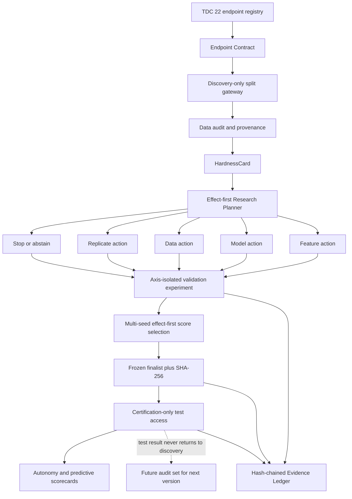

# ADMET-EvO v3：22 个 TDC endpoint 专用研究 Agent

## 1. 本次实现边界

v3 只面向 TDC ADMET Group 的固定 22 个 endpoint，不把 MoleculeNet、Polaris 或任意新数据集混入主结论。系统的默认目标是“效果优先且证据可靠”：研究动作路由中预期效果权重默认为 `0.80`；候选先经过多 seed 复核，再按平均验证效果选择。既有 22-task held-out replay 显示 LCB 和 cost-aware LCB 没有优于 mean-score selection，因此 `score` 是默认策略，计算成本只有显式选择 `cost-aware-lcb` 时才进入最终效用。

这次实现增加了五个可执行层：

1. `EndpointContract`：固定 22 个 endpoint 的任务、指标、方向、标签语义、assay/source family 和 split 所有权。
2. `HardnessCard`：从 discovery train/validation 计算 scarcity、imbalance、domain shift、local roughness/activity cliffs、data quality、split leakage risk。
3. `ResearchAction`：把诊断转换为 feature、model、data、replicate、stop 五类单轴、可证伪动作。
4. `EvidenceLedger`：用 SHA-256 哈希链记录研究计划、每次实验和冻结认证事件。
5. `ADMET Autonomy Benchmark`：除论文的 feature/model/data 三轴外，评价预测提升、验证到测试迁移、故障发现、因果归因、实验效率、稳定性、可复现性、协议安全、数据治理、假设纪律、受证据支持的新颖性以及停止/拒答能力。

## 2. 可执行闭环



## 3. 数据获得与清洗

`MolecularDataCurator` 支持四种显式数据策略：

| 策略 | 行为 | 适用场景 |
|---|---|---|
| `official` | 不改变 TDC 行，只生成审计 | 强基线和协议复现 |
| `canonical_deduplicate` | 标准化结构并按 canonical SMILES 去重 | 研究重复记录影响 |
| `quality_filtered` | 额外移除无效结构、缺失/非有限标签和分类冲突结构 | 数据质量动作 |
| `leakage_safe` | 在上述基础上移除与 validation 完全相同的训练结构 | 发现 split overlap 时 |

外部数据必须携带 `SourceManifest`，至少声明 endpoint、来源、许可、获取时间、引用、assay、species、单位和 label transform。数据进入系统后先被清洗并放入 quarantine；在 assay/单位对齐实验完成前不会自动并入 TDC 训练数据。这样 Agent 具备获取、整理和清洗能力，同时不会把“同名 endpoint”误当成“同一测量过程”。

示例：

```bash
admet-agent curate-external \
  --task Caco2_Wang \
  --table external/caco2.csv \
  --manifest external/caco2.manifest.json \
  --smiles-col smiles \
  --target-col papp \
  --output-dir data/quarantine/caco2
```

## 4. Discovery 与冻结测试

只做诊断、不训练模型：

```bash
admet-agent diagnose \
  --task AMES \
  --seed 1 \
  --data-dir data \
  --run-dir runs/v3-diagnosis
```

该命令只调用 TDC 的 train/validation split API，不调用会物化 test frame 的 `group.get()`。输出包括：

```text
runs/v3-diagnosis/tasks/AMES/
└── diagnosis_seed_1.json
```

效果优先搜索：

```bash
admet-agent search \
  --task AMES \
  --rounds 3 \
  --validation-seeds 1,2,3,4,5 \
  --robust-top-k 6 \
  --selection-policy score \
  --effect-priority 0.80 \
  --run-dir runs/v3-ames-search
```

搜索目录会新增：

```text
tasks/AMES/
├── endpoint_contract.json
├── profile_seed_1.json
├── hardness_seed_1.json
├── research_plan_seed_1.json
├── search_seed_1.json
└── finalist_seed_1.json
evidence_ledger.jsonl
action_outcomes.jsonl
```

当前执行协议不再把“提出了一个合理动作”计为科研成功。被路由的 feature/model/data 动作必须自动保留 matched control，并在相同 validation seeds 上配对比较；只有平均定向增益超过预注册的 `0.005` native-metric 阈值才记为 `supported`，反向超过阈值记为 `refuted`，其余均为 `inconclusive`。`search_seed_*.json` 中的 `action_evidence` 给出 treatment/control run id、逐 seed delta、均值、标准差及单轴校验状态。

`action_outcomes.jsonl` 是 discovery-only 的追加式结果记忆。相同 endpoint 的重复运行只保留最新结果用于统计，避免伪重复；同 ADMET 类别中的历史 supported/refuted/inconclusive 结果通过 Beta(2,2) 收缩校准下一次动作效用，因此单次失败不会粗暴翻转规则，重复失败则会逐步降低动作优先级。

汇总 validation 搜索而不接触 test：

```bash
admet-agent summarize-search \
  --run-dir runs/v3-search \
  --output-json reports/v3_search.json \
  --output-markdown reports/v3_search.md
```

`finalize` 的顺序是：规范化 finalist → 写入不可变 freeze SHA-256 → 才加载 test → 从头训练 → TDC evaluator。测试结果不会被传回 search planner。任何 finalist 变化必须使用新的 freeze；论文主结论还应预先规定“一版一次认证”，下一版使用 future audit set，避免跨目录的人为 test 反馈。

完整 22-task certification 还必须先通过全局冻结审计；CLI 对 `finalize --all` 强制要求该授权文件：

```bash
admet-agent audit-freeze \
  --run-dir runs/v3-agent-tdc22 \
  --protocol runs/v3-policy-benchmark-v2/protocol.json \
  --output-audit reports/v3_freeze_authorization.json \
  --output-finalists reports/v3_finalists.json

admet-agent finalize --all \
  --finalists reports/v3_finalists.json \
  --freeze-audit reports/v3_freeze_authorization.json \
  --seeds 1,2,3,4,5 \
  --run-dir runs/v3-certification
```

审计会拒绝：少于 22 个 task、少于 5 个 discovery seeds、缺失单轴动作证据、失败实验/未解决 planner error、过大的 validation standard error、损坏的 evidence ledger、已存在 test 结果、协议或 finalist 哈希不匹配。审计失败时 test 保持锁定。

## 5. 自主科研能力的标准化评价

```bash
admet-agent benchmark-agent \
  examples/autonomy_episode.example.json \
  --output reports/autonomy_scorecard.json
```

总分采用 endpoint macro aggregation，并同时施加两道边界：

- `coverage`：没有覆盖全部 22 个 endpoint 时按 `sqrt(coverage)` 降权。
- `protocol_safety`：一旦存在 test feedback 或协议违规，总分封顶 `0.25`。

只有 22 个 endpoint 都具有冻结 test 结果、没有 test feedback、没有协议违规时，claim level 才能成为 `full_22_task_frozen_test_certification`。只有 validation 的完整 22-task 实验会明确标记为 `full_22_task_validation_evidence_only`。

必须使用相同预算比较以下 controls：

1. 随机动作策略。
2. 固定规则策略。
3. 相同搜索空间的传统 AutoML。
4. 每 endpoint 的强固定模型。
5. 去掉跨任务记忆的 Agent。
6. 去掉 Hardness 诊断的 Agent。
7. 去掉数据动作的 Agent。
8. 仅作为非部署上界的 retrospective oracle。

前四个主 controls 已有可执行 brain，可以在同一组 `--rounds`、`--validation-seeds` 和 `--robust-top-k` 参数下运行：

```bash
# 完整 agent
admet-agent search --all --brain agent \
  --benchmark-protocol runs/v3-policy-benchmark-v2/protocol.json \
  --rounds 2 --validation-seeds 1,2,3,4,5 \
  --run-dir runs/policy-agent

# 同预算随机动作、固定规则、传统 AutoML
admet-agent search --all --brain random-control --policy-seed 20260819 \
  --benchmark-protocol runs/v3-policy-benchmark-v2/protocol.json \
  --rounds 2 --validation-seeds 1,2,3,4,5 --run-dir runs/policy-random
admet-agent search --all --brain fixed-rules-control \
  --benchmark-protocol runs/v3-policy-benchmark-v2/protocol.json \
  --rounds 2 --validation-seeds 1,2,3,4,5 --run-dir runs/policy-rules
admet-agent search --all --brain automl-control \
  --benchmark-protocol runs/v3-policy-benchmark-v2/protocol.json \
  --rounds 2 --validation-seeds 1,2,3,4,5 --run-dir runs/policy-automl

# 非自适应强固定参考
admet-agent search --all --brain strong-fixed-control \
  --benchmark-protocol runs/v3-policy-benchmark-v2/protocol.json \
  --rounds 1 --validation-seeds 1,2,3,4,5 --run-dir runs/policy-fixed
```

随机策略使用 task name 和 `--policy-seed` 的稳定哈希，运行顺序不会改变抽样；AutoML 固定数据与 representation，只搜索 model/hyperparameter；固定规则 control 可读取 Hardness 阈值，但不读取研究计划、历史动作结果或跨任务记忆。这些约束防止把更大的搜索空间误称为“更聪明的 agent”。

`--benchmark-protocol` 会在运行前验证 SHA-256、arm、task、discovery seeds、selection policy 和候选预算，并把协议哈希写入 environment manifest 与每个 task summary。缺少该绑定的旧 pilot 只能作为开发证据，不能进入正式 policy comparison。

## 6. 什么结果才能证明 Agent 很好

不能只报告 22 个测试分数的平均值。最低证据包应同时满足：

- 预测效果：相对强固定模型和同预算 AutoML 的 endpoint-level paired improvement，并给 bootstrap confidence interval。
- 决策效果：Agent 选择的下一动作优于同预算随机/规则策略，报告 action regret 和 success@budget。
- 迁移效果：validation 改善能够保持到一次性 frozen test，报告 optimism gap。
- 自主诊断：在 Hidden Fault Benchmark 中检测 label conflict、unit mismatch、duplicate leakage、imbalance、OOD、cliff、错误 metric direction、伪外部数据等故障，报告 precision/recall/F1 和 false-alarm cost。
- 科学性：每个动作在执行前有 hypothesis、falsification test 和最小有效提升阈值；失败结果同样进入 ledger。
- 安全性：test feedback events 必须为 0，外部来源 manifest 完整率必须为 100%。

v3 代码提供了这些证据的结构和评分器，但“效果已经提高”的结论必须等 22-task 同预算实验真正跑完后才能成立。

开发阶段可运行确定性的 fault-injection integration suite：

```bash
admet-agent run-hidden-fault-suite \
  --data-dir data \
  --output reports/v3_hidden_fault_suite.json
```

它覆盖 clean negative control、无效结构/标签、冲突标签、split overlap、错误 metric direction、缺失 provenance、species/assay/unit mismatch。该套件只能证明检测链路按设计工作，不能替代由另一方封存标签和注入逻辑的独立 blind challenge；报告会明确写入 `claim_scope=deterministic_integration_fixture_not_independent_blind_evaluation`。
