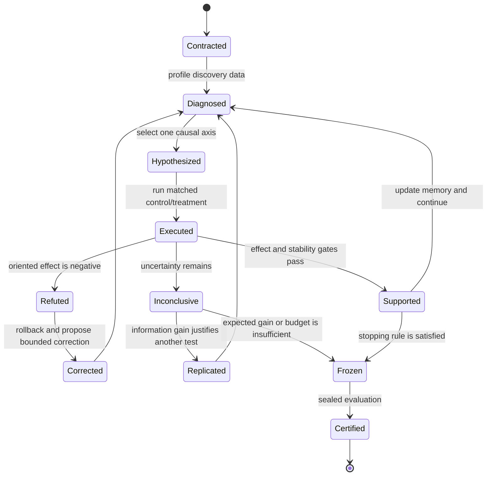
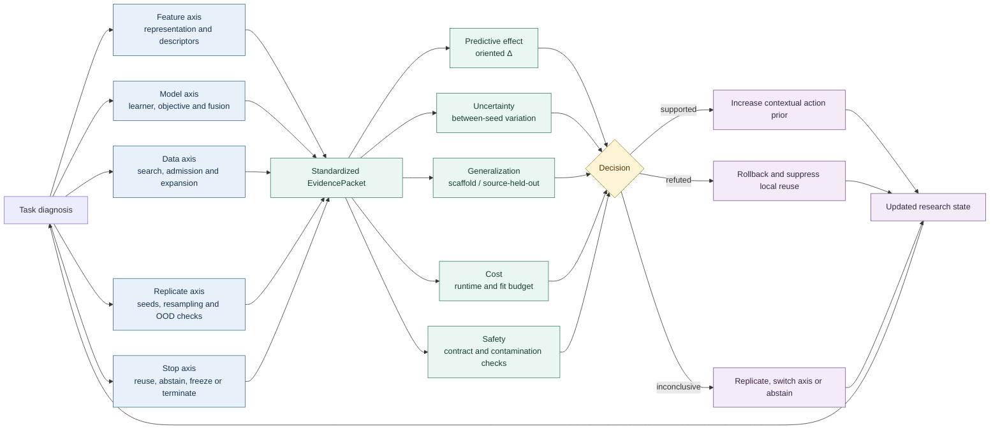
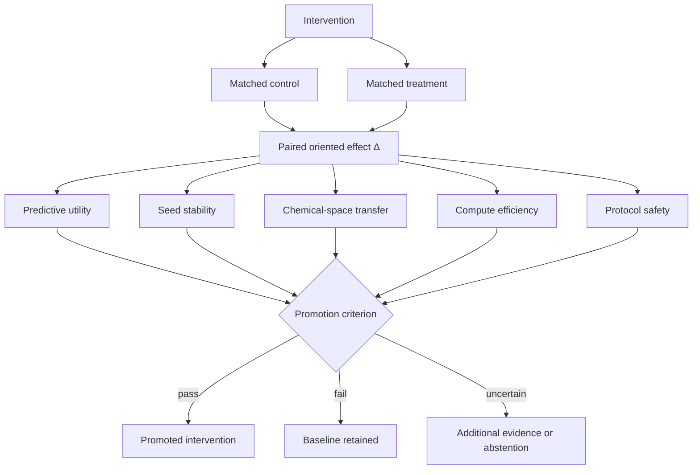

# ADMET-EvO architecture and workflow diagrams

This file contains manuscript-ready Markdown/Mermaid source for the two main conceptual figures. The figures deliberately foreground ADMET-EvO as an autonomous, closed-loop research system; benchmark performance is treated as downstream evidence rather than the organizing principle.

## Figure 1 | Architecture of an autonomous, closed-loop ADMET research agent

### Figure 1a | System architecture

```mermaid
flowchart LR
    Q[Scientific question] --> C[EndpointContract<br/>endpoint · assay · label · metric · split]
    C --> R[Research state<br/>HardnessCard · faults · memory · budget]
    R --> P[Hypothesis planner<br/>diagnose → propose → prioritize]

    P --> A{Action router}
    A --> F[Feature action]
    A --> M[Model action]
    A --> D[Data action]
    A --> X[Replicate action]
    A --> S[Stop / abstain action]

    F --> E[Matched experiment executor]
    M --> E
    D --> E
    X --> E

    E --> V[Evidence packet<br/>effect · uncertainty · stability · cost · safety]
    V --> J{Evidence gate}
    J -->|supported| U[Promote candidate]
    J -->|refuted| B[Rollback and revise]
    J -->|inconclusive| N[Replicate or change axis]

    U --> L[Hash-chained evidence ledger<br/>and action memory]
    B --> L
    N --> L
    L --> R

    S --> Z[Content-addressed freeze]
    U -->|stopping criteria met| Z
    Z --> T[Sealed certification executor]
    T --> O[Predictions and audit bundle]

    classDef contract fill:#E8F1FA,stroke:#3B6C91,color:#17324D;
    classDef agent fill:#EAF6F2,stroke:#3B7F6B,color:#173E35;
    classDef action fill:#FFF4D6,stroke:#B1841D,color:#4A380B;
    classDef evidence fill:#F3ECF8,stroke:#79558F,color:#382545;
    classDef freeze fill:#FDEBE7,stroke:#A95A48,color:#4C261E;
    class C,R contract;
    class P,A,L agent;
    class F,M,D,X,S,E action;
    class V,J,U,B,N evidence;
    class Z,T,O freeze;
```

### Figure 1b | Updated task-specific data search, cleaning and expansion module

```mermaid
flowchart TD
    C[EndpointContract] --> Q[Endpoint-specific search plan<br/>synonyms · assay terms · exclusions]
    Q --> S[Source scouting<br/>databases · literature · supplements]
    S --> P[Immutable raw evidence<br/>checksum · license · citation · provenance]
    P --> A[Data-audit-only run<br/>test labels unavailable]

    A --> M[Semantic alignment<br/>endpoint · assay · species · unit · direction]
    M --> C1[Structure standardization<br/>parent · charge · tautomer · canonical identity]
    C1 --> C2[Identity and conflict audit<br/>replicates · duplicates · contradictory labels]
    C2 --> C3[Lineage and overlap audit<br/>source independence · exact overlap]
    C3 --> C4[Chemical-space audit<br/>coverage · target-distribution shift]

    C4 --> G{Score-blind admission gate}
    G -->|endpoint-equivalent<br/>independent and qualified| D[Direct supervised role]
    G -->|related but non-equivalent<br/>bridge criteria satisfied| B[Controlled bridge role]
    G -->|insufficient evidence<br/>or failed checks| R[Fail closed<br/>quarantine / repair / abstain]

    D --> W[Fold-specific contamination firewall]
    B --> W
    W --> W1[Remove exact protected-set identities]
    W1 --> W2[Remove near analogues<br/>Morgan radius 2; Tanimoto ≥ 0.80]
    W2 --> H[Train-relevance estimation]

    H --> T{Task type}
    T -->|classification| K1[Adaptive core set<br/>match class prevalence + scaffold diversity]
    T -->|regression| K2[Adaptive core set<br/>match target quantiles + scaffold diversity]
    K1 --> W3[External sample-mass cap]
    K2 --> W3

    W3 --> R1[Development ratio screen<br/>0.5× · 1× · 2× · 4× · 8×]
    R1 --> R2[Smallest passing ratio<br/>within one standard error of the best]
    R2 --> C5[Locked-ratio confirmation<br/>disjoint seeds]
    C5 --> E{Promotion gate}
    E -->|stable gain| P1[Promote data action]
    E -->|unstable or negative| P2[Retain baseline and update memory]
    P1 --> L[Versioned data bundle + evidence ledger]
    P2 --> L

    classDef source fill:#E8F1FA,stroke:#3B6C91,color:#17324D;
    classDef audit fill:#EAF6F2,stroke:#3B7F6B,color:#173E35;
    classDef gate fill:#FFF4D6,stroke:#B1841D,color:#4A380B;
    classDef reject fill:#FDEBE7,stroke:#A95A48,color:#4C261E;
    classDef model fill:#F3ECF8,stroke:#79558F,color:#382545;
    class C,Q,S,P source;
    class A,M,C1,C2,C3,C4,W,W1,W2,H audit;
    class G,T,E gate;
    class R,P2 reject;
    class D,B,K1,K2,W3,R1,R2,C5,P1,L model;
```

### Figure 1c | One autonomous research episode

## Figure 2 | How interventions along five axes feed evidence back to the research policy

### Figure 2a | Multi-axis intervention-to-evidence map

### Figure 2b | Recommended result-facing summary panel

## Figure captions

**Figure 1 | ADMET-EvO is an autonomous, evidence-gated research system.** **a,** An executable EndpointContract and a multidimensional research state condition the hypothesis planner, which routes feature, model, data, replicate or stop actions to a matched executor. Standardized evidence updates an append-only ledger and contextual memory; a content-addressed freeze separates discovery from sealed certification. **b,** The updated data branch performs endpoint-specific source search, immutable provenance capture, molecular standardization and score-blind admission before any external record can influence model fitting. Qualified records undergo fold-specific exact and near-analogue filtering, relevance- and diversity-aware core-set construction, external-mass control, ratio selection and locked confirmation. **c,** Each episode converts supported, refuted or inconclusive evidence into promotion, correction, replication or stopping.

**Figure 2 | Five intervention axes are evaluated through a common feedback interface.** **a,** Feature, model, data, replicate and stop actions generate EvidencePackets containing predictive effect, uncertainty, generalization, cost and protocol-safety measurements. The resulting decision changes only the contextually matched action memory and thereby conditions the next research state. **b,** Every result-facing comparison is expressed as a matched control–treatment effect and must satisfy predictive, stability, transfer, efficiency and safety criteria before promotion.
