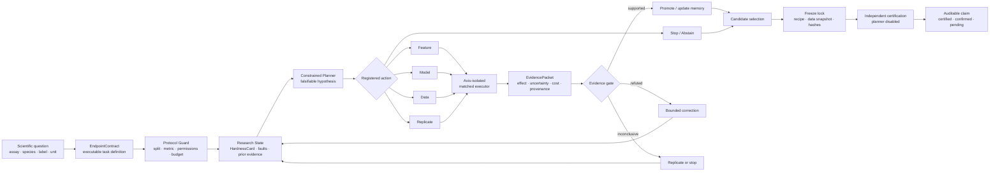

# ADMET-EvO 核心框架与逻辑链条（中英文双语）

## 1. 一句话定义 / One-sentence definition

**English**

ADMET-EvO is an evidence-gated autonomous research agent that transforms an endpoint-level scientific question into a sequence of falsifiable experiments, an endpoint-specific predictive recipe, and a freeze-locked, auditable claim.

**中文**

ADMET-EvO 是一个由证据门控的自主研究 Agent：它把端点层面的科学问题转化为一系列可证伪实验、一个端点特异性的预测配方，以及一项经过冻结且可审计的结论。

这句话应当成为 Methods 的总纲。它强调三个递进层次：

1. Agent 处理的是 **scientific question**，而不只是固定的 `X/y`；
2. Agent 产生的是 **falsifiable experimental lineage**，而不只是一次模型搜索；
3. 系统输出的是 **frozen evidence-backed claim**，而不只是最高验证集分数。

## 2. 核心逻辑链 / Core logic chain

整篇 Methods 只需要不断回答这条链上三个问题：

- 每个节点接收什么输入、产生什么输出？
- 哪个组件有权改变什么，不能改变什么？
- 一项模型变化如何升级为可信的科学证据？

## 3. 为什么它是一个真正的 research agent / What makes it a research agent

“Fancy” 不应写成形容词，而应拆成六项可验证的系统能力。

### 3.1 It formalizes the scientific task before fitting a model  
### 它在建模前先形式化科学问题

普通预测管线通常从给定的 feature matrix、label 和 metric 开始。ADMET-EvO 首先建立 EndpointContract，固定 assay 语义、物种、标签定义、单位、变换、评价指标、分子身份规则、数据分区和外部数据政策。若定义缺失或冲突，系统执行 repair、quarantine 或 abstention，而不是直接训练模型。

**Method-level claim**

> The Agent does not assume that a named dataset already defines a valid prediction task; it first converts endpoint semantics and data ownership into an executable contract.

> Agent 不假定一个有名称的数据集已经构成有效预测任务，而是先把端点语义和数据权限转化为可执行契约。

### 3.2 It diagnoses why an endpoint is difficult  
### 它诊断端点为什么困难

Agent 不把所有低分都解释为“模型不够强”。它从 discovery-only 数据构建 HardnessCard，区分样本稀缺、类别不平衡、化学域漂移、局部构效关系粗糙、数据质量和泄漏风险，并把这些信号与可执行 fault 分开。

**Method-level claim**

> ADMET-EvO represents task difficulty as a structured diagnostic state that conditions the next experiment, rather than as a scalar score used only for retrospective description.

> ADMET-EvO 将任务难度表示为决定下一实验的结构化诊断状态，而不是仅用于事后描述的单一分数。

### 3.3 It chooses scientific interventions, not only models  
### 它选择科研干预，而不只是模型

Agent 的动作空间覆盖 Feature、Model、Data、Replicate 和 Stop/Abstain。每项动作都必须具有因果依据、预期方向、control、treatment、唯一变化轴、seed 计划、成本估计和判定规则。因此 Agent 的基本动作单位是 hypothesis-driven intervention，而不是任意代码修改。

**Method-level claim**

> The planning policy selects among registered, falsifiable interventions that may change representation, learner, admissible evidence, replication depth, or the decision to stop.

> 规划策略从已注册且可证伪的干预中进行选择，这些干预可以改变表征、学习器、获准证据、重复深度，或直接决定停止。

### 3.4 It learns from negative evidence and performs bounded correction  
### 它利用负证据并进行有限纠错

每个实验均产生标准化 EvidencePacket。Supported、refuted、inconclusive、failed 和 stopped 动作全部进入 evidence ledger 和 memory。Refuted 或 inconclusive 结果可以触发与 parent hypothesis 相连的有限纠错，但仅有纠错计划而没有完成实验不计为 self-correction。

**Method-level claim**

> The research state is updated by completed experimental evidence, including failures and negative outcomes, rather than by the planner's narrative alone.

> 研究状态由已经完成的实验性证据更新，其中包括失败和负结果，而不是由 planner 的文字叙述直接更新。

### 3.5 It can acquire data while governing scientific compatibility  
### 它能够主动找数据，同时治理科学兼容性

外部数据模块不仅搜索分子记录，还判断记录是否测量同一科学问题。数据依次经过来源冻结、assay/species/unit/label 对齐、身份标准化、冲突处理、score-blind admission、fold-specific contamination firewall、core-set 构建、sample-mass control 和独立确认。

**Method-level claim**

> External data are treated as candidate scientific evidence whose endpoint compatibility, provenance, contamination risk, and contribution must be established before model training.

> 外部数据被视为候选科学证据；在进入模型训练前，必须确认其端点兼容性、来源、污染风险和有效贡献。

### 3.6 It separates discovery from certification  
### 它把发现与认证隔离

研究闭环结束后，系统冻结完整 recipe、数据快照、依赖、seed 和 hash。独立 executor 只能从冻结对象重建预测产物，不能调用 planner、memory 或 adaptive data module。认证结果只改变 claim status，不能回流修改同一 finalist。

**Method-level claim**

> ADMET-EvO terminates in an immutable predictive product whose certification is evaluator-owned and cannot reopen the discovery loop.

> ADMET-EvO 最终生成不可变的预测产物，其认证由独立 evaluator 管理，并且不能重新开启同一发现闭环。

## 4. 系统的三层架构 / Three-layer architecture

为了让读者快速理解，主文可以把所有实现组件归并为三层，而不是逐个罗列十几个模块。

### Layer I. Scientific task layer / 科学任务层

**Objects**：EndpointContract、partition ownership、source registry、protocol guard。  
**Question**：系统正在研究什么，哪些证据可以合法使用？  
**Failure behavior**：repair、quarantine 或 abstain。

### Layer II. Autonomous research layer / 自主研究层

**Objects**：HardnessCard、fault diagnosis、constrained planner、five-axis action registry、matched executor。  
**Question**：在当前证据和预算下，下一个最有价值且可证伪的动作是什么？  
**Failure behavior**：refute、replicate、bounded correction 或 stop。

### Layer III. Evidence and certification layer / 证据与认证层

**Objects**：EvidencePacket、evidence gate、action memory、hash-chained ledger、candidate selector、freeze lock、certification executor。  
**Question**：观察到的变化是否足以支持 promotion，并且能否在隔离环境中被重建和认证？  
**Failure behavior**：rollback、downgrade claim、pending 或 reject。

这三层之间的边界本身就是系统的重要设计：任务层不能被模型分数静默改写；自主研究层不能访问 sealed labels；认证层不能调用 planner 重新搜索。

## 5. Methods 的推荐主结构 / Recommended Methods structure

Methods 不建议从 benchmark 开始。建议先用四节讲清系统，再写数据、实验和统计。

### 5.1 System overview and design principles  
### 系统总览与设计原则

本节用 2–3 段完成三件事：一句话定义 ADMET-EvO；给出三层架构；概括完整 episode。设计原则可收束为 endpoint specificity、protocol isolation、falsifiability、immutable evidence、bounded autonomy 和 fail-closed certification。

### 5.2 Endpoint formalization and research-state construction  
### 端点形式化与研究状态构建

解释 EndpointContract、partition ownership、HardnessCard 和 research state。重点是 Agent 如何从“数据集名称”上升到“可执行科学任务”。

### 5.3 Constrained research planning and intervention execution  
### 受约束的研究规划与干预执行

解释五类 action、hypothesis schema、单轴 matched experiment、EvidencePacket 和 compute-aware choice。重点是 Agent 如何把判断转化为真实实验。

### 5.4 Evidence-gated learning, correction, and stopping  
### 证据门控的学习、纠错与停止

解释 supported/refuted/inconclusive、negative evidence retention、memory、bounded correction、rollback 和 Stop/Abstain。重点是 Agent 如何从实验后果中改变后续行为。

### 5.5 Autonomous external-evidence acquisition and governance  
### 自主外部证据获取与治理

解释 source discovery、endpoint judge、immutable acquisition、standardization、admission gate、contamination firewall、adaptive weighting 和 confirmation。重点是 Agent 如何扩展研究对象而不破坏协议。

### 5.6 Freeze lock, certification, and claim states  
### 冻结、认证与结论状态

解释 content-addressed recipe、separate executor、blind prediction、ledger 和 claim tiers。重点是系统如何从探索过程产出可信且不可事后修改的结论。

### 5.7 Predictive models and implementation  
### 预测模型与实现

集中交代 representations、learners、optional experts、LLM、tool registry、runtime environment 和 dependency versions。模型库是 Agent 的工具，不应抢占框架主线。

### 5.8 Evaluation design and statistical analysis  
### 评测设计与统计分析

最后说明 TDC-22、prospective CYP、Agent/process controls、baselines、ablation、metrics、seeds、bootstrap、sign-flip、calibration 和 applicability analysis。

## 6. 可直接放在 Methods 开头的双语正文 / Bilingual opening draft

### English

ADMET-EvO was designed as a protocol-constrained autonomous research agent for molecular absorption, distribution, metabolism, excretion, and toxicity prediction. Rather than mapping a fixed feature matrix directly to a score, the system mapped an endpoint-level scientific specification and an admissible evidence set to a research trajectory, a frozen predictive recipe, and an auditable claim. A trajectory comprised endpoint formalization, discovery-only diagnosis, falsifiable hypothesis registration, matched intervention, evidence grading, optional external-evidence acquisition, bounded correction or stopping, and independent certification.

The architecture separated three functional layers. The scientific task layer defined what was being predicted and which evidence could be used through an executable EndpointContract and explicit partition ownership. The autonomous research layer constructed a task-specific research state, diagnosed likely limitations, and selected among registered Feature, Model, Data, Replicate, and Stop/Abstain actions. The evidence and certification layer converted completed experiments into standardized EvidencePackets, retained positive and negative outcomes in an immutable lineage, selected an endpoint-specific recipe, and reconstructed the frozen product in a planner-independent certification environment.

The research loop was represented as

\[
\mathcal{S}_{t}\xrightarrow{\pi}a_t
\xrightarrow{\mathcal{E}}e_t
\xrightarrow{\mathcal{U}}\mathcal{S}_{t+1},
\]

where \(\mathcal{S}_{t}\) denotes the complete research state, \(\pi\) the constrained planning policy, \(a_t\) a registered intervention, \(\mathcal{E}\) the matched experimental executor, \(e_t\) the resulting EvidencePacket, and \(\mathcal{U}\) the evidence-gated state update. The language-model planner could formulate hypotheses and choose among registered actions, but could not alter endpoint semantics, data partitions, metrics, certification rules, or safety gates; access sealed labels; or treat an unexecuted proposal as evidence. The loop terminated when a promotion or stopping criterion was met, no protocol-valid action remained, the expected value of additional evidence was insufficient, or the research budget was exhausted.

### 中文

ADMET-EvO 被设计为一个面向分子吸收、分布、代谢、排泄和毒性预测的受协议约束自主研究 Agent。该系统并非把固定的特征矩阵直接映射为一个预测分数，而是把端点层面的科学定义和获准使用的证据集合转化为一条研究轨迹、一个冻结的预测配方以及一项可审计的结论。一条完整轨迹包括端点形式化、仅限 discovery 数据的诊断、可证伪假设注册、配对干预、证据分级、可选的外部证据获取、有限纠错或停止，以及独立认证。

系统架构分为三个功能层。科学任务层通过可执行的 EndpointContract 和明确的数据分区权限，定义系统正在预测什么以及哪些证据可以使用。自主研究层构建端点特异性的研究状态，诊断可能的限制因素，并从 Feature、Model、Data、Replicate 和 Stop/Abstain 五类注册动作中选择下一步干预。证据与认证层把已经完成的实验转化为标准化 EvidencePacket，在不可变 lineage 中同时保留正结果和负结果，选择端点特异性的预测配方，并在不调用 planner 的独立认证环境中重建冻结产物。

在上述闭环中，\(\mathcal{S}_{t}\) 表示完整研究状态，\(\pi\) 表示受约束的规划策略，\(a_t\) 表示已注册干预，\(\mathcal{E}\) 表示配对实验 executor，\(e_t\) 表示由实验产生的 EvidencePacket，\(\mathcal{U}\) 表示证据门控的状态更新。语言模型 planner 可以提出假设并在已注册动作中进行选择，但不能修改端点语义、数据划分、指标、认证规则或安全门槛，不能读取 sealed labels，也不能把尚未执行的提案当作证据。当达到 promotion 或 stopping criterion、不再存在符合协议的动作、额外证据的预期价值不足或研究预算耗尽时，闭环终止。

## 7. 写作优先级 / Writing priority

正式扩写时建议按以下优先级安排篇幅：

1. **必须讲透**：EndpointContract、research state、five-axis actions、EvidencePacket、correction/stop、external-data governance、freeze/certification。
2. **正文讲清规则**：HardnessCard、candidate ranking、ledger、claim tiers、权限边界。
3. **补充材料展开**：所有 fingerprint 维度、hyperparameter、prompt、schema、阈值表、source dossier 和 artifact map。
4. **最后交代**：benchmark 清单、环境和常规统计细节。

Methods 的阅读体验应当是：读者先理解“Agent 如何研究”，再理解“我们用什么模型实现它”，最后理解“我们怎样验证它”。

