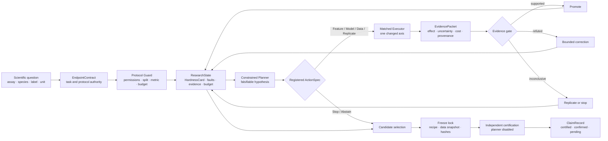

# Methods v2: Evidence-gated autonomous research in ADMET-EvO

> **Use note / 使用说明**  
> This is a bilingual authoring draft. The English paragraphs are written as manuscript-ready main text; the Chinese paragraphs are semantic counterparts for internal revision. Items in square brackets require final experimental metadata. Detailed thresholds, schemas, prompts, and source dossiers should be moved to Supplementary Methods.  
> 这是中英双语写作稿。英文段落按可进入主文的风格撰写，中文段落用于内部核对语义。方括号内容需要在定稿时补充；详细阈值、schema、prompt 和数据来源 dossier 建议放入 Supplementary Methods。

---

## 1. Study objective, unit of analysis, and system boundary  
## 研究目标、分析单位与系统边界

### English

ADMET-EvO was designed as an evidence-gated autonomous research agent for molecular absorption, distribution, metabolism, excretion, and toxicity prediction. Rather than mapping a fixed feature matrix directly to a prediction score, the system transformed an endpoint-level scientific specification and an admissible evidence set into (i) a sequence of falsifiable experiments, (ii) an endpoint-specific predictive recipe, and (iii) a freeze-locked, auditable claim. The unit of analysis was an **endpoint research episode**, beginning with an executable EndpointContract and ending with a FrozenRecipe and a ClaimRecord.

The system boundary separated scientific autonomy from protocol authority. The Agent could diagnose a task, propose and execute registered interventions, acquire admissible external evidence, update its strategy from completed experiments, and decide to replicate, stop, or abstain. It could not redefine endpoint semantics, alter protected data partitions or metrics, access sealed labels during discovery, bypass an evidence gate, or modify a finalist after freezing. Thus, autonomy referred to constrained experimental choice within a prespecified protocol, rather than unrestricted control over the study design.

### 中文

ADMET-EvO 被设计为一个面向分子吸收、分布、代谢、排泄与毒性预测的证据门控自主研究 Agent。系统并非将固定特征矩阵直接映射为一个预测分数，而是把端点层面的科学定义与获准使用的证据集合转化为：（i）一系列可证伪实验；（ii）一个端点特异性的预测配方；以及（iii）一项经过冻结且可审计的结论。基本分析单位为一次 **端点研究 episode**：它始于可执行的 EndpointContract，终于 FrozenRecipe 和 ClaimRecord。

系统边界将科学自主性与协议控制权分离。Agent 可以诊断任务、提出并执行注册干预、获取符合要求的外部证据、根据已完成实验调整策略，并决定重复、停止或弃权；但不能重新定义端点语义，不能修改受保护的数据分区或指标，不能在 discovery 阶段访问 sealed labels，不能绕过证据门，也不能在冻结后修改 finalist。因此，这里的自主性是指在预先规定的协议内自主选择科学实验，而不是对研究设计拥有不受限制的控制权。

## 2. System overview and typed research objects  
## 系统总览与类型化研究对象

### English

The architecture comprised three functional layers. The **scientific task layer** fixed the biological meaning of the endpoint, partition ownership, admissible evidence, metric, and resource constraints. The **autonomous research layer** constructed an endpoint-specific state and selected among registered Feature, Model, Data, Replicate, and Stop/Abstain interventions. The **evidence and certification layer** evaluated completed interventions, maintained an immutable lineage, froze the selected predictive product, and reconstructed it in a planner-independent environment.



**Figure 1 | Protocol-safe research loop in ADMET-EvO.** Rounded process nodes describe mutable discovery operations; EndpointContract and Protocol Guard define protocol authority; EvidencePacket is the only object that can update experimental belief; and certification operates only on a frozen product.

The interfaces among layers were implemented through six typed objects (Table 1). This object separation prevented a natural-language plan from being treated as evidence, a score from silently changing the task definition, or a certification result from reopening discovery.

| Object | Produced by | Consumed by | Mutability and role |
|---|---|---|---|
| **EndpointContract** | protocol initializer and validator | all components | Immutable after validation; defines endpoint semantics, partitions, metric, external-data roles, and budgets |
| **ResearchState** | discovery profiler and evidence updater | planner | Mutable during discovery; contains HardnessCard, faults, prior evidence, uncertainty, resources, and admissible actions |
| **ActionSpec** | constrained planner | protocol guard and executor | Immutable per attempt; specifies hypothesis, control, treatment, changed axis, seeds, cost, and verdict rule |
| **EvidencePacket** | evaluator from completed run artifacts | evidence gate, memory, ledger | Append-only; records native score, oriented effect, uncertainty, cost, provenance, audit status, and verdict |
| **FrozenRecipe** | candidate selector and freeze service | certification executor | Content-addressed and immutable; serializes the complete endpoint-specific predictive product |
| **ClaimRecord** | certification evaluator | reporting layer | Append-only; links the claim tier to frozen artifacts and certification evidence |

### 中文

系统由三个功能层组成。**科学任务层**固定端点的生物学含义、数据分区权限、可用证据、评价指标和资源约束。**自主研究层**构建端点特异性的研究状态，并从 Feature、Model、Data、Replicate 和 Stop/Abstain 五类注册干预中选择动作。**证据与认证层**评估已经完成的干预、维护不可变的实验 lineage、冻结选定的预测产物，并在独立于 planner 的环境中重建该产物。

三个层通过六种类型化对象连接：EndpointContract、ResearchState、ActionSpec、EvidencePacket、FrozenRecipe 和 ClaimRecord。这种对象分离防止自然语言计划被误当作证据，防止模型分数静默改变任务定义，也防止认证结果重新开启 discovery 阶段。

## 3. Agent–environment interface and protocol authority  
## Agent–环境接口与协议控制权

### English

An endpoint episode was represented as

\[
S_t \xrightarrow{\pi} a_t
\xrightarrow{\mathcal E} e_t
\xrightarrow{\mathcal U} S_{t+1},
\]

where \(S_t\) denotes the complete ResearchState at step \(t\), \(\pi\) the constrained planning policy, \(a_t\) a validated ActionSpec, \(\mathcal E\) the matched experimental executor, \(e_t\) the resulting EvidencePacket, and \(\mathcal U\) an evidence-gated update. The planner generated hypotheses and selected among registered actions, whereas the executor owned training and prediction, and the evaluator owned effect orientation, validity checks, verdicts, and state transitions.

The information and modification rights of these components were explicitly restricted (Table 2). Protected labels were not exposed to the planner, memory, data curator, candidate selector, or discovery executor. Where contamination control required protected molecular structures, an evaluator-owned structure-only view could be used to compute identities and similarities without exposing labels or per-record outcomes.

| Component | Discovery data | Protected structures | Protected labels | May change protocol | May write evidence |
|---|---:|---:|---:|---:|---:|
| Planner | Yes | No | No | No | No |
| External-data curator | Yes | No by default | No | No | No |
| Discovery executor | Yes | No | No | No | Run artifacts only |
| Evaluator / firewall | As required | Structure-only when authorized | Certification only | No | Yes |
| Certification executor | Frozen inputs only | According to locked manifest | Yes, once | No | Certification record only |

Invalid endpoint definitions, unavailable dependencies, contaminated inputs, incomplete matched pairs, timeouts, and failed reconstruction were represented as explicit machine-readable states. Components failed closed by routing the episode to repair, quarantine, retry under a registered rule, stopping, or abstention; they could not silently substitute a different endpoint, data source, model, split, or metric.

### 中文

一次端点 episode 被表示为 \(S_t \rightarrow a_t \rightarrow e_t \rightarrow S_{t+1}\)。其中，\(S_t\) 是第 \(t\) 步完整的 ResearchState，\(\pi\) 是受约束的规划策略，\(a_t\) 是通过校验的 ActionSpec，\(\mathcal E\) 是配对实验 executor，\(e_t\) 是由实验生成的 EvidencePacket，\(\mathcal U\) 是证据门控的状态更新。Planner 负责形成假设并从注册动作中选择下一步；executor 拥有训练和预测的执行权；evaluator 则拥有效应方向统一、有效性检查、verdict 和状态更新的控制权。

各组件的信息访问与修改权限被显式限制。Protected labels 不向 planner、memory、data curator、candidate selector 或 discovery executor 暴露。若污染控制需要使用受保护分子的结构，只有 evaluator 管理的 structure-only 视图可以计算分子身份和相似度，并且不能暴露标签或逐条结果。

无效的端点定义、缺失依赖、污染输入、不完整的配对实验、超时和重建失败都会保留为机器可读状态。系统以 fail-closed 方式进入 repair、quarantine、按注册规则重试、停止或弃权，而不能静默替换成另一个端点、数据源、模型、划分或指标。

## 4. Endpoint formalization and discovery-only diagnosis  
## 端点形式化与仅限 discovery 数据的诊断

### English

Before molecular profiling or model fitting, the protocol initializer instantiated an EndpointContract containing the endpoint identifier, ADMET category, task type, assay system, species where applicable, label semantics, unit and transformation, molecular identity rule, primary metric and direction, discovery partitions, protected partitions, external-data policy, and episode budget. A named dataset was not assumed to constitute a valid prediction task. For example, CYP substrate status, reversible inhibition, time-dependent inhibition, mechanism-based inhibition, and induction were represented as distinct endpoint semantics. Missing or incompatible fields triggered repair, data-stewardship review, or abstention before optimization.

After contract validation, the Agent profiled only the discovery partitions and constructed a multidimensional HardnessCard. The card represented six non-exclusive dimensions: sample and scaffold scarcity, class imbalance where applicable, chemical-domain shift, local structure–activity roughness or activity cliffs, data-quality defects, and split-leakage risk. The full severity vector, together with executable faults and uncertainty, entered ResearchState; a scalar summary was retained only for reporting. This distinction prevented a descriptive hardness score from being mistaken for a directly actionable diagnosis.

Faults and hypotheses were represented separately. A fault denoted an observed, executable condition such as exact train–validation overlap, severe class scarcity, an unavailable dependency, or an endpoint-contract conflict. A hypothesis proposed a causal intervention to address one or more conditions and remained unverified until a matched experiment produced an EvidencePacket.

### 中文

在进行分子画像或模型训练之前，protocol initializer 首先建立 EndpointContract，其中包括端点标识符、ADMET 类别、任务类型、assay system、适用时的物种、标签语义、单位与变换、分子身份规则、主评价指标及方向、discovery 分区、protected 分区、外部数据政策和 episode 预算。系统不假定一个有名称的数据集天然构成有效预测任务。例如，CYP substrate、可逆抑制、时间依赖性抑制、机制性抑制和诱导被表示为不同的端点语义。若字段缺失或不兼容，系统会在优化前进入 repair、数据治理复核或 abstention。

EndpointContract 通过校验后，Agent 仅使用 discovery 分区构建多维 HardnessCard。该对象描述六类可以同时存在的困难：样本与 scaffold 稀缺、分类任务中的类别不平衡、化学域漂移、局部构效关系粗糙或 activity cliff、数据质量缺陷，以及 split leakage 风险。完整严重度向量连同可执行 faults 和 uncertainty 一起进入 ResearchState；标量汇总仅用于报告。这样可避免把一个描述性 hardness score 误当成可以直接行动的诊断。

Fault 与 hypothesis 分开表示。Fault 是已经观察到且可以处理的条件，例如 train–validation 精确重叠、严重的类别稀缺、依赖不可用或 EndpointContract 冲突；hypothesis 则是针对一个或多个条件提出的因果干预，在配对实验生成 EvidencePacket 前始终属于未验证状态。

## 5. Registered interventions and falsifiable planning  
## 注册干预与可证伪规划

### English

At each step, the planner received a bounded view of ResearchState and selected one of five registered action families: **Feature**, **Model**, **Data**, **Replicate**, or **Stop/Abstain**. Feature actions altered molecular representation while holding the learner fixed; Model actions altered the learning algorithm or ensemble while holding the representation and data fixed; Data actions changed only an admissible training-evidence set or its prespecified weighting; Replicate actions increased evidence under an unchanged intervention; and Stop/Abstain terminated or deferred the episode when further protocol-valid evidence was not justified.

Every proposal had to compile to an ActionSpec containing: (i) a causal rationale linked to the current state; (ii) an expected effect direction; (iii) explicit control and treatment configurations; (iv) exactly one intended change axis; (v) fixed data partitions, metric, fit budget, and seed plan; (vi) estimated compute and scientific risk; and (vii) a prespecified verdict rule. Proposals that were unregistered, changed multiple causal axes without a factorial design, required prohibited information, exceeded the remaining budget, or lacked an executable control were rejected by the Protocol Guard before execution.

Historical memory could inform the priority of an action but could not determine its verdict. Evidence was transported across endpoints only when endpoint semantics, intervention definitions, and evaluation contexts were compatible; otherwise it was treated as weak context or ignored. The implemented deterministic and language-model-assisted planning variants used the same action registry, protocol guard, executor, evidence gate, and budget so that planning behavior could be compared without changing the experimental substrate.

### 中文

在每一步中，planner 接收边界明确的 ResearchState，并从五类注册动作中选择：**Feature、Model、Data、Replicate 或 Stop/Abstain**。Feature 动作在固定 learner 的条件下改变分子表征；Model 动作在固定 representation 和 data 的条件下改变学习算法或 ensemble；Data 动作只改变获准使用的训练证据集合或其预先规定的权重；Replicate 动作在干预不变的情况下增加证据；Stop/Abstain 则在继续获取有效证据缺乏依据时终止或推迟 episode。

每项提案都必须编译为 ActionSpec，其中包含：与当前状态相连的因果依据、预期效应方向、明确的 control 和 treatment、唯一的目标变化轴、固定的数据分区/指标/训练预算/seed 计划、预计计算与科学风险，以及预先规定的 verdict rule。未注册、在没有 factorial design 时同时改变多个因果轴、需要被禁止的信息、超过剩余预算或缺乏可执行 control 的提案，会在执行前被 Protocol Guard 拒绝。

历史 memory 可以影响动作优先级，但不能决定实验 verdict。只有当端点语义、干预定义和评价语境兼容时，证据才能跨端点迁移；否则只能作为弱背景或被忽略。确定性 planning 版本和 LLM-assisted planning 版本使用相同的 action registry、protocol guard、executor、evidence gate 和预算，从而在不改变实验基础设施的情况下比较 planning 行为。

## 6. Matched execution, evidence gating, correction, and stopping  
## 配对执行、证据门控、纠错与停止

### English

The executor translated each validated ActionSpec into a control–treatment comparison that held the endpoint, split, metric, seed, fit budget, and all non-target axes constant. Shared controls could be cached for efficiency, but every logical pair remained explicit in the ledger. For treatment \(T\), control \(C\), metric \(m\), and direction \(d\), the oriented effect was

\[
\Delta=d[m(T)-m(C)],
\]

where \(d=+1\) for maximized metrics and \(d=-1\) for minimized metrics. Positive \(\Delta\) therefore denoted improvement for every endpoint while preserving the native metric in reports.

Completed run artifacts were passed to the evaluator, which created an EvidencePacket containing the native scores, paired oriented effect, between-seed variability, positive-seed fraction, runtime and resource use, status and failure reason, protocol and data audits, provenance, and artifact hashes. The evidence gate classified the intervention as supported, refuted, inconclusive, invalid, failed, or stopped using rules fixed before certification. Exact generic and endpoint-specific thresholds are reported in Supplementary Table [Sx]. Negative, inconclusive, invalid, and failed experiments remained first-class ledger entries.

Only a completed EvidencePacket could change ResearchState. Supported evidence could promote a candidate and update contextual memory. Refuted or inconclusive evidence could trigger at most [one] bounded correction linked to its parent hypothesis; the correction had to change an untried axis or request replication under the remaining budget. Scheduling a follow-up did not count as self-correction—the matched follow-up had to complete and generate its own EvidencePacket. Contradictory confirmation caused rollback or claim downgrading.

An episode stopped when a prespecified promotion or stopping criterion was met, no valid action remained, the estimated value of additional evidence was below its cost, the remaining budget could not complete a valid comparison, or the budget was exhausted. Abstention was used when the scientific task or evidence set could not be made protocol-valid. These terminal states were reported rather than replaced by post hoc search.

**Algorithm 1 | Evidence-gated endpoint research episode**

```text
Input: endpoint specification q, discovery data D, protocol P, budget B
Output: FrozenRecipe F and ClaimRecord C, or an explicit abstention

1  E <- validate_and_freeze_endpoint_contract(q, P)
2  if E is invalid: return repair_or_abstain(E)
3  S0 <- discovery_only_profile(E, D, B)
4  t <- 0
5  while budget_remains(St):
6      Ht, At <- planner.propose(St, registered_action_space)
7      if At is Stop or Abstain: break
8      At <- protocol_guard.validate(At, E, St)
9      if At is rejected: append_rejection_and_update(St); continue
10     Rt <- matched_executor.run(At)
11     et <- evaluator.build_evidence_packet(Rt, At, E)
12     append_to_hash_chained_ledger(Ht, At, Rt, et)
13     St+1 <- evidence_gate.update(St, et)
14     if et requests bounded correction: register_parent_link(St+1, Ht)
15     t <- t + 1
16 candidate <- select_under_registered_policy(S0:t)
17 F <- freeze_recipe_data_environment_and_hashes(candidate)
18 C <- independent_certifier.reconstruct_and_evaluate(F)
19 return F, C
```

### 中文

Executor 把每个通过校验的 ActionSpec 转换为 control–treatment 配对比较，并保持端点、数据划分、指标、seed、训练预算和所有非目标轴不变。为提高效率，可以缓存共享 control，但每一个逻辑比较仍须在 ledger 中显式存在。通过方向参数 \(d\) 将原生指标转换为 oriented effect 后，所有任务中的正 \(\Delta\) 都统一表示改进，同时报告中仍保留原生 endpoint metric。

已完成的运行产物交给 evaluator，由其生成 EvidencePacket。该对象包括原生分数、配对 oriented effect、seed 间变异、positive-seed fraction、运行时间与资源消耗、状态与失败原因、协议和数据审计、provenance 及 artifact hashes。Evidence gate 按认证前固定的规则，将干预归类为 supported、refuted、inconclusive、invalid、failed 或 stopped。精确的通用及端点特异性阈值进入 Supplementary Table [Sx]。负结果、不确定结果、无效实验和失败实验都作为一等证据保留。

只有已经完成的 EvidencePacket 才能改变 ResearchState。Supported evidence 可以晋升候选项并更新 contextual memory。Refuted 或 inconclusive evidence 最多触发 [一次] 与 parent hypothesis 相连的有限纠错；纠错必须改变一个尚未尝试的轴，或在剩余预算下申请重复实验。仅安排 follow-up 不算 self-correction，配对 follow-up 必须真实完成并生成自己的 EvidencePacket。若确认实验与原结论矛盾，则执行 rollback 或降低 claim tier。

当达到预先规定的 promotion/stopping criterion、不再存在有效动作、额外证据的预期价值低于成本、剩余预算无法完成有效比较，或预算耗尽时，episode 终止。当科学任务或证据集合无法满足协议要求时，系统选择 abstention。这些终止状态会被如实报告，而不会被事后搜索替换。

## 7. Autonomous external-evidence acquisition and governance  
## 自主外部证据获取与治理

### English

External-data acquisition was implemented as a registered Data intervention, not as unrestricted file concatenation. The module comprised six separable stages: endpoint-specific source discovery, immutable evidence capture, endpoint-aware curation, score-blind admission, fold-specific contamination control and adaptive training-set construction, followed by locked confirmation. Failure of a mandatory stage left the baseline dataset unchanged.

The EndpointContract was expanded into source queries containing endpoint synonyms, assay terms, species and unit constraints, and explicit exclusions. Every retrieval attempt was written to a query ledger with source, parameters, access time, filters, retrieval count, error state, retry decision, and stopping reason. Raw files were preserved without in-place modification and linked to source-, assay-, and record-level provenance. Molecular identities were standardized before deduplication and overlap checks; target values were converted only through transformations authorized by the EndpointContract. Conflicting, incompatible, predicted-only, circular, contaminated, unlicensed, or unverifiable evidence was rejected or quarantined with an explicit reason.

Admission was score-blind: protected labels and model-performance changes were unavailable when deciding whether a source could enter a modeling role. Candidate evidence was assigned to direct, convertible, auxiliary/bridge-only, quarantine, or rejected roles according to endpoint compatibility, provenance, identity conflicts, target agreement, distributional alignment, and chemical-space coverage. Exact admission thresholds and source-specific decisions are given in Supplementary Methods and Source Dossier [Sx]. Passing admission did not by itself establish benefit; it only authorized a matched Data experiment.

Admitted records were re-filtered within each discovery fold through an evaluator-owned contamination firewall. Exact molecular matches and near analogues to protected structures were excluded under the locked identity and similarity rules without loading protected labels. The remaining records were selected into scaffold-diverse, task-adaptive core sets and assigned a capped total sample mass so that a large external source could not numerically dominate endpoint-native observations. The chosen data ratio was locked under a prespecified development rule and evaluated on disjoint confirmation seeds. Failed or unstable confirmation retained the native baseline and updated memory with negative evidence.

### 中文

外部数据获取被实现为一类注册的 Data intervention，而不是不受约束的文件拼接。该模块由六个可分离阶段组成：端点特异性的来源发现、不可变证据捕获、端点感知的数据整理、score-blind admission、fold-specific 污染控制、adaptive training-set construction，以及随后进行的 locked confirmation。任一强制阶段失败都不会改变 baseline dataset。

EndpointContract 被扩展为包含端点同义词、assay 术语、物种与单位约束及明确排除项的查询计划。每次检索都写入 query ledger，记录来源、参数、访问时间、过滤器、返回数量、错误状态、重试决定和停止原因。原始文件不被原地修改，并与 source、assay 和 record 三级 provenance 关联。分子身份在去重和重叠检查前完成标准化；目标值只能通过 EndpointContract 允许的变换进行转换。冲突、不兼容、仅预测、循环来源、污染、许可不清或无法验证的证据会被拒绝或隔离，并保留原因。

数据准入是 score-blind 的：在判断一个来源能否进入建模角色时，系统不可访问 protected labels，也不可参考模型性能变化。候选证据根据端点兼容性、provenance、身份冲突、目标一致性、分布对齐和化学空间覆盖，被分配为 direct、convertible、auxiliary/bridge-only、quarantine 或 rejected。精确阈值和逐来源决定进入 Supplementary Methods 与 Source Dossier [Sx]。通过 admission 并不证明数据有益，只代表它可以进入一项受控的 Data experiment。

通过准入的记录还需要在每个 discovery fold 内经过 evaluator 管理的 contamination firewall。系统按冻结的身份和相似度规则去除与 protected structures 完全相同或高度相似的分子，但不读取 protected labels。剩余记录被选择为 scaffold-diverse、task-adaptive core set，并设置外部样本总权重上限，防止大型来源在数值上压倒端点原生数据。所选 data ratio 按预先规定的 development rule 锁定，再使用不重叠的 confirmation seeds 进行评价。若确认失败或不稳定，则保留原始 baseline，并把负证据写入 memory。

## 8. Predictive portfolio and candidate selection  
## 预测工具组合与候选项选择

### English

The predictive portfolio was a registered tool library rather than the definition of the Agent. It contained complementary two-dimensional molecular representations, conventional tree and kernel learners, gradient-boosting methods, neural predictors, and optional pretrained or three-dimensional representations when their dependencies and use conditions were satisfied. The complete feature definitions, model versions, hyperparameter spaces, and dependency rules are reported in Supplementary Table [Sx]. A missing optional dependency was recorded and could not be silently replaced by a differently named surrogate.

Ensembles were permitted only after their components had been evaluated independently. A blend was compared with its strongest eligible component under matched partitions and seeds, and was promoted only if it passed the same evidence gate as other interventions. Candidate selection followed one prespecified policy—score-only, uncertainty-aware, or compute-aware—for a given experimental condition. Selection-policy variants were compared as registered controls and were not chosen retrospectively from protected outcomes.

The selected candidate included not only a trained model identifier but the complete executable recipe: molecular standardization, representations, preprocessing, learner and hyperparameters, ensemble weights where applicable, training data manifest and weights, seeds, software environment, and prediction post-processing.

### 中文

预测模型组合是 Agent 的注册工具库，而不是 Agent 本身的定义。工具库包含互补的二维分子表征、传统树模型与核方法、gradient boosting、神经网络预测器，以及在依赖和使用条件满足时启用的预训练或三维表征。完整 feature 定义、模型版本、超参数空间和依赖规则进入 Supplementary Table [Sx]。可选依赖缺失时会明确记录，不能静默替换为名称不同的 surrogate。

Ensemble 只有在各组成模型完成独立评价后才允许使用。Blend 必须在相同数据分区与 seeds 下和最强 eligible component 做配对比较，并通过与其他干预相同的 evidence gate。每个实验条件使用一种预先规定的 candidate-selection policy：score-only、uncertainty-aware 或 compute-aware。不同选择策略作为注册 control 进行比较，不能依据 protected outcomes 事后挑选。

最终候选项不仅包含训练模型的标识符，还包含完整可执行 recipe：分子标准化、表征、预处理、learner 与超参数、适用时的 ensemble weights、训练数据 manifest 与权重、seeds、软件环境和预测后处理。

## 9. Immutable lineage, freeze lock, and independent certification  
## 不可变 lineage、冻结与独立认证

### English

Hypotheses, ActionSpecs, executions, failures, EvidencePackets, promotions, corrections, rollbacks, stopping decisions, and freezes were appended to a SHA-256 hash-chained ledger. Each entry referenced the preceding digest and the content hashes of its inputs and outputs, making deletion, reordering, or mutation detectable. Contextual memory was derived from ledgered evidence and retained supported, negative, inconclusive, and failed outcomes. A planner narrative or an unexecuted correction could not enter memory as successful evidence.

After candidate selection, the freeze service serialized the complete recipe, data and source manifests, code revision, dependency versions, random seeds, and artifact hashes into a FrozenRecipe. The finalization path rejected silent replacement of an existing finalist. Certification used a separate executor that reconstructed predictions exclusively from the FrozenRecipe; the planner, adaptive data module, and action memory were disabled. Certification outcomes could update ClaimRecord but could not mutate the finalist or reopen the same discovery lineage.

Claims were assigned explicit evidence states rather than a binary success label. **Certified** denoted successful reconstruction and evaluation under the locked protected protocol; **confirmed** denoted a development-stage effect reproduced under the registered independent confirmation design; **pending** denoted a frozen product awaiting protected or prospective outcomes; and **rejected/abstained** denoted failed certification or an invalid evidence basis. Prospective CYP predictions, where applicable, were frozen before labels or external evaluation feedback became available.

### 中文

Hypothesis、ActionSpec、执行、失败、EvidencePacket、promotion、correction、rollback、stopping decision 和 freeze 都追加到 SHA-256 hash-chained ledger。每条记录引用前一条 digest 以及输入/输出的 content hash，使删除、重排或修改可以被检测。Contextual memory 只能从已经进入 ledger 的证据派生，并同时保留 supported、negative、inconclusive 和 failed outcomes。Planner 的文字叙述或尚未执行的 correction 不能作为成功证据写入 memory。

Candidate selection 后，freeze service 将完整 recipe、数据和来源 manifests、代码版本、依赖版本、random seeds 与 artifact hashes 序列化为 FrozenRecipe。Finalization path 拒绝静默替换已有 finalist。Certification 使用单独的 executor，只能依据 FrozenRecipe 重建预测；planner、adaptive data module 和 action memory 均被禁用。认证结果可以更新 ClaimRecord，但不能修改 finalist，也不能重新开启同一条 discovery lineage。

系统使用明确的 evidence state，而不是二元 success 标签。**Certified** 表示在冻结的 protected protocol 下成功重建并完成评价；**confirmed** 表示 development-stage effect 在注册的独立确认设计中复现；**pending** 表示预测产物已经冻结但仍等待 protected 或 prospective outcome；**rejected/abstained** 表示认证失败或证据基础无效。适用时，prospective CYP predictions 在标签或外部评价反馈可用前完成冻结。

## 10. Evaluation design  
## 评价设计

### English

Evaluation separated predictive utility from research-process quality and protocol safety. This prevented competitive prediction from being used as the sole evidence of autonomy and prevented successful process execution from being mistaken for improved molecular prediction.

**Predictive utility.** Endpoint-native metrics were reported together with paired oriented effects, between-seed uncertainty, positive-seed fraction, calibration where applicable, chemical-space or scaffold transfer, and performance–compute trade-offs. Aggregation units were fixed as endpoint, matched action pair, seed, and complete research episode; across-trial maxima were not treated as independent observations.

**Research-process quality.** Episode-level measures included EndpointContract completion, diagnosis coverage, valid ActionSpec rate, matched-pair completeness, fraction of executed proposals, negative-result retention, evidence-supported promotion, completed self-correction, rollback accuracy, appropriate stopping/abstention, and cost per evidence-bearing action. Progress measures were reported separately from final endpoint performance.

**Protocol safety.** Evaluations tested sealed-label inaccessibility, resistance to endpoint/split/metric mutation, score-blind external-data admission, contamination-firewall operation, unsafe-merger avoidance, ledger integrity, freeze immutability, and independent reconstruction. Safety failures were counted even when the associated model score improved.

To attribute the claimed capabilities, the full system was compared with controls using the same data, action primitives, executor, evaluator, seeds, and compute budget. Controls included [expanded AutoML], matched-cost random action selection, deterministic effect-first routing, and [LLM-assisted routing]. Mechanism-specific ablations removed or replaced the HardnessCard, evidence gate, contextual memory, bounded correction, external-data governance, or freeze/certification boundary one at a time. Because complete deterministic rules can match an Agent on some protocol fixtures, such fixtures were interpreted as tests of implementation correctness rather than evidence that language-model planning was universally superior.

### 中文

评价将预测效用、研究过程质量和协议安全性分开。这样可以避免用有竞争力的预测性能单独证明 autonomy，也避免把成功执行流程误当成分子预测已经提高。

**预测效用。** 报告端点原生指标、配对 oriented effect、seed 间不确定性、positive-seed fraction、适用时的 calibration、chemical-space/scaffold transfer，以及 performance–compute trade-off。聚合单位预先固定为 endpoint、matched action pair、seed 和完整 research episode；across-trial maximum 不作为独立观察值。

**研究过程质量。** Episode-level 指标包括 EndpointContract 完成度、诊断覆盖率、有效 ActionSpec 比例、matched-pair completeness、提案执行比例、负结果保留、由证据支持的 promotion、已经完成的 self-correction、rollback 正确性、合理 stopping/abstention，以及每个 evidence-bearing action 的成本。过程进展与最终 endpoint performance 分开报告。

**协议安全性。** 检查 sealed-label 不可访问性、对 endpoint/split/metric 修改的抵抗、score-blind external-data admission、contamination firewall、unsafe-merger avoidance、ledger integrity、freeze immutability 和独立重建。即使模型分数提升，相应安全失败仍然计为失败。

为验证各项能力主张，full system 与共享相同数据、action primitives、executor、evaluator、seeds 和 compute budget 的 controls 比较。Controls 包括 [expanded AutoML]、matched-cost random action selection、deterministic effect-first routing 和 [LLM-assisted routing]。机制消融依次移除或替换 HardnessCard、evidence gate、contextual memory、bounded correction、external-data governance 或 freeze/certification boundary。由于完整的确定性规则在部分协议 fixture 上可以与 Agent 表现相同，这类 fixture 应被解释为实现正确性测试，而不是 LLM planning 普遍更优的证据。

## 11. Statistical analysis and reproducibility  
## 统计分析与可复现性

### English

All intervention effects were computed from matched control–treatment runs. For each endpoint and intervention, we report the mean and dispersion of \(\Delta\) across the prespecified seeds, the fraction of seeds with positive effect, and [confidence intervals obtained by endpoint- or seed-level bootstrap, as appropriate]. Across-endpoint comparisons used paired procedures on endpoint-level summaries, including [paired bootstrap or sign-flip tests], with multiplicity control applied to [the prespecified family of primary comparisons]. Effect sizes and uncertainty were reported alongside \(P\)-values. Exact sample sizes, seed sets, missing-run rules, timeout handling, and endpoint-specific metrics are listed in Supplementary Tables [Sx–Sy].

Reproducibility artifacts included the EndpointContract, configuration and action registries, prompts and model-backend metadata, source and data manifests, environment lockfile, code revision, random seeds, run artifacts, EvidencePackets, hash-chained ledger, FrozenRecipe, predictions, and ClaimRecord. Language-model backend, version or snapshot, decoding parameters, retry policy, and token/cost accounting were fixed and reported for every planning condition. Re-execution began from the frozen initial state and did not depend on conversational history unavailable in the artifact bundle.

### 中文

所有干预效应均来自配对的 control–treatment runs。对每个端点和干预，报告预先规定 seeds 上 \(\Delta\) 的均值与离散程度、正效应 seed 比例，以及[按端点或 seed 层级 bootstrap 得到的置信区间]。跨端点比较在 endpoint-level summary 上使用配对方法，包括[paired bootstrap 或 sign-flip test]，并对[预先规定的 primary comparison family]进行多重性控制。除 \(P\)-value 外，同时报告 effect size 和 uncertainty。精确样本量、seed sets、missing-run rule、timeout handling 和端点特异性指标进入 Supplementary Tables [Sx–Sy]。

可复现 artifact 包括 EndpointContract、configuration/action registries、prompts 与 model-backend metadata、source/data manifests、environment lockfile、代码版本、random seeds、run artifacts、EvidencePackets、hash-chained ledger、FrozenRecipe、predictions 和 ClaimRecord。每个 planning condition 使用的语言模型 backend、version/snapshot、decoding parameters、retry policy 与 token/cost accounting 均需冻结并报告。重执行从冻结的 initial state 开始，不依赖 artifact bundle 之外的对话历史。

---

## 12. Recommended main-text layout  
## 推荐主文排版

### Main Methods

1. Study objective and system boundary
2. System overview and typed objects
3. Protocol-safe research loop
4. Endpoint formalization and diagnosis
5. Registered actions and evidence-gated adaptation
6. External-evidence governance
7. Freeze and certification
8. Evaluation and statistics

### Supplementary Methods

1. Full EndpointContract and ActionSpec schemas
2. HardnessCard formulas, weights, and sensitivity analysis
3. Action registry, prompts, and planner backends
4. Molecular representations, learners, and hyperparameter spaces
5. External-source dossiers, queries, admission thresholds, and curation rules
6. Contamination firewall and core-set construction
7. Evidence-gate thresholds and endpoint-specific exceptions
8. Baselines, controls, ablations, seed sets, and budgets
9. Artifact manifest, ledger schema, freeze procedure, and reconstruction test

## 13. Claim-defining sentence  
## 核心定义句

### English

> ADMET-EvO is an evidence-gated research system in which autonomy is expressed as constrained experimental choice, while scientific validity is protected by evaluator-owned state transitions and planner-independent certification.

### 中文

> ADMET-EvO 是一个证据门控的自主研究系统：其自主性体现在受约束的实验选择上，而其科学有效性由 evaluator 掌控的状态更新和独立于 planner 的认证流程保障。
