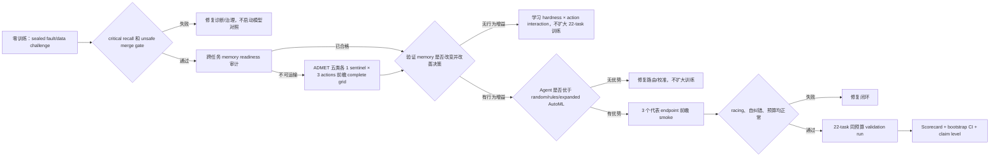

# ADMET Agent：AI Scientist Goal 状态与证据边界

更新时间：2026-08-20。范围固定为 TDC ADMET 22 endpoints。既有 test/leaderboard 结果
只用于一次性应用资格认证，不再反馈给模型、路由、阈值或数据动作。

## 当前结论

当前最强且可信的表述是：

> 一个在固定 TDC-22 场景中已达到项目应用性能门槛、具备可审计科学实验闭环组件的
> bounded ADMET research agent；其相对传统/expanded AutoML 的科研过程优势正在按
> 预注册协议验证。

现在不能声称“整体优于 AutoML”“路由优于随机/AutoML”或“自主科研能力已经得到独立
盲测证明”。可以声称一项边界明确的成本结果：新验证种子上，相对 score-only 选择达到
实用非劣，同时所选 recipe 的估算成本降低 72.2%；这不是 Agent-vs-AutoML 优越性。

## 已完成的硬证据

| 证据 | 当前结果 | 能支持什么 | 不能支持什么 |
|---|---:|---|---|
| 应用性能资格 | 22/22 有冻结结果；18 Top-5；21 Top-10 | 预测性能达到项目方认可的够用门槛 | 不能证明策略优于 AutoML |
| 单轴实验合格率 | 22/22 = 1.000 | 历史 Agent 能构造可归因实验 | 不是随机/rules/AutoML 的同预算增量 |
| treatment/control 完整率 | 22/22 = 1.000 | 不是只报告赢家的无对照搜索 | 不等于因果结论一定正确 |
| falsification resolution | 20/22 = 0.909 | 能给出 supported/refuted 结论 | 2 个仍 inconclusive |
| 负结果保留 | 2/2 = 1.000 | refuted 结果进入 ledger | 尚未证明它们改变了下一动作 |
| 历史 self-correction | 0/2；coverage=0 | 明确暴露旧 run 的时序证据缺口 | 不能把旧 run 讲成闭环自纠错 |
| 前瞻纠错 smoke | scheduled/completed 2/2；linked correction 1/1；evidence repair 1 | 已实际响应 refuted/incomplete evidence 并执行 follow-up | 两个 child hypothesis 都 inconclusive；对照目前仅是 locked policy replay |
| 纠错 policy replay | Agent process 1.000；expanded/conventional AutoML 0.300；random 0.500；complete rules 1.000 | 显式反馈链相对 scalar AutoML 的流程合同增量 | 仅 2 个本地案例；规则完全打平，不证明 learned reasoning |
| Legacy Agent vs AutoML | normalized delta −0.011923；CI [−0.023226, −0.003536]；fit-time ratio 1.363 | 必须保留的负证据与正式重跑依据 | 两臂均违反原 max-actions=8，源码快照不同，不能作为正式同预算认证 |
| 历史资源 | 790 fits；23871.9 fit-s | 可精确分账 | 没有记录 racing savings，不能讲节省 |
| 新种子实用非劣/成本 | mean delta −0.000348；CI [−0.001482, 0.000585]；cost ratio 0.278 | 相对 score-only 的 bounded Pareto efficiency | 不能证明路由或 Agent 优于随机/AutoML；2/22 有 material regression |
| 跨任务 memory readiness | 22/22 单轴结果；动作分布 18/3/1；transport-eligible 0/22 | 证明历史结果可审计，并已阻断 selection bias 回灌 | 不能证明 cross-task learning；当前 no-memory parity 是预期行为 |
| 前瞻 cross-task transport grid | 5 ADMET 类别 × 3 actions × 5 seeds；100/100 fits；0 failure | feature/model 两类形成 protocol-bound global priors；反证与无结论被保留 | data action 仍不可路由；尚未证明 contextual routing 或 AutoML 优越性 |
| 独立 post-memory confirmation | 5 个非训练端点；fresh seeds 6–10；50/50 fits | Agent 在部署前发现 global negative prior 过度泛化并触发回滚 | 2 supported/2 refuted/1 inconclusive；不能声称安全剪枝或节省 |
| Hidden-fault：Agent | micro F1=1.000；critical recall=1.000 | 完整 endpoint guard 能发现注入故障 | 本地确定性 fixture，不是独立盲测 |
| Hidden-fault：expanded AutoML | F1=0.615；critical recall=0.167 | 量化 endpoint-semantic guard 相对 schema-only AutoML 的增量 | 不比较预测质量 |
| Data stewardship：Agent | decision accuracy=1.000；unsafe merges=0/11 | 合同治理能阻止危险数据进入训练 | 与完整规则基线打平 |
| Data stewardship：expanded AutoML | accuracy=0.273；unsafe merges=7/11 | 量化直接/弱治理数据策略的风险 | 本地单故障 dossier |

应用资格 seal：`4b62bb35565fdbcd3de1e7860ee02e202bd705fca71bf1873bab390dd2a8689b`。
完整过程基线见 `reports/research_process_baseline_v3.json`。

## 已实现、等待前瞻证据的能力

1. Research Capability Scorecard v3：应用性能与安全是 foundation gates；process advantage、
   frozen application certification 和 expanded-AutoML predictive noninferiority 是独立 claim
   flags。九个科研过程维度采用最弱组件，不允许高分补偿关键短板。
2. Expanded-space AutoML：与 Agent 共享 model/feature/data/imbalance/tuning 原语，但不使用
   hardness、research plan、matched-pair priority 或 action memory。
3. 关键消融：`agent_no_memory`、`agent_no_hardness`、`agent_no_data` 均为可执行策略。
4. seed-2 racing：两个 seed 都更差、mean gap ≥0.005 且耗时 ≥3× 才停；保护预注册
   treatment/control；所有 arm 使用相同规则。
5. Sealed hidden-fault 与 sealed data-stewardship commit/reveal 评分；危险数据误接纳为硬失败。
6. 数据治理：source manifest、license、checksum、assay/species/unit/transform 合同、清洗、
   quarantine 与 source-held-out-only admission 协议。
7. test firewall：过程评测递归拒绝 test/heldout 字段；仅允许 `test_loaded=false` 审计哨兵。
8. validation-only self-correction scheduler：refuted 时换实验轴，证据缺失时补 matched pair/
   paired seeds，supported 且性能已合格时停止；quarantine 外部数据不能自动合并。
9. cross-task transport firewall：历史 policy-selected outcomes 仅供审计；只有前瞻性随机分配
   或 complete action grid、同预算、共同协议哈希、每动作至少 5 个端点且结果有变化时，
   memory 才能改变动作排序或放行 UniMol2。

第 8 项使用两阶段计分。全 22-task 历史队列只保留 2 个低成本 follow-up；这两个任务已在
当前源码快照下以前瞻方式完成：12 个 2D tree fits、67.6 fit-s、Uni-Mol2/调参/ensemble
均为 0。CYP2C9 完成缺失证据修复，hERG 在 data action 被 refuted 后切到 model axis；两者
新假设都 inconclusive，因此再次停止。历史指标仍保持 0/2，新 smoke 单独报告 linked
behavioral correction 1/1，绝不回填或改写旧证据。

这些属于已测试的机制，不等于已完成的独立效果验证。

两条低成本 challenge 都出现同一个关键负结果：Agent 明显优于 conventional/expanded
AutoML，但与 complete deterministic rules 完全相同。因此现阶段可以讲“Agent 系统整合了
AutoML 没有的 endpoint/data safety guard”，不能把这部分包装成 learned autonomous
reasoning。详见 `reports/fault_policy_controls_v1.md` 和
`reports/data_stewardship_controls_v1.md`。

路由证据也有明确负结果：历史 full-memory Agent 相对 matched-cost random 的均值为
+0.000827，但 bootstrap CI [−0.003797, 0.005419] 跨 0，不能支持 routing/memory
superiority。另一方面，锁定 risk guard 在 fresh validation seeds 上相对 score-only 的
均值为 −0.000348，95% CI [−0.001482, 0.000585]，20/22 endpoints 未超过 −0.005
实用退化界限，aggregate cost ratio=0.278。其合格证见
`reports/practical_efficiency_certification_v1.md`；允许的 claim 仅为 bounded
practical noninferiority + estimated 72.2% selected-recipe cost reduction。

此外，22 个历史 selected actions 高度不均衡：feature/model/data=18/3/1，normalized
action entropy=0.525，且 transport-eligible records=0/22。它们能证明 matched experiment
执行和负结果保留，但由于 action 是旧策略自己选择的、反事实动作缺失，不能训练或证明
跨任务路由。运行时现已强制 observational multiplier=1.0，并禁止这类 memory 改变排序或
启用 UniMol2。详见 `reports/cross_task_memory_readiness_v1.md`。

随后完成了前瞻性 complete action grid：A/D/M/E/T 各一个 sentinel，feature/model/data
三个 treatment 共 15 个 matched episodes、每个 5 seeds。通过共享完全相同的 control，
实际执行 100/100 fits、0 failure，而不是机械重复成 150 fits；避免 50 个重复 fits 和估算
510.6 fit-s，UniMol2 fits=0。结果为：feature 3 supported/2 refuted，形成轻度正向 global
prior（posterior=0.556）；RandomForest vs ExtraTrees 4 refuted/1 inconclusive，形成负向 prior
（posterior=0.278）；quality filtering 虽然改变 25/25 splits 的训练成员，但 5/5 endpoints
均 inconclusive，因此保持 neutral、禁止影响路由。完整证据见
`reports/transport_grid_results_v1.md`。这支持“Agent 能以前瞻对照实验修正历史选择偏差、
利用负结果并避免重复计算”，但不支持 contextual routing advantage 或 end-to-end
Agent-vs-AutoML superiority。

将上述 priors 回放到 22 个历史 hardness cards 后，selected utility 在 17/22 发生变化，
但 selected action 改变为 0/22。`model-estimator-family` 已替换原先更昂贵的 RBF/ensemble
动作成为可执行的 matched RandomForest-vs-ExtraTrees action，但其负向 prior 尚未改变
top action。因此当前只能声称“cross-task evidence 已满足协议并可被安全保存/校准”，
不能声称 memory 已带来 behavioral advantage。见
`reports/transport_memory_behavior_replay_v1.md`。下一次 claim 升级必须在独立的
post-memory endpoint cohort 上预先冻结动作选择，再比较 memory/no-memory regret。

该独立 cohort 随后已完成：Solubility 与 PPBR 上 RandomForest treatment 分别获得
+0.066880 和 +0.258620 oriented mean gain，均为 5/5 seeds 同向 supported；CYP3A4 与
Clearance_Microsome refuted，DILI inconclusive。全局负向剪枝的 mean positive regret=
0.065379、maximum regret=0.258620，明确失败。所谓“少做 25 个 treatment fits”不能计为
节省，因为它会漏掉两个有效实验。系统现要求 `negative_gate_confirmed=true` 才允许破坏性
剪枝，而当前 memory 明确为 false。见 `reports/post_memory_confirmation_v1.md`。这是一项
真正的 self-discovered policy failure + automatic safety rollback 证据，但仍不是相对
AutoML 的整体优势证明。

Legacy 22-task Agent/AutoML 结果也已按 train-only normalization 重审。Agent−AutoML macro
delta=−0.011923，bootstrap CI [−0.023226, −0.003536]，5/2/15 wins/ties/losses，总 fit-time
ratio=1.363；因此旧结果明确不支持 predictive 或 compute superiority。更重要的是，两臂
实际约 12 configs/task，却绑定了 max-actions=8 的协议，且源码快照不同，所以只能作为
exploratory negative evidence，不能升级为任一方向的正式因果认证。见
`reports/legacy_agent_automl_audit_v1.md`。

前瞻自纠错证据见 `reports/self_correction_smoke_v1.md`。它支持“已完成一次由 refutation
驱动的跨轴纠正，并在后续证据仍不足时停止”，不支持“发现了更好的预测配方”；由于尚未
执行独立未见 feedback episodes，也暂不支持比较性的 autonomous reasoning advantage。
两案例 locked policy replay 中 Agent 相对 scalar AutoML 有流程合同差异，但 complete
rules 精确打平；见 `reports/feedback_policy_controls_v1.md`。

## 正式 v5 对照

预注册：`runs/v5-policy-benchmark-90m/protocol.json`  
SHA-256：`ff01a79f6db0bb6d51a2abff3bcec1becde54827265ad720f525514d0858f4a7`

- 22 endpoints；5 validation seeds；test feedback=0。
- sequential Agent/committee/random/rules/expanded AutoML：每任务最多 8 个唯一配置、24 个
  fit 账面上限、90 分钟全任务硬截止。
- conventional AutoML 和 strong-fixed 保留为解释性参考。
- Agent 与对照均报告 score、fits、fit-seconds、anytime AUC、time-to-qualified、停止决策、
  失败 fit、重复动作和 peak storage，不只报告最终均值。

## 最省成本的执行顺序

这套顺序把大规模训练放在最后。任何低成本 gate 失败，都先修研究逻辑，不通过增加
Uni-Mol2、更多 ensemble 或更多 trial 掩盖问题。

## Claim 升级条件

| Claim | 尚缺条件 |
|---|---|
| `performance_qualified_components` | 当前已满足 |
| `validation_process_advantage` | 当前未满足：fault/data 两维相对 complete rules 的差值为 0；需 unseen composite challenge + random/rules/conventional/expanded AutoML 的九维差值 LCB 全部 >0 |
| `validation_application_performance_qualified` | 当前已满足；独立于是否胜过 AutoML |
| `validation_process_advantage` | 当前未满足正式证据：需 22-task、同预算、同源码/协议的 process-control LCB |
| `expanded_automl_predictive_noninferiority` | 可选更强 claim；22/22 normalized delta 的 one-sided LCB ≥−0.01，且同预算/同协议 |
| `frozen_application_qualified_process_advantage` | application freeze 与 process advantage 同时满足；不要求先证明预测胜过 AutoML |
| `frozen_process_advantage_plus_automl_noninferiority` | 最强项目内 claim；再叠加 expanded-AutoML predictive noninferiority |
| 通用“自主科学家” | 仍需独立机构、前瞻数据和跨域复现；当前项目不应声称 |

## 验证状态

本轮完整回归：`303 passed`；self-correction smoke 执行了 12 个 validation-only 2D tree
fits。未读取 test 标签。
