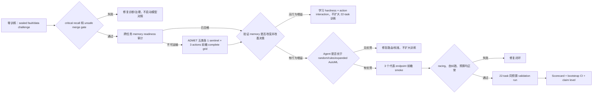

# ADMET Agent：AI Scientist Goal 状态与证据边界

更新时间：2026-08-20。范围固定为 TDC ADMET 22 endpoints。既有 test/leaderboard 结果
只用于一次性应用资格认证，不再反馈给模型、路由、阈值或数据动作。

2026-08-20 的后续外部数据审计发生一次已隔离但不可逆的 test-access incident：诊断命令
误读 hERG 官方 test 标签汇总。该信息未进入训练、选择或策略，冻结结果未修改；但本次外部
数据票据不能再声明 `test_accessed=false`，只能声明 `test_feedback_used=false`。详见
`reports/test_firewall_incident_2026-08-20.md`。

## 当前结论

当前最强且可信的表述是：

> 一个在固定 TDC-22 场景中已达到项目应用性能门槛、具备可审计科学实验闭环组件的
> bounded ADMET research agent；其相对传统/expanded AutoML 的科研过程优势正在按
> 预注册协议验证。

现在不能声称“整体优于 AutoML”“路由优于随机/AutoML”或“自主科研能力已经得到独立
盲测证明”。可以声称一项边界明确的成本结果：新验证种子上，相对 score-only 选择达到
实用非劣，同时所选 recipe 的估算成本降低 72.2%；这不是 Agent-vs-AutoML 优越性。

## 已完成的硬证据

| 证据 | 当前结果 | 能支持什么 | 不能支持什么 |
|---|---:|---|---|
| 应用性能资格 | 22/22 有冻结结果；估算 5 Top-1、18 Top-5、21 Top-10；联合平均名次 4.545 | 预测性能达到项目方认可的够用门槛 | 排名为快照插入估算；不能证明策略优于 AutoML |
| 跨 endpoint 固定模型比较 | 在 14 个完整覆盖固定模型中，平均名次超过 13 个；Agent + fixed models 排第 2 | Agent 已超过绝大多数单一固定模型 | MapLight + GNN 仍更优；不能声称平均超过所有模型 |
| 单轴实验合格率 | 22/22 = 1.000 | 历史 Agent 能构造可归因实验 | 不是随机/rules/AutoML 的同预算增量 |
| treatment/control 完整率 | 22/22 = 1.000 | 不是只报告赢家的无对照搜索 | 不等于因果结论一定正确 |
| falsification resolution | 20/22 = 0.909 | 能给出 supported/refuted 结论 | 2 个仍 inconclusive |
| 负结果保留 | 2/2 = 1.000 | refuted 结果进入 ledger | 尚未证明它们改变了下一动作 |
| 历史 self-correction | 0/2；coverage=0 | 明确暴露旧 run 的时序证据缺口 | 不能把旧 run 讲成闭环自纠错 |
| 前瞻纠错 smoke | scheduled/completed 2/2；linked correction 1/1；evidence repair 1 | 已实际响应 refuted/incomplete evidence 并执行 follow-up | 两个 child hypothesis 都 inconclusive；对照目前仅是 locked policy replay |
| 纠错 policy replay | Agent process 1.000；expanded/conventional AutoML 0.300；random 0.500；complete rules 1.000 | 显式反馈链相对 scalar AutoML 的流程合同增量 | 仅 2 个本地案例；规则完全打平，不证明 learned reasoning |
| Legacy Agent vs AutoML | normalized delta −0.011923；CI [−0.023226, −0.003536]；fit-time ratio 1.363 | 必须保留的负证据与正式重跑依据 | 两臂均违反原 max-actions=8，源码快照不同，不能作为正式同预算认证 |
| 历史资源 | 790 fits；23871.9 fit-s | 可精确分账 | 没有记录 racing savings，不能讲节省 |
| 新种子实用非劣/成本 | mean delta −0.000348；CI [−0.001482, 0.000585]；cost ratio 0.278 | 相对 score-only 的 bounded Pareto efficiency | 不能证明路由或 Agent 优于随机/AutoML；2/22 有 material regression |
| 跨任务 memory readiness | 22/22 单轴结果；动作分布 18/3/1；transport-eligible 0/22 | 证明历史结果可审计，并已阻断 selection bias 回灌 | 不能证明 cross-task learning；当前 no-memory parity 是预期行为 |
| 前瞻 cross-task transport grid | 5 ADMET 类别 × 3 actions × 5 seeds；100/100 fits；0 failure | feature/model 两类形成 protocol-bound global priors；反证与无结论被保留 | data action 仍不可路由；尚未证明 contextual routing 或 AutoML 优越性 |
| 独立 post-memory confirmation | 5 个非训练端点；fresh seeds 6–10；50/50 fits | Agent 在部署前发现 global negative prior 过度泛化并触发回滚 | 2 supported/2 refuted/1 inconclusive；不能声称安全剪枝或节省 |
| 条件式多 Agent 回放 | 单 Agent 20/22；targeted 1/22；full committee 1/22 | 覆盖 2/2 scheduled corrections 与 1/1 历史候选分歧，同时避免 90.9% 默认委员会调用 | 零训练流程回放；不能证明多 Agent 提高预测分数 |
| Sealed composite research challenge | Agent decision 10/10、macro=1.000、unsafe=0、估算 30 fits；static rules=0.860/3 unsafe/48 fits；expanded AutoML=0.540/1 unsafe/48 fits | 证明生产 feedback policy 能联合处理反馈、预算、数据准入、成本门槛、matched pair 与停止；相对 static rules case-score delta +0.140，CI [0.040, 0.260] | 同团队本地出题；不是独立 blind challenge，不能通过全局 process-advantage flag |
| 生产/科研两线极简 policy v2 | 4 个任务家族；low/higher-data=13/9；22/22 reuse-and-stop；默认新增科研 fits=0 | 已合格任务不再重复搜索；异常任务至多一个 matched pair，低/较高数据上限分别为 10/6 fits | 零训练路由回放；不证明异常实验能提升预测，也不把模型推理成本记为 0 |
| Hidden-fault：Agent | micro F1=1.000；critical recall=1.000 | 完整 endpoint guard 能发现注入故障 | 本地确定性 fixture，不是独立盲测 |
| Hidden-fault：expanded AutoML | F1=0.615；critical recall=0.167 | 量化 endpoint-semantic guard 相对 schema-only AutoML 的增量 | 不比较预测质量 |
| Data stewardship：Agent | decision accuracy=1.000；unsafe merges=0/11 | 合同治理能阻止危险数据进入训练 | 与完整规则基线打平 |
| Data stewardship：expanded AutoML | accuracy=0.273；unsafe merges=7/11 | 量化直接/弱治理数据策略的风险 | 本地单故障 dossier |

应用资格 seal：`4b62bb35565fdbcd3de1e7860ee02e202bd705fca71bf1873bab390dd2a8689b`。
完整过程基线见 `reports/research_process_baseline_v3.json`。

## 已实现、等待前瞻证据的能力

1. Research Capability Scorecard v3：应用性能与安全是 foundation gates；process advantage、
   frozen application certification 和 expanded-AutoML predictive noninferiority 是独立 claim
   flags。九个科研过程维度采用最弱组件，不允许高分补偿关键短板。
2. Expanded-space AutoML：与 Agent 共享 model/feature/data/imbalance/tuning 原语，但不使用
   hardness、research plan、matched-pair priority 或 action memory。
3. 关键消融：`agent_no_memory`、`agent_no_hardness`、`agent_no_data` 均为可执行策略。
4. seed-2 racing：两个 seed 都更差、mean gap ≥0.005 且耗时 ≥3× 才停；保护预注册
   treatment/control；所有 arm 使用相同规则。
5. Sealed hidden-fault 与 sealed data-stewardship commit/reveal 评分；危险数据误接纳为硬失败。
6. 数据治理：source manifest、license、checksum、assay/species/unit/transform 合同、清洗、
   quarantine 与 source-held-out-only admission 协议。
7. test firewall：过程评测递归拒绝 test/heldout 字段；仅允许 `test_loaded=false` 审计哨兵。
8. validation-only self-correction scheduler：refuted 时换实验轴，证据缺失时补 matched pair/
   paired seeds，supported 且性能已合格时停止；quarantine 外部数据不能自动合并。
9. cross-task transport firewall：历史 policy-selected outcomes 仅供审计；只有前瞻性随机分配
   或 complete action grid、同预算、共同协议哈希、每动作至少 5 个端点且结果有变化时，
   memory 才能改变动作排序或放行 UniMol2。
10. conditional committee activation：普通任务默认单 Agent；只有选中的 data action、外部
    数据准入、高成本表示、破坏性 policy update、跨轴分歧或已安排纠错，才调用相关专家；
    所有提议仍经同一 Arbiter 和共享 fit ceiling。
11. sealed composite research challenge：同一 episode 同时包含 validation feedback、paired
    seed 充分性、剩余动作预算、0.60 cost gate、quarantined/admitted external data、跨轴纠错、
    parent linkage 与停止；所有 arm 每例最多一个 follow-up、六个估算 fits。
12. production/research two-lane policy：ADMET 类别只决定 endpoint/data contract；四个
    metric-aligned task families 决定科学问题，low/higher-data 只决定 paired-seed 证据强度。
    合格任务默认复用冻结 recipe 并停止；异常任务最多一个 hypothesis 和一个 matched pair，
    不自动 correction。

第 8 项使用两阶段计分。全 22-task 历史队列只保留 2 个低成本 follow-up；这两个任务已在
当前源码快照下以前瞻方式完成：12 个 2D tree fits、67.6 fit-s、Uni-Mol2/调参/ensemble
均为 0。CYP2C9 完成缺失证据修复，hERG 在 data action 被 refuted 后切到 model axis；两者
新假设都 inconclusive，因此再次停止。历史指标仍保持 0/2，新 smoke 单独报告 linked
behavioral correction 1/1，绝不回填或改写旧证据。

这些属于已测试的机制，不等于已完成的独立效果验证。

两条低成本 challenge 都出现同一个关键负结果：Agent 明显优于 conventional/expanded
AutoML，但与 complete deterministic rules 完全相同。因此现阶段可以讲“Agent 系统整合了
AutoML 没有的 endpoint/data safety guard”，不能把这部分包装成 learned autonomous
reasoning。详见 `reports/fault_policy_controls_v1.md` 和
`reports/data_stewardship_controls_v1.md`。

路由证据也有明确负结果：历史 full-memory Agent 相对 matched-cost random 的均值为
+0.000827，但 bootstrap CI [−0.003797, 0.005419] 跨 0，不能支持 routing/memory
superiority。另一方面，锁定 risk guard 在 fresh validation seeds 上相对 score-only 的
均值为 −0.000348，95% CI [−0.001482, 0.000585]，20/22 endpoints 未超过 −0.005
实用退化界限，aggregate cost ratio=0.278。其合格证见
`reports/practical_efficiency_certification_v1.md`；允许的 claim 仅为 bounded
practical noninferiority + estimated 72.2% selected-recipe cost reduction。

此外，22 个历史 selected actions 高度不均衡：feature/model/data=18/3/1，normalized
action entropy=0.525，且 transport-eligible records=0/22。它们能证明 matched experiment
执行和负结果保留，但由于 action 是旧策略自己选择的、反事实动作缺失，不能训练或证明
跨任务路由。运行时现已强制 observational multiplier=1.0，并禁止这类 memory 改变排序或
启用 UniMol2。详见 `reports/cross_task_memory_readiness_v1.md`。

随后完成了前瞻性 complete action grid：A/D/M/E/T 各一个 sentinel，feature/model/data
三个 treatment 共 15 个 matched episodes、每个 5 seeds。通过共享完全相同的 control，
实际执行 100/100 fits、0 failure，而不是机械重复成 150 fits；避免 50 个重复 fits 和估算
510.6 fit-s，UniMol2 fits=0。结果为：feature 3 supported/2 refuted，形成轻度正向 global
prior（posterior=0.556）；RandomForest vs ExtraTrees 4 refuted/1 inconclusive，形成负向 prior
（posterior=0.278）；quality filtering 虽然改变 25/25 splits 的训练成员，但 5/5 endpoints
均 inconclusive，因此保持 neutral、禁止影响路由。完整证据见
`reports/transport_grid_results_v1.md`。这支持“Agent 能以前瞻对照实验修正历史选择偏差、
利用负结果并避免重复计算”，但不支持 contextual routing advantage 或 end-to-end
Agent-vs-AutoML superiority。

将上述 priors 回放到 22 个历史 hardness cards 后，selected utility 在 17/22 发生变化，
但 selected action 改变为 0/22。`model-estimator-family` 已替换原先更昂贵的 RBF/ensemble
动作成为可执行的 matched RandomForest-vs-ExtraTrees action，但其负向 prior 尚未改变
top action。因此当前只能声称“cross-task evidence 已满足协议并可被安全保存/校准”，
不能声称 memory 已带来 behavioral advantage。见
`reports/transport_memory_behavior_replay_v1.md`。下一次 claim 升级必须在独立的
post-memory endpoint cohort 上预先冻结动作选择，再比较 memory/no-memory regret。

该独立 cohort 随后已完成：Solubility 与 PPBR 上 RandomForest treatment 分别获得
+0.066880 和 +0.258620 oriented mean gain，均为 5/5 seeds 同向 supported；CYP3A4 与
Clearance_Microsome refuted，DILI inconclusive。全局负向剪枝的 mean positive regret=
0.065379、maximum regret=0.258620，明确失败。所谓“少做 25 个 treatment fits”不能计为
节省，因为它会漏掉两个有效实验。系统现要求 `negative_gate_confirmed=true` 才允许破坏性
剪枝，而当前 memory 明确为 false。见 `reports/post_memory_confirmation_v1.md`。这是一项
真正的 self-discovered policy failure + automatic safety rollback 证据，但仍不是相对
AutoML 的整体优势证明。

Legacy 22-task Agent/AutoML 结果也已按 train-only normalization 重审。Agent−AutoML macro
delta=−0.011923，bootstrap CI [−0.023226, −0.003536]，5/2/15 wins/ties/losses，总 fit-time
ratio=1.363；因此旧结果明确不支持 predictive 或 compute superiority。更重要的是，两臂
实际约 12 configs/task，却绑定了 max-actions=8 的协议，且源码快照不同，所以只能作为
exploratory negative evidence，不能升级为任一方向的正式因果认证。见
`reports/legacy_agent_automl_audit_v1.md`。

前瞻自纠错证据见 `reports/self_correction_smoke_v1.md`。它支持“已完成一次由 refutation
驱动的跨轴纠正，并在后续证据仍不足时停止”，不支持“发现了更好的预测配方”；由于尚未
执行独立未见 feedback episodes，也暂不支持比较性的 autonomous reasoning advantage。
两案例 locked policy replay 中 Agent 相对 scalar AutoML 有流程合同差异，但 complete
rules 精确打平；见 `reports/feedback_policy_controls_v1.md`。

多 Agent 的当前定位也已量化。历史 22-task 回放仅把 CYP2C9_Substrate 升级为 targeted
review、把 hERG 升级为 full committee，其余 20 个保持单 Agent；覆盖全部 2 个 scheduled
corrections 和历史唯一 1 个 candidate-set divergence，避免 20/22（90.9%）默认委员会
调用及 61/66（92.4%）逻辑角色分配，且不增加 fit budget。这个结果证明条件激活机制能
减少规划冗余并覆盖已知风险，不证明委员会带来预测优势。见
`reports/conditional_committee_activation_v1.md`。

跨 endpoint 应用表现采用联合名次而不是混合平均 AUROC/AUPRC/Spearman/MAE。按
2026-08-17 冻结榜单快照插入现有分数，Agent 估算 Top-1 为 5/22，平均名次 4.545；在
14 个精确模型名、完整覆盖 22 endpoints 的固定模型中超过 13 个，总体排第 2。
MapLight + GNN 的联合平均名次 3.864，仍优于 Agent。因此允许的表述是“超过绝大多数完整覆盖的
固定模型”，而不是“平均超过所有模型”。见
`reports/cross_endpoint_fixed_model_comparison_v1.md`。

新的 composite challenge 将此前彼此孤立的 fault/data/feedback 能力放入同一决策情境。
生产 `ValidationSelfCorrectionPlanner` 直接作为 Agent arm，未使用按答案填表的代理实现；
结果为 10/10 正确、macro process=1.000、unsafe actions=0、30 estimated fits。locked static
rules 为 6/10、macro=0.860、3 unsafe、48 fits；expanded/conventional AutoML 均为 4/10、
macro=0.540、1 unsafe、48 fits。Agent−static-rules paired case-score delta=+0.140，episode
bootstrap 95% CI [0.040, 0.260]。commit→submission→reveal 及各 arm hash 均已落盘，未训练
模型、未读取 test。由于题目仍由同一开发团队编写，这只升级为 integrated local policy
conformance evidence，不足以把 `validation_process_advantage` 标为通过。见
`reports/composite_research_challenge_v1.md`。

针对流程仍然过重的问题，默认调度进一步改成生产/科研两线。A/D/M/E/T 只负责 endpoint
与数据 contract；建模任务分为 ordinary AUROC classification（8）、imbalanced AUPRC
classification（5）、continuous MAE regression（5）和 rank-PK Spearman regression（4）。
数据规模只保留两个有不同动作的档位：low-data(<1000)=13、higher-data(≥1000)=9；原
medium 桶没有独立动作，已删除。

生产默认链现在是 contract→复用已合格冻结 recipe→stop。当前 22/22 均通过资格门且没有
新异常，零训练回放为 22/22 `reuse_and_stop`，默认新增科研 fits=0。只有 contract 失败、
artifact 缺失、validation-side 资格退化/高不确定性、数据漂移/来源缺口可开研究票据；预测
问题最多运行一个假设与一个 matched pair，low-data 最多 10 fits，higher-data 最多 6 fits，
结论写入 memory 后停止，不自动 correction。

每任务 matched pair、strong anchor、screen 后补五种子、自动跨轴 correction、scalar hardness
routing、committee、HPO、ensemble、UniMol2 和外部数据搜索均退出默认调度。上一版
`reports/streamlined_category_size_policy_v1.md` 与
`reports/minimal_exact_pair_pilot_v1.md` 只保留为历史 shadow/pilot evidence；当前默认候选及
完整 22-task 路由见 `reports/lean_category_size_policy_v2.md`。冻结生产结果不变。

统一 evidence-vector scorecard 已将所有现有证据绑定为不可互相补偿的 claim gates：预测
资格为 18/22 Top-5、21/22 Top-10；本地 sealed composite 中 Agent macro=1.00、unsafe=0，
locked rules=0.86、expanded AutoML=0.54，Agent−rules case-score delta=+0.14，bootstrap
95% CI [0.04, 0.26]；数据治理和反馈纠错相对 scalar AutoML 有优势，但尚未超过 complete
rules；cross-task grid 只证明 causal priors 可保存，尚未证明 routing outcome advantage。
正式控制拆为两条最小因果 track：22-task predictive 只比较 streamlined Agent、expanded
AutoML、strong-fixed；rules/random/no-memory/no-hardness/no-data 在同动作预算 process track
比较，避免为不回答其因果问题的模型重训练付费。见
`reports/ai_scientist_evidence_scorecard_v1.md`。

关键 process ablations 已完成并保留负结果。no-memory replay 在 22/22 HardnessCards 上改变
17 个 selected utility、2 个 action ranking，但最终 selection changed=0/22；旧 validation-only
full-outcome-vs-winner-only memory 的 mean oriented gain=−0.00031、claim gate=false。因此当前
memory 只能声称安全保存和校准证据，不能声称带来行为或预测优势。no-hardness hidden-fault
ablation 将 micro/critical recall 从 1.00 降至 0，证明 endpoint diagnosis 是安全机制所必需，
但不是预测效果证明。no-data acquisition ablation 采取 reject-all，unsafe merges=0，但准入
accuracy 从 1.00 降至 0.364，量化了删除数据获取能力后的机会损失。这三项均为本地 locked
process evidence，不替代正式 predictive control 或外部独立验证。

三臂 22-task predictive control 已在冻结源码与 fresh validation seed 11→12 下完成：
streamlined Agent 与 expanded AutoML 各 2 个 screen configs、只在 seed 12 重训各自赢家，
strong-fixed 只评估一个冻结 LightGBM anchor。共 154/154 logical charged fits、113 physical
unique fits、0 failures；完全相同配置跨臂复用 41 次，实际物理训练减少 26.6%。Agent−expanded
AutoML mean normalized utility delta=−0.00983，task-bootstrap 95% CI [−0.02770, +0.00648]，
W/T/L=5/7/10；预注册 noninferiority margin=−0.01，但 lower bound 未通过。因此正式对照已经
完成，允许声称“应用性能合格且科研过程有本地优势”，不允许声称“预测上不劣或优于 AutoML”。
该负结果未触发 seed-12 调参。探索性 problem ledger 发现 8 个 material losses 全由 AutoML
LightGBM 胜出，并提出“科研 matched pair 与预测 strong anchor 分离”等三个 future-seed
可证伪假设；当前 policy 未修改，未来确认不得复用 seed 12。见
`reports/minimal_predictive_control_v1.md` 与
`reports/predictive_control_problem_ledger_v1.md`。

## 正式 v5 对照

预注册：`runs/v5-policy-benchmark-90m/protocol.json`  
SHA-256：`ff01a79f6db0bb6d51a2abff3bcec1becde54827265ad720f525514d0858f4a7`

- 22 endpoints；5 validation seeds；test feedback=0。
- sequential Agent/committee/random/rules/expanded AutoML：每任务最多 8 个唯一配置、24 个
  fit 账面上限、90 分钟全任务硬截止。
- conventional AutoML 和 strong-fixed 保留为解释性参考。
- Agent 与对照均报告 score、fits、fit-seconds、anytime AUC、time-to-qualified、停止决策、
  失败 fit、重复动作和 peak storage，不只报告最终均值。

## 最省成本的执行顺序

这套顺序把大规模训练放在最后。任何低成本 gate 失败，都先修研究逻辑，不通过增加
Uni-Mol2、更多 ensemble 或更多 trial 掩盖问题。

## Claim 升级条件

| Claim | 尚缺条件 |
|---|---|
| `performance_qualified_components` | 当前已满足 |
| `validation_process_advantage` | 当前未满足：本地 composite 已相对 locked static rules/AutoML 为正，但仍非独立出题，且未覆盖九维 LCB；需 independently authored unseen composite challenge + random/rules/conventional/expanded AutoML 的九维差值 LCB 全部 >0 |
| `validation_application_performance_qualified` | 当前已满足；独立于是否胜过 AutoML |
| `validation_process_advantage` | 当前未满足正式证据：需 22-task、同预算、同源码/协议的 process-control LCB |
| `expanded_automl_predictive_noninferiority` | 可选更强 claim；22/22 normalized delta 的 one-sided LCB ≥−0.01，且同预算/同协议 |
| `frozen_application_qualified_process_advantage` | application freeze 与 process advantage 同时满足；不要求先证明预测胜过 AutoML |
| `frozen_process_advantage_plus_automl_noninferiority` | 最强项目内 claim；再叠加 expanded-AutoML predictive noninferiority |
| 通用“自主科学家” | 仍需独立机构、前瞻数据和跨域复现；当前项目不应声称 |

## 2026-08-20 数据研究与图融合更新

主线现已从榜单优化转为 Agent-vs-AutoML 的科研能力：自动 source scout、endpoint-semantic
judge 和论文一致的三重结构防火墙已经实现。hERG 自动发现 3 个候选，但 3/3 均需 bridge，
0 个允许直接合并。防火墙由密封 evaluator 执行：脱盐、去电荷、canonical tautomer、标准
InChIKey exact de-duplication；若外部文件按 InChIKey skeleton 命中超过 5% 的 test molecules，
整份拒绝；剩余行再删除 ECFP4 Tanimoto ≥0.90 的 test near analogues。它读取 test 结构但不读取
标签，也不向 planner 暴露结构或相似度反馈。

这里记录一次实际的协议自纠错：初版把论文中的 InChIKey skeleton 误实现为 Bemis–Murcko
scaffold；在核对论文 methods 后、任何外部数据训练前已纠正，并增加 salt/charge 与 skeleton
coverage 测试。不得把初版实现称为论文等价。

图融合采用 ≤20-fit 独立票据，而不是 22-task model-zoo 扩张。当前已有 2D、pinned GIN、共享
cache 和 OOF-safe shallow decision-tree gate；缺少内容寻址的 distinct MPNN provider，因此
训练前 failed closed，不自动安装重型环境，也不允许以 GIN 冒充 MPNN。见
`reports/bounded_graph_fusion_ticket_v1.md`。

发表判断见 `reports/ai_for_science_publication_readiness_v1.md`：当前具备可信的 AI-for-Science
方法故事，但综合型顶刊证据仍缺 independently authored unseen challenge、一个成功的真实
source-held-out data discovery，以及最好由外部实验/数据进行的 prospective confirmation。

## 验证状态

本轮完整回归：`404 passed in 27.71s`；self-correction smoke 执行了 12 个 validation-only
2D tree fits。当前新增机制未读取 test 标签。因 `guard.py` 的合法变更使旧论文 figure manifest
source hash 失效，已用原构建脚本重生成 figure manifest 后再次完成全量回归；预测、选择和 freeze
均未改变。
