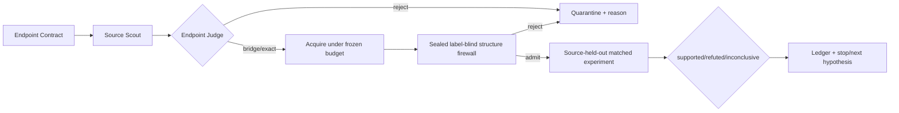

# 自动外部数据 Agent：能力与证据边界 v1

> 状态：`mechanism_ready_real_source_gain_pending`。机制已经可执行，真实 source-held-out 增益尚未完成。

## 闭环

## 当前 hERG 自动发现结果

Scout 找到 3 个候选；3/3 均判为 `bridge_required`，
没有任何数据可直接拼入训练集。判定不仅看字段类型，还看 target、物种、assay、
label threshold、单位、来源谱系、许可和结构重叠风险。

## 三重结构排除

1. 脱盐、去电荷、规范互变异构体并生成标准 InChIKey 后，删除与 train、validation 或 test 完全相同的记录。
2. 若外部文件按 InChIKey skeleton 命中超过 5% 的 test 分子，拒绝整份数据。
3. 删除与任一 test 分子的 ECFP4（Morgan radius=2）Tanimoto ≥0.90 的记录。

Test 结构仅由密封去污染执行器读取；`test_labels_loaded=false`，结构不返回 planner。
Agent 与 AutoML 数据臂使用相同来源、查询/API 预算和相同防火墙，避免以更多数据
冒充更好的科研决策。两者唯一差异是 endpoint 判断、可证伪准入假设和停止策略。

## Claim 边界

- 允许：The mechanism discovers candidates, adjudicates endpoint semantics and fails closed before unsafe merge.
- 禁止：Autonomously acquired data has improved hERG prediction.
