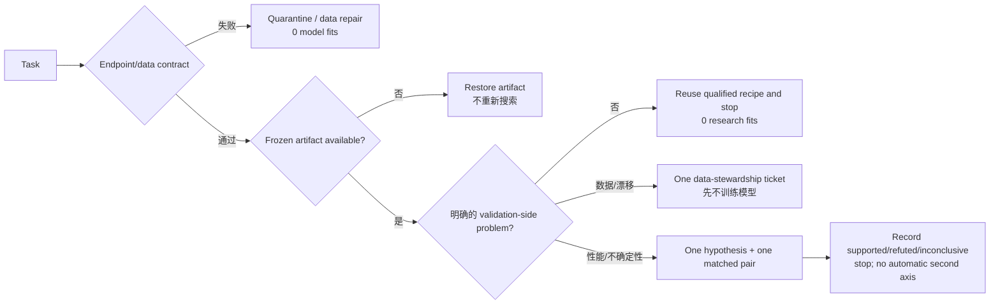

# TDC ADMET-22 两线极简策略 v2

> 核心变化：预测已合格，因此默认不再让每个任务重复做科研实验。生产和科研彻底分线；test 继续冻结。

## 默认流程

当前 22/22 已通过冻结资格门且默认没有新异常，因此：
**22 个任务全部复用并停止；默认科研拟合上限 = 0。**
这不等于模型推理免费；它表示不再为已经合格的任务追加搜索训练。

## 四类任务 × 两档数据量

A/D/M/E/T 只负责 endpoint、单位、物种和 assay contract；真正决定研究问题的是下面四类。

| 任务家族 | 低数据 <1000 | 较高数据 ≥1000 | 研究重点 |
|---|---:|---:|---|
| 普通二分类（AUROC） | 6 | 2 | 表示与 scaffold 泛化 |
| 不平衡二分类（AUPRC） | 2 | 3 | 少数类召回且不牺牲 precision |
| 连续值回归（MAE） | 1 | 4 | 连续误差与异常值稳健性 |
| 排序型 PK 回归（Spearman） | 4 | 0 | 跨 scaffold 排序一致性 |

## 数据量只改变证据强度，不扩张搜索空间

| 数据档 | 22-task 数量 | 若被触发时的实验 | 最大研究 fits | 默认禁止 |
|---|---:|---|---:|---|
| 低数据 <1000 | 13 | 同一 matched pair × 5 seeds | 10 | HPO、从头训练大模型、按单次分数决策 |
| 较高数据 ≥1000 | 9 | 同一 matched pair × 3 seeds | 6 | 多轮 screen、自动 ensemble、默认 UniMol2 |

低数据需要更多重复来控制方差，但候选仍只有 treatment/control 两个；较高数据用更少 seeds，避免样本规模导致计算膨胀。原 medium 分支被删除，因为它没有独立动作。

## 什么情况下才启动研究线

仅接受四种 validation-side 信号：contract 失败、冻结 artifact 缺失、资格退化/高不确定性、数据漂移或来源缺口。hardness 仍可用于解释和报告，但不再生成多条默认分支。

研究线一旦启动，也只有一张票：一个可证伪假设、一个单轴 matched pair，然后无论 supported、refuted 或 inconclusive 都停止并写入 memory。若要开第二张票，必须作为新的、预注册的问题，而不是自动 correction。

## 从默认路径删除的内容

- `per_task_matched_pair`
- `per_task_strong_anchor`
- `screen_then_five_seed_confirmation`
- `automatic_cross_axis_correction`
- `medium_data_branch`
- `scalar_hardness_routing`
- `committee`
- `hpo`
- `ensemble_search`
- `unimol2`
- `external_data_search`

多 Agent、外部数据与 UniMol2 并未从项目删除，但不属于任务默认调度：只有数据准入/高风险审计可请求 targeted reviewer；UniMol2 必须有表示失败证据、独立预算与可复用缓存；外部数据必须先有来源、许可和 source-heldout protocol。

## 22 个任务的默认路由

| Task | ADMET | 任务家族 | N train | 数据档 | 默认动作 | 研究 fits |
|---|---|---|---:|---|---|---:|
| DILI | toxicity | 普通二分类（AUROC） | 325 | low_data | `reuse_qualified_frozen_recipe_and_stop` | 0 |
| HIA_Hou | absorption | 普通二分类（AUROC） | 403 | low_data | `reuse_qualified_frozen_recipe_and_stop` | 0 |
| Bioavailability_Ma | absorption | 普通二分类（AUROC） | 448 | low_data | `reuse_qualified_frozen_recipe_and_stop` | 0 |
| hERG | toxicity | 普通二分类（AUROC） | 457 | low_data | `reuse_qualified_frozen_recipe_and_stop` | 0 |
| CYP3A4_Substrate_CarbonMangels | metabolism | 普通二分类（AUROC） | 468 | low_data | `reuse_qualified_frozen_recipe_and_stop` | 0 |
| Pgp_Broccatelli | absorption | 普通二分类（AUROC） | 851 | low_data | `reuse_qualified_frozen_recipe_and_stop` | 0 |
| BBB_Martins | distribution | 普通二分类（AUROC） | 1421 | higher_data | `reuse_qualified_frozen_recipe_and_stop` | 0 |
| AMES | toxicity | 普通二分类（AUROC） | 5093 | higher_data | `reuse_qualified_frozen_recipe_and_stop` | 0 |
| Caco2_Wang | absorption | 连续值回归（MAE） | 637 | low_data | `reuse_qualified_frozen_recipe_and_stop` | 0 |
| PPBR_AZ | distribution | 连续值回归（MAE） | 1952 | higher_data | `reuse_qualified_frozen_recipe_and_stop` | 0 |
| Lipophilicity_AstraZeneca | absorption | 连续值回归（MAE） | 2940 | higher_data | `reuse_qualified_frozen_recipe_and_stop` | 0 |
| LD50_Zhu | toxicity | 连续值回归（MAE） | 5168 | higher_data | `reuse_qualified_frozen_recipe_and_stop` | 0 |
| Solubility_AqSolDB | absorption | 连续值回归（MAE） | 6986 | higher_data | `reuse_qualified_frozen_recipe_and_stop` | 0 |
| CYP2D6_Substrate_CarbonMangels | metabolism | 不平衡二分类（AUPRC） | 465 | low_data | `reuse_qualified_frozen_recipe_and_stop` | 0 |
| CYP2C9_Substrate_CarbonMangels | metabolism | 不平衡二分类（AUPRC） | 467 | low_data | `reuse_qualified_frozen_recipe_and_stop` | 0 |
| CYP2C9_Veith | metabolism | 不平衡二分类（AUPRC） | 8463 | higher_data | `reuse_qualified_frozen_recipe_and_stop` | 0 |
| CYP3A4_Veith | metabolism | 不平衡二分类（AUPRC） | 8628 | higher_data | `reuse_qualified_frozen_recipe_and_stop` | 0 |
| CYP2D6_Veith | metabolism | 不平衡二分类（AUPRC） | 9191 | higher_data | `reuse_qualified_frozen_recipe_and_stop` | 0 |
| Half_Life_Obach | excretion | 排序型 PK 回归（Spearman） | 465 | low_data | `reuse_qualified_frozen_recipe_and_stop` | 0 |
| Clearance_Microsome_AZ | excretion | 排序型 PK 回归（Spearman） | 770 | low_data | `reuse_qualified_frozen_recipe_and_stop` | 0 |
| VDss_Lombardo | distribution | 排序型 PK 回归（Spearman） | 791 | low_data | `reuse_qualified_frozen_recipe_and_stop` | 0 |
| Clearance_Hepatocyte_AZ | excretion | 排序型 PK 回归（Spearman） | 848 | low_data | `reuse_qualified_frozen_recipe_and_stop` | 0 |
