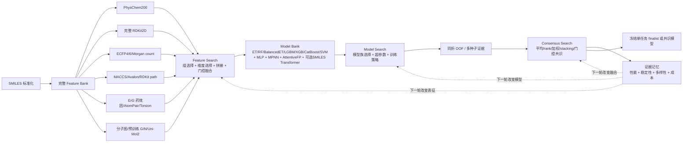

# ADMET-EvO 表征层与先进模型扩展实施规划

> 文档用途：直接交给实现 Agent，作为需求、接口、实验规范和验收标准。
> 适用范围：TDC ADMET 22 个终点；每个终点保持单任务训练与独立冻结。
> 本阶段不包含：外部数据自动搜集、多任务联合训练、使用官方 test 参与搜索。

## 1. 先判断用户给出的现状图是否准确

图的主干方向基本正确：SMILES 经过固定分子表征，进入传统机器学习候选池，再通过验证结果进行模型筛选与预测融合。但有四处必须修正：

1. **当前已有冻结的预训练 GIN-300 路线。** v2.7 的 MapLight+GNN 执行器已使用 `gin_supervised_masking` 图向量，并与二维特征拼接为 2863 维输入。本文建议新增的是将其从冻结 recipe 路线提升为通用 Feature Bank 原子表征。
2. **Uni-Mol2 同时存在冻结 CLS 与端到端微调。** 通用搜索注册表主要暴露冻结 84M CLS；`frozen_executor.py` 已实现基于 `MolTrain`/`MolPredict` 的任务级微调和预测。本阶段不应重复实现，而应统一注册、预算门控与消融证据。
3. **OOF 能力已局部存在，但尚未覆盖全部模型搜索。** Uni-Mol2 冻结 recipe 执行器含内层 scaffold OOF；通用搜索仍主要使用官方 train/validation 和匹配的多个 validation seed。本文新增目标是为全部兼容候选提供统一同折 OOF 合同。
4. **MACCS 和 ECFP6 并非完全从零实现。** 当前注册表已经有 `maccs` 和 `morgan_r3`；当前 `morgan` 就是 radius 2，约等于 ECFP4。需要做的是规范命名、加入候选生成和完成测试，而不是重复写一套指纹代码。

因此应该明确区分：

- **现有并必须保留**：Morgan/ECFP4、Morgan radius 3/ECFP6、Morgan count、MACCS、Avalon、ErG 药效团、RDKit path fingerprint、AtomPair、Topological Torsion、完整 RDKit2D descriptors、Uni-Mol2 冻结向量；传统 ML；验证筛选；两模型预测融合。
- **本次新增**：与 RDKit2D 分离的 `PhysChem200`、分子图数据对象、冻结预训练 GIN 表征、MPNN、AttentiveFP、MLP、可选 SMILES Transformer、严格同折 OOF，以及表征选择、模型选择、融合选择构成的闭环搜索。

## 2. 目标架构

可编辑架构图见：[ADMET_EvO_graph_extension_architecture.drawio](./ADMET_EvO_graph_extension_architecture.drawio)。



核心原则：**这不是把几组特征和模型各试一次，而是表征、模型和融合三个搜索轴反复迭代。每轮可以换表征块、重新做维度选择、改变拼接/门控方式、换模型族、调整超参数，最后还可以把多个已验证模型组成共识模型。**

## 3. 表征层的精确定义

### 3.1 完整 RDKit 2D descriptors

`rdkit2d` 保留现有语义：由 `rdkit.Chem.Descriptors` 计算的完整、有限的二维描述符集合。它包含物化量、拓扑指数、片段计数、部分电荷和结构描述符，是一个**混合二维描述符库**，不能与下面的 `PhysChem200` 合并命名。

```text
representation_id: rdkit2d
kind: dense_float
dimension: 由锁定的 RDKit 版本和名称 manifest 决定
source: rdkit.Chem.Descriptors
```

要求：保存完整名称与顺序；缺失值填补、缩放和维度筛选必须在 fold-train 内拟合。允许 Feature Search 从完整 RDKit2D 中挑选子集，但原始全量表征仍要保留，不能永久裁成 200 维。

### 3.2 独立的 PhysChem200

新增 `physchem200`，它和 `rdkit2d` 是两个原子表征块：

- 目标：约 200 个基础物化、构成、电性、氢键、极性、脂溶性、拓扑/形状相关的连续描述符。
- 输出：固定顺序 `float32[200]`。
- 不允许从 `rdkit2d` 随便取前 200 个然后改名为物化描述符。
- 200 个名称、定义、单位/无量纲属性、上游实现和版本必须写入 `configs/physchem200_v1.json`。

这里不存在全行业唯一的“标准 PhysChem200”。实现 Agent必须显式选择并冻结来源。推荐两种合法路线：

1. **Mordred Community 路线（推荐用于真正独立的 PhysChem200）**：从 [Mordred Community](https://github.com/JacksonBurns/mordred-community) 的二维描述符中按类别和稳定性筛选 200 个，生成项目自己的版本化 allowlist。
2. **DescriptaStorus 路线（兼容 Chemprop/GROVER 生态）**：使用 [descriptastorus](https://github.com/bp-kelley/descriptastorus) 的约 200 维 RDKit2D/normalized 特征。但这一路线应命名为 `descriptastorus_rdkit2d_norm_200`，不能宣称为纯 PhysChem200。

在未确认具体 200 维来源前，Agent可以先完成接口、manifest 和选择逻辑，但不得伪造一份“标准200维”清单。

### 3.3 指纹表征库：ECFP、MACCS、Avalon 与路径指纹

#### ECFP4 与 ECFP6

必须锁定命名：

| 表示名 | RDKit 参数 | 默认维度 | 说明 |
|---|---:|---:|---|
| `ecfp4_2048` | Morgan `radius=2` | 2048 bit | ECFP 的数字表示直径，因此 radius 2 对应 ECFP4 |
| `ecfp6_2048` | Morgan `radius=3` | 2048 bit | radius 3 对应 ECFP6 |

统一使用新版 generator API：

```python
from rdkit.Chem import rdFingerprintGenerator

ecfp4 = rdFingerprintGenerator.GetMorganGenerator(radius=2, fpSize=2048)
ecfp6 = rdFingerprintGenerator.GetMorganGenerator(radius=3, fpSize=2048)
```

迁移策略：

- 当前 `morgan` 作为 `ecfp4_2048` 的兼容别名，不重复拼接两份相同指纹。
- 当前 `morgan_r3` 作为 `ecfp6_2048` 的兼容别名。
- 缓存 key 必须包含 radius、fpSize、是否 count、是否使用 chirality 和 RDKit 版本。
- 第一轮使用 bit fingerprint；count 版本作为独立消融，不与 bit 版本混名。

#### MACCS Keys

- 来源：`rdkit.Chem.MACCSkeys.GenMACCSKeys(mol)`。
- RDKit 返回 167 位；公开 MACCS 通常称 166 keys，第 0 位是占位位。
- 默认保留原始 167 位并记录 `bit0_reserved=true`；若删除第 0 位，必须另命名为 `maccs_166`。

#### Avalon 与 RDKit path fingerprint

两者均保留为独立表征块：Avalon偏子结构模式，RDKit path fingerprint偏路径/拓扑片段。Feature Search可以选择单独使用、与 ECFP/描述符拼接或完全排除。

### 3.4 药效团与拓扑关系表征

上一版遗漏这一层是不正确的。必须完整保留：

| 表征 | 作用 | 默认形态 |
|---|---|---|
| ErG | reduced-graph 药效团/功能基团拓扑关系 | 315维连续/稀疏向量 |
| AtomPair | 原子对类型及拓扑距离 | 2048-bit hashed fingerprint |
| Topological Torsion | 连续四原子拓扑序列 | 2048-bit hashed fingerprint |
| Morgan count | 圆形环境的计数信息 | 2048维 count vector |

ErG 不是普通结构指纹的替代品，它提供药效团关系视角；AtomPair/Torsion提供长程拓扑关系。它们应作为独立 feature groups 被选择和组合。

完整 Feature Bank 至少包括：

```text
连续描述符：PhysChem200 | RDKit2D
圆形指纹：ECFP4 | ECFP6 | Morgan count
结构/路径：MACCS | Avalon | RDKit path fingerprint
药效团/拓扑：ErG | AtomPair | Topological Torsion
图表征：raw molecular graph | pretrained GIN embedding
预训练分子表征：Uni-Mol2 CLS
```

任何组合都由 Feature Search生成，不预设只有五个固定 bundle。

### 3.5 分子图对象

新增统一的 `MolecularGraph`/PyG `Data` 构建器。最低特征合同如下：

**节点特征：**

- atomic number
- degree
- formal charge
- number of hydrogens
- hybridization
- chirality
- aromatic flag
- ring flag

**边特征：**

- bond type：single/double/triple/aromatic
- conjugated flag
- ring flag
- stereo
- bond direction（存在时）

**图级字段：**

- canonical SMILES
- molecule ID/hash
- label、label mask
- task type
- split/fold ID

要求：

- 无向化学键在 PyG 中转成两条有向边。
- 保留立体化学；标准化时不能删除任务所需的 stereochemistry。
- 图缓存与标签分开保存，避免同一分子跨 fold 时重复生成图，也避免缓存携带错误标签。
- 无效 SMILES 必须进入数据审计报告，不能静默丢弃。

### 3.6 预训练 GIN-300

预训练 GIN只作为 **Frozen GIN embedding**：冻结编码器，图级池化输出约300维向量，再输入 MLP、ExtraTrees、LightGBM等定长向量模型，或进入表征融合。它不属于本项目的可训练图模型，不进行 GIN fine-tuning。

建议优先从 DGL-LifeSci 的 `load_pretrained` 获取 Hu 等人图预训练路线的 GIN 权重，例如 context prediction、edge prediction、masking 或 Infomax 变体。实现 Agent必须在下载后登记：

```text
model_id
source_url
upstream_repository
upstream_commit_or_release
license
sha256
embedding_dim
atom_feature_schema
bond_feature_schema
pooling
```

预训练权重的原子/键编码必须和运行时 featurizer 完全一致；不一致时禁止强行加载。

### 3.7 Uni-Mol2

保留现有 `unimol2` 路线，但本阶段只把它定义为：

```text
SMILES/构象 → Uni-Mol2 84M 冻结 CLS → 定长向量模型
```

不要在同一阶段同时实现 Uni-Mol2 全量端到端微调。三维构象生成、显存预算和随机性需要单独的实验协议。

## 4. 模型层规划

模型层不是一条从“简单”到“高级”的单向替换链，而是一个可搜索的 Model Bank。任何被选中的定长表征组合都可以送入兼容的传统模型或 MLP；任何图表征都可以送入兼容的图模型；冻结图/三维 embedding 可以重新进入定长模型池。Agent每一轮都能重新选择模型族和训练策略。

### 4.0 现有传统 ML 完整保留

以下七类是当前 Agent 已有能力，不能被新增深度模型覆盖、删除或降级成文档中的一个模糊“传统模型”节点：

| registry ID | 具体模型 | 分类 | 回归 | 保留要求 |
|---|---|---:|---:|---|
| `extra_trees` | ExtraTreesClassifier / ExtraTreesRegressor | ✓ | ✓ | 强指纹基线；继续参与所有定长表征搜索 |
| `random_forest` | RandomForestClassifier / RandomForestRegressor | ✓ | ✓ | 保留 class weight / balanced subsample 路线 |
| `balanced_extra_trees` | 多成员欠采样 ExtraTrees ensemble | ✓ | — | 仅分类；不平衡任务候选；当前默认约7个成员并平均概率 |
| `lightgbm` | LGBMClassifier / LGBMRegressor | ✓ | ✓ | 可选依赖；继续使用类别权重和GPU/CPU配置 |
| `xgboost` | XGBClassifier / XGBRegressor | ✓ | ✓ | 可选依赖；保留GPU/CPU和类别不平衡配置 |
| `catboost` | CatBoostClassifier / CatBoostRegressor | ✓ | ✓ | 可选依赖；保留自动类别权重配置 |
| `svm_rbf` | 校准 SVC / SVR | ✓ | ✓ | 小样本候选；当前建议 `n_train <= 5000` |

它们必须进入与新模型相同的闭环：

```text
任意选中的定长 FeatureGenome
→ 七类 ML 中兼容的模型候选
→ Optuna/规则/LLM 提出超参数
→ matched OOF 与多 seed 评估
→ 单独成为 finalist，或与ML/MPNN/AttentiveFP/SMILES Transformer组成共识模型
```

现有首轮逻辑也应保留：LightGBM、XGBoost、ExtraTrees、RandomForest、CatBoost作为主要 baseline；类别不平衡时加入 BalancedExtraTrees；小样本时加入 RBF-SVM。新增模型只能扩展候选池，不能把这套强基线吃掉。

新增 MLP、MPNN、AttentiveFP和可选 SMILES Transformer。图模型严格限定为 MPNN与AttentiveFP；预训练 GIN只提供冻结表征。模型不是“越新越优先”，而是依据同折证据、稳定性、互补性和成本进入下一轮。

### 4.1 MLP：定长向量的神经基线

输入：PhysChem200、完整/已选择的 RDKit2D、各类指纹、冻结 GIN 或 Uni-Mol2 embedding，以及 Feature Search产生的任意兼容拼接组合。

推荐初始结构：

```text
Input
→ Linear(512)
→ LayerNorm
→ GELU
→ Dropout(0.1–0.3)
→ Linear(256)
→ GELU
→ Dropout
→ task head
```

- 分类输出 logit；训练用 `BCEWithLogitsLoss`，不在模型内部提前 sigmoid。
- 回归输出原始连续值；可仅用训练 fold 拟合目标标准化。
- 早停依据与 TDC 官方指标方向一致。
- 对稀疏 bit 指纹不要盲目使用超宽网络；MLP 是候选，不应默认替代树模型。

### 4.2 MPNN

建议以边条件消息传递实现：

```text
atom encoder
→ NNConv / edge-conditioned message
→ GRU update × T steps
→ Set2Set 或 attention pooling
→ task head
```

这是本项目保留的两种可训练图模型之一。原子和键特征、消息传递步数、池化方式及预测头都必须进入版本化配置；产生的 graph embedding 可以与平面特征进行中间融合。

### 4.3 AttentiveFP

- 可使用 PyG `torch_geometric.nn.models.AttentiveFP`，或以 DGL-LifeSci 为参考实现。
- 它同时学习原子级和图级注意力，适合分子性质预测。
- 初始建议：2–4 GNN layers，2–3 timesteps，hidden 128/256，dropout 0.1–0.3。
- 输出仍须走统一预测接口和同折验证，不因模型“先进”而放宽证据标准。

### 4.4 可选 SMILES Transformer（非图模型）

仅在资源允许且同折验证显示互补性时启用。它接收规范化 SMILES/token 序列，属于序列模型，不计入图模型清单。首选冻结预训练 embedding + MLP；是否微调必须作为独立实验并登记预训练语料、权重版本和潜在重叠风险。

## 5. 推荐技术栈与获取来源

### 5.1 主实现栈

| 能力 | 推荐来源 | 用途 |
|---|---|---|
| RDKit2D、MACCS、Morgan/ECFP、Avalon、ErG、AtomPair、Torsion | [RDKit 官方文档](https://www.rdkit.org/docs/GettingStartedInPython.html)；[安装说明](https://www.rdkit.org/docs/Install.html) | 分子标准化、二维描述符、结构/药效团/拓扑指纹 |
| Mordred Community | [官方仓库](https://github.com/JacksonBurns/mordred-community) | 构建独立、版本化的 PhysChem200 候选池 |
| DescriptaStorus | [官方仓库](https://github.com/bp-kelley/descriptastorus) | 可选的 normalized RDKit2D 约200维表示；不得冒充纯 PhysChem200 |
| PyTorch | [PyTorch 官方安装页](https://pytorch.org/get-started/locally/) | MLP 与深度学习训练底座 |
| PyTorch Geometric | [安装文档](https://pytorch-geometric.readthedocs.io/en/latest/install/installation.html)；[神经网络模块](https://pytorch-geometric.readthedocs.io/en/latest/modules/nn.html)；[GitHub](https://github.com/pyg-team/pytorch_geometric) | MPNN 组件与 AttentiveFP；本项目仅保留这两种可训练图模型 |
| DGL-LifeSci | [GitHub](https://github.com/awslabs/dgl-lifesci)；[预训练模型接口](https://lifesci.dgl.ai/api/model.pretrain.html) | 取得预训练 GIN 权重；建议隔离为冻结 embedding 提取器 |
| OGB molecular encoders | [OGB Graph Property Prediction](https://ogb.stanford.edu/docs/graphprop/)；[GitHub](https://github.com/snap-stanford/ogb) | 可复用原子/键 categorical encoder 和分子图规范 |
| Uni-Mol | [官方仓库](https://github.com/deepmodeling/Uni-Mol) | 现有可选三维预训练表征 |

### 5.2 可选的第二阶段预训练权重

| 项目 | 来源 | 进入条件 |
|---|---|---|
| GraphMVP | [GitHub](https://github.com/chao1224/GraphMVP) | 仅在可导出冻结分子 embedding 且来源可审计时作为额外表征测试，不加入可训练图模型池 |
| Mole-BERT | [GitHub](https://github.com/junxia97/Mole-BERT) | 需要更强的自监督 GNN 初始化时 |
| MolCLR | [GitHub](https://github.com/yuyangw/MolCLR) | 需要对比学习初始化时 |
| DeepChem | [官方文档](https://deepchem.readthedocs.io/)；[GitHub](https://github.com/deepchem/deepchem) | 快速原型或交叉核对，不建议与主 PyG 训练栈同时承担同一模型 |

下载规则：

- 只从官方文档、官方 release、官方模型仓库或明确的 Hugging Face 发布者获取。
- 不在训练时临时下载；先执行显式的 `prepare-assets` 步骤。
- 每个权重文件必须记录 URL、版本/commit、许可证和 SHA256。
- 权重缓存目录不得与 TDC 数据目录混淆。
- 上游许可证不清楚时，不进入可发布实验。

### 5.3 推荐依赖边界

为了避免环境失控，建议采用：

```text
RDKit              → 所有二维与图构建
PyTorch + PyG      → MLP、MPNN、AttentiveFP
DGL-LifeSci        → 仅预训练 GIN 权重加载/冻结向量提取
Uni-Mol tools      → 仅 Uni-Mol2 路线
Transformers       → 可选 SMILES 序列表征/模型，不属于图模型
```

不要在一个模型内部混用 PyG 与 DGL tensor/graph 对象。DGL 的预训练 GIN先输出普通 NumPy/Parquet embedding，再进入统一定长向量模型。

## 6. 软件接口设计

### 6.1 表征合同

```python
class RepresentationArtifact:
    representation_id: str
    kind: Literal["dense_bit", "dense_float", "graph"]
    molecule_ids: list[str]
    values: object
    manifest: dict

class RepresentationProvider(Protocol):
    def fit(self, train_smiles, train_y=None): ...
    def transform(self, smiles) -> RepresentationArtifact: ...
    def cache_key(self) -> str: ...
```

关键规则：

- `fit()` 只允许看到当前训练 fold。
- 指纹和原始图构建通常无监督，可共享分子级缓存；带统计量的填补、缩放、特征选择必须 fold-local。
- `dense_*` 与 `graph` 不允许直接混为同一 ndarray。

### 6.2 模型合同

```python
class ModelAdapter(Protocol):
    accepted_kinds: set[str]
    def fit(self, train, valid, task_spec, seed): ...
    def predict(self, data) -> np.ndarray: ...
    def save(self, path): ...
    @classmethod
    def load(cls, path): ...
    def metadata(self) -> dict: ...
```

注册时声明：

```text
model_id
accepted_representation_kinds
classification/regression support
GPU requirement
recommended sample range
default budget
search space
determinism limitations
```

### 6.3 缓存合同

建议目录：

```text
cache/
  representations/
    physchem200_v1/<cache_key>/
    rdkit2d/<cache_key>/
    maccs_167/<cache_key>/
    ecfp4_2048/<cache_key>/
    ecfp6_2048/<cache_key>/
    avalon/<cache_key>/
    erg/<cache_key>/
    atom_pair/<cache_key>/
    torsion/<cache_key>/
    molecular_graph_v1/<cache_key>/
    pretrained_gin_300/<model_hash>/<cache_key>/
  manifests/
  locks/
```

缓存 key 至少包括：canonical SMILES hash、代码版本、RDKit/模型版本、表示参数和权重 SHA256。

## 7. 表征—模型—融合的闭环搜索

### 7.1 搜索对象不是固定 recipe，而是三层基因

每个实验配置至少由三段组成：

```text
FeatureGenome
  = 原子表征块集合
  + 每块内部的选择器
  + 缩放/填补
  + 拼接或中间融合方式

ModelGenome
  = 模型族
  + 架构/超参数
  + 损失、采样、校准和训练策略

FusionGenome
  = 成员集合
  + 概率/连续值/rank/stacking/门控方式
  + 权重与证据门槛
```

Agent每轮可修改其中任意一层，而不是跑完预先写死的模型列表就停止。

### 7.2 Feature Search：表征块选择

Feature Search先操作组级开关：

```text
physchem200
rdkit2d
ecfp4 / ecfp6 / morgan_count
maccs / avalon / rdkit_path
erg / atom_pair / torsion
pretrained_gin
unimol2
raw_graph
```

允许的组级动作：`add`、`drop`、`replace`、`keep`、`interact`。例如：

- 在 ECFP4 强基线上加入 ErG，验证药效团视角是否补充；
- 用 ECFP6 替换 ECFP4；
- 保留 ECFP4，同时加入 AtomPair观察长程拓扑增益；
- 删除与当前 bundle 高度冗余的 Avalon；
- 把 frozen GIN 与 PhysChem200拼接，形成图+物化早期融合。

### 7.3 Feature Search：块内维度选择

组被选中后，还可在 fold 内做块内选择：

| 数据类型 | 允许的选择器 |
|---|---|
| bit/count fingerprint | 低方差过滤、频率过滤、互信息、L1、树模型重要度 |
| 连续描述符 | 缺失率过滤、近零方差、相关性去冗余、互信息、mRMR、L1/ElasticNet、树/置换重要度 |
| frozen embedding | 无监督降维、稀疏线性选择、监督投影；必须 fold-local |
| graph | 节点/键 schema、pooling、层级表示选择；不把节点直接当平面列过滤 |

选择器本身是可搜索组件。任何用到标签的选择器都必须只在当前 fold-train 上拟合。

### 7.4 三种表征融合均允许

1. **Early fusion**：兼容的定长块直接拼接，如 `PhysChem200 + ECFP4 + ErG + frozen GIN`。
2. **Intermediate fusion**：GNN池化得到图向量，再与 PhysChem/指纹/Uni-Mol 向量进入 gated MLP、attention fusion 或 mixture-of-experts head。
3. **Late fusion**：不同表征—模型管线各自预测，再形成共识模型。

因此“都可融”应体现在接口上：只要分子 ID、fold 和输出语义一致，就能进入相应融合层；但是否保留由验证证据决定。

### 7.5 Model Search

对每个有潜力的 feature genome，Model Search可以：

- 在传统模型、MLP和图模型族之间切换；
- 调整模型超参数、损失、类别权重、采样、早停和校准；
- 将同一 feature genome 交给多个模型，评估归纳偏置差异；
- 将同一模型用于多个 feature genome，区分“数据/表征增益”和“模型增益”。

搜索时优先采用逐级预算：低成本 proxy 筛选 → 多 seed确认 → 完整预算。预算控制不能把某个模型族永久排除，只决定本轮资源分配。

### 7.6 闭环记忆与下一轮提案

每次实验要把以下证据写回 memory：

```text
feature groups 与选择后的维度
model/fusion 配方
fold/seed 分数与方差
相对父实验的有向增量
预测相关性和残差互补性
训练时间、峰值显存、失败状态
适用任务画像
```

下一轮提案应由证据触发：

- 特征增益明显 → 在该 feature lineage 上换模型或做局部特征选择；
- 模型增益明显但方差大 → 加强正则/预训练/多 seed；
- 两个模型分数接近但误差互补 → 提议共识模型；
- 新表征无增益且高度相关 → 回退并降低其先验；
- MPNN 或 AttentiveFP 优于平面特征 → 在这两种架构内优化图特征、消息步数、池化、正则和中间融合；
- 平面模型仍最强 → 不因“先进性”强推 GNN。

建议实现为真正的循环，而不是三段独立脚本：

```python
while budget.remaining and not convergence.reached:
    parent = memory.select_promising_lineage()
    action = brain.choose_action(
        choices=["feature", "model", "fusion"],
        parent=parent,
        evidence=memory.summary(),
    )
    candidate = mutate(parent, action)
    result = evaluator.run_matched_oof(candidate)
    memory.record(candidate, result)

    if memory.has_complementary_predictions():
        consensus_candidates = fusion_search.propose(memory.oof_pool())
        memory.record_all(evaluator.run_consensus(consensus_candidates))
```

停止条件由预算、连续若干轮无最小效应增益、候选重复和稳定性决定；不能因为“每个模型跑过一次”就认为搜索完成。

## 8. 验证与防泄露规范

这部分优先级高于模型数量。

1. 继续使用 TDC 官方 train/validation/test 合同；搜索阶段绝不加载 test 标签。
2. 每个 endpoint 单独训练、单独选择、单独冻结，不进行 22 任务联合训练。
3. 若实现 K 折 OOF，所有候选必须使用完全相同的 fold assignment。
4. scaler、imputer、目标变换、采样器、阈值选择和特征选择只能在 fold-train 上拟合。
5. 预训练模型允许使用无标签预训练权重，但必须登记预训练语料来源；如果语料可能含 TDC 分子，冻结表示实验和随机初始化实验必须并列报告。
6. 跨任务只能共享超参数先验和模型效果摘要，不共享另一个任务的原始带标签样本。
7. 每次实验保存 molecule ID、split ID、fold ID 和 canonical SMILES hash，运行前检查 train–validation 结构重叠。
8. 深度模型至少报告多个种子的均值、标准差和失败率，不只保留最好 seed。

### 8.1 OOF 的正确使用

真正的 OOF 要求每个训练分子的预测来自“没有见过该分子的 fold 模型”。它用于：

- 比较模型稳定性；
- 学习 ensemble 权重或简单 stacking；
- 校准分类概率；
- 形成一致的错误分析表。

不能把对同一个固定 validation 集的多 seed 预测称为 OOF。

## 9. 融合策略

### 9.1 早期特征拼接

只要都是分子级定长向量，就允许组成搜索候选，例如：

```text
PhysChem200 + RDKit2D(selected)
ECFP4 + ECFP6 + MACCS
ECFP4 + ErG + AtomPair
PhysChem200 + ECFP4 + ErG + frozen GIN
Uni-Mol2 CLS + ECFP4 + RDKit2D(selected)
```

拼接前每个块独立预处理，并保存 block boundary。Agent可以对整个块做开关选择，也可对块内维度做 fold-local 选择。不能把“全拼接”设为永远默认最优。

### 9.2 中间表示融合

图网络产生的 graph embedding、预训练 GIN、Uni-Mol2、PhysChem 和指纹可以在预测头前融合：

```text
h_graph = GNN(graph)
h_flat  = MLP(selected flat features)
h_3d    = Projection(UniMol2 CLS)

h = concat(h_graph, h_flat, h_3d)
或
h = gate_graph*h_graph + gate_flat*h_flat + gate_3d*h_3d
```

允许的中间融合器：concat-MLP、gated fusion、cross-attention、mixture-of-experts。第一版先实现 concat-MLP 和 gated fusion；更复杂注意力必须在简单融合显示增益后启用。

### 9.3 共识模型/预测级融合

所有完成同折 OOF 的模型均可进入 Consensus Search，不限于两个模型。候选包括：

- simple mean；
- median 或 trimmed mean；
- 分类概率加权平均；
- 连续预测值加权平均；
- AUROC/AUPRC/Spearman 的 rank averaging；
- 基于 OOF 的线性/逻辑 stacking；
- 非负约束权重优化；
- 按任务画像或化学空间门控的 mixture-of-experts；
- 多 seed、同架构 deep ensemble；
- 跨模型族共识，例如 ECFP-LightGBM + MPNN + AttentiveFP + Uni-Mol/MLP。

共识成员的选择不仅看单模分数，还看：

```text
OOF性能
跨fold/seed稳定性
预测相关性
残差/错误集合互补性
校准误差
推理成本
```

高分但预测高度相关的五个树模型不一定优于一个树模型加一个 MPNN 或 AttentiveFP。优先保留归纳偏置和错误模式不同的成员。

### 9.4 共识模型的证据门槛

- 所有成员必须使用相同 molecule order、fold registry 和指标定义。
- 分类融合前可先做 fold-local calibration；不能在 test 上校准。
- 权重学习必须基于 OOF；最终训练时重新拟合成员，但冻结权重规则。
- 共识必须相对最强单模型报告均值增益、正增益 fold/seed 比例和不确定性。
- MAE 任务不能将 rank 值直接当最终连续预测。
- stacking 必须 nested OOF，防止二级模型看见其训练样本的一级预测。
- 若共识没有稳定超过最强成员，则 finalist应回退为单模型。

### 9.5 搜索空间可以包含“融合的融合”，但要分层

允许先形成表征融合模型，再参与预测级共识，例如：

```text
成员 A = [ECFP4 + ErG + PhysChem200] → LightGBM
成员 B = [raw graph + selected flat features] → gated AttentiveFP
成员 C = [Uni-Mol2 + RDKit2D(selected)] → MLP

Consensus = weighted(A, B, C)
```

不建议无限递归嵌套。每个 finalist最多三层：表征选择/融合 → 单模型 → 共识模型；完整 lineage 必须可追踪。

## 10. 搜索空间建议

第一版不要给 Agent无限搜索空间。建议：

| 模型 | 第一版搜索变量 |
|---|---|
| MLP | layers 1–3；hidden 128–512；dropout 0–0.4；lr 1e-5–3e-3；weight decay |
| MPNN | message steps 2–6；hidden 128/256；Set2Set steps；dropout |
| AttentiveFP | layers 2–4；timesteps 2–4；hidden 128/256；dropout |
| 可选 SMILES Transformer | frozen/微调；max length；lr；dropout；pooling；仅在序列路线启用 |

所有搜索范围写入版本化配置，不允许 LLM 临时创造未验证的超参数名。

## 11. 分阶段实施计划

### Phase 0：纠正注册表、表征定义和实验谱系

- 增加 `ecfp4_2048`、`ecfp6_2048` 正式名。
- 将旧 `morgan`、`morgan_r3` 设为兼容别名。
- 确认 `maccs` 实现和 167 位约定。
- 恢复并测试 Avalon、ErG、RDKit path、AtomPair、Torsion 和 Morgan count 的独立注册项。
- 将 `rdkit2d` 与 `physchem200` 定义为两个不同表征；PhysChem200 来源未冻结前不得冒名实现。
- 将现有 Uni-Mol2 文档修正为 frozen representation。
- 为实验增加 `parent_run_id`、`feature_genome`、`model_genome` 和 `fusion_genome`，使每轮变异可追踪。

验收：相同 SMILES 的旧/新 ECFP alias 位向量完全一致。

### Phase 1：完整 Feature Bank、选择器和 MLP

- 保留完整 RDKit2D，并独立实现/冻结 PhysChem200 manifest。
- 接入所有现有结构、药效团和拓扑表征块。
- 建立统一 dense feature artifact、fold-local preprocess 和缓存。
- 实现组级选择、块内过滤/选择、任意兼容拼接和 block boundary manifest。
- 实现 MLP adapter。
- 用 cheap probe models 对 FeatureGenome进行多轮 forward/backward/replace 搜索，而不是只跑五个固定 bundle。

验收：传统基线结果不回退；缓存重跑完全复用；无 fold 统计泄露。

### Phase 2：图数据基础设施与 MPNN

- 实现 molecular graph builder。
- 接入 MPNN，打通端到端图训练、图 embedding 导出和图+平面中间融合。
- 完成 batching、GPU/CPU、early stopping、checkpoint 和种子管理。
- 冻结图数据 schema v1。

验收：同一分子图在重复运行中的原子/边特征完全一致；分类和回归各通过一个 smoke test。

### Phase 3：冻结 GIN 表征与 AttentiveFP

- 实现 frozen GIN-300 embedding 提取；禁止微调或将其注册成可训练图模型。
- 接入 AttentiveFP。
- 将 MPNN、AttentiveFP 与冻结 GIN embedding 纳入相同 folds、seeds 和成本审计。

验收：每个模型均能 save/load 后复现预测；预训练权重有完整 manifest 和 SHA256。

### Phase 4：可选 SMILES Transformer（非图模型）

- 增加 tokenizer、序列长度和冻结 embedding 缓存。
- 优先测试冻结序列表征 + MLP；微调作为独立的高成本候选。
- 只在达到路由阈值且与现有候选有互补性的任务运行。

验收：相对最强平面/图候选报告同折增益、显存、训练时间和预测互补性，而不是只报告最好分数。

### Phase 5：闭环记忆、OOF、多层融合和冻结

- 建立所有模型共享的 fold registry。
- 保存 OOF predictions 和 per-fold metrics。
- 实现表征早期融合、图+平面中间融合和多成员 Consensus Search。
- 把特征增益、模型增益、预测互补性与成本写回 memory，驱动下一轮 Feature/Model/Fusion proposal。
- 在 OOF 上筛选均值、rank、非负加权、stacking和门控共识；然后冻结配方并用完整官方 train 重新训练。
- finalization 阶段保持一次性官方 test 评估。

验收：任何 test 信息都无法通过 API 进入候选生成、超参数选择或融合权重学习。

## 12. 代码改造建议

结合现有 ADMET-EvO 结构，建议新增或调整：

```text
admet_agent/
  representations/
    base.py
    physchem200.py
    rdkit_dense.py
    fingerprints.py
    pharmacophore.py
    molecular_graph.py
    pretrained_gin.py
    unimol2.py
  models/
    base.py
    sklearn_models.py
    mlp.py
    pyg_mpnn.py
    pyg_attentivefp.py
    smiles_transformer.py
  evaluation/
    fold_registry.py
    oof.py
    consensus.py
  search/
    feature_search.py
    model_search.py
    fusion_search.py
    experiment_lineage.py
  assets/
    model_manifest.py
  configs/
    physchem200_v1.json
    rdkit2d_manifest.json
    feature_groups.yaml
    feature_selectors.yaml
    graph_features_v1.json
    model_search_spaces.yaml
    fusion_search_spaces.yaml
```

现有文件的建议职责变化：

- `registry.py`：只登记能力、依赖和兼容性，不实例化重模型。
- `features.py`：逐步变成 representation facade，旧接口保持兼容。
- `selection.py`：拆分传统模型和深度模型 adapter。
- `brain.py`：根据任务画像、父实验和 evidence memory 分别提出 feature/model/fusion actions，不直接写训练逻辑。
- `runner.py`：统一调度、折分、预测保存、证据判断和冻结。

## 13. 必须编写的测试

### 表征测试

- ECFP4 radius 2、ECFP6 radius 3 参数快照测试。
- MACCS 输出长度与 bit 0 约定测试。
- 完整 RDKit2D 与 PhysChem200 分离注册、名称、顺序、长度和有限值测试。
- Avalon、ErG、RDKit path、AtomPair、Torsion、Morgan count 的输出维度和缓存测试。
- 选择器必须只在 fold-train 拟合；validation变化不能影响已拟合的 selected feature list。
- canonical SMILES 相同的分子必须命中同一分子级缓存。
- 手性异构体在保留立体信息的图特征中可区分。

### 模型测试

- 分类和回归最小数据集 smoke test。
- `save → load → predict` 数值一致性。
- CPU 和 CUDA 输出容差测试。
- 固定 seed 的可复现性报告。
- 不支持的 representation kind 必须在训练前失败。

### 泄露测试

- validation/test 分子不能参与 scaler/imputer fit。
- OOF 每条预测对应的模型训练索引中不存在该样本。
- finalization 前禁止读取 test 标签。
- 跨 TDC endpoint 的原始数据不能进入当前 endpoint 的训练对象。

### 融合测试

- 成员预测 shape 和 molecule ID 完全对齐。
- 分类概率范围检查。
- MAE 不允许 rank prediction 作为最终输出。
- 融合未超过最强成员的证据阈值时必须被拒绝。
- 早期拼接必须保存每个 feature block 的列边界和预处理器。
- 中间 gated fusion 必须保存各模态 gate/投影配置。
- stacking 必须验证一级 OOF 预测与二级训练样本完全隔离。
- 共识模型的成员、权重、层级和完整 lineage 可从 frozen recipe恢复。

## 14. Agent 的执行指令

实现 Agent 应按以下顺序工作：

1. 先读取现有 `registry.py`、`features.py`、`selection.py`、`brain.py`、`runner.py` 和测试，生成“已有/缺失/冲突”清单。
2. 不要重复实现已有的 `maccs`、`morgan`、`morgan_r3`、Avalon、ErG、RDKit path、AtomPair和Torsion；先补齐注册、文档、规范别名和兼容性测试。
3. 绝不把完整 RDKit2D 和 PhysChem200 合并成同一 representation；先确认 PhysChem200 的上游来源及200项清单。
4. 先实现 `FeatureGenome → ModelGenome → FusionGenome → EvidenceMemory → next proposal` 的闭环合同，再批量增加模型；不允许把模型清单写成一次性 for-loop 后结束。
5. Feature Search必须同时支持组级开关、块内选择、拼接和中间融合；每个选择动作都要有父实验和 matched-control。
6. 可训练图模型统一走 PyG，并且只允许 MPNN 与 AttentiveFP；DGL-LifeSci 只作为预训练 GIN 权重/冻结 embedding 边界。
7. 每新增一个模型，必须同时交付注册项、依赖检查、默认搜索空间、训练 adapter、保存/加载、CPU smoke test、分类/回归支持声明和运行成本记录。
8. 所有新模型先在一个分类 endpoint 和一个回归 endpoint 进行小规模 smoke test，再扩展到 22 个任务。
9. Consensus Search必须能接受任意已对齐的单模型或中间融合模型，并用 OOF证据选择成员和权重。
10. 不要因为模型更新颖就自动进入 finalist；所有模型与传统强基线使用相同 folds、seeds、指标和预算审计。
11. 每个最终配方写出：表征列表、选择后维度、融合层级、图 schema、预处理统计、模型版本、成员/权重、权重哈希、fold registry、随机种子和依赖版本。

## 15. 推荐的最小可行版本

MVP不是“依次试几个模型”，而是先打通一次可以回环的闭环，再逐渐扩充表征和模型池：

```text
1. 完整 Feature Bank 注册：PhysChem200 与 RDKit2D分离，恢复药效团/拓扑表征
2. FeatureGenome：组选择 + 块内选择 + 任意定长拼接
3. ModelGenome：现有传统模型 + MLP
4. OOF证据与 ExperimentLineage，允许下一轮重新改 FeatureGenome/ModelGenome
5. Consensus Search：mean/rank/非负加权，能回写多样性证据
6. 分子图构建器 + MPNN，增加图与平面中间融合
7. frozen pretrained GIN-300 表征 + AttentiveFP
8. stacking/gated consensus；图模型池到此冻结为 MPNN 与 AttentiveFP
```

这样第一阶段就已经是可迭代 Agent，而不是一个静态 benchmark 脚本；后续新增任何表征或模型都会自动进入相同的选择、融合和证据闭环。

## 16. 完成定义

本扩展只有同时满足以下条件才算完成：

- 表征名称、参数和维度有版本化合同；
- PhysChem200 与完整 RDKit2D 明确分离，ErG等现有表征未被删除；
- Feature Search可以反复改变组、维度、拼接和中间融合，而非固定 bundle列表；
- Model Search可以在同一 feature lineage上反复换模型和训练策略；
- Consensus Search支持多成员、多模型族和同架构多 seed，并能回退到最强单模型；
- 每轮结果写回 evidence memory并能触发下一轮 feature/model/fusion action；
- 图模型能够独立训练、保存、加载和复现预测；
- 所有候选共享相同、可审计的任务内 folds；
- 预处理和 ensemble 无验证/test 泄露；
- 每种外部代码或权重有来源、许可证、版本和 SHA256；
- 传统强基线、单图模型和融合模型同时报告；
- finalization 只使用已冻结配方，不能在看到 test 结果后回到搜索阶段修改模型。
